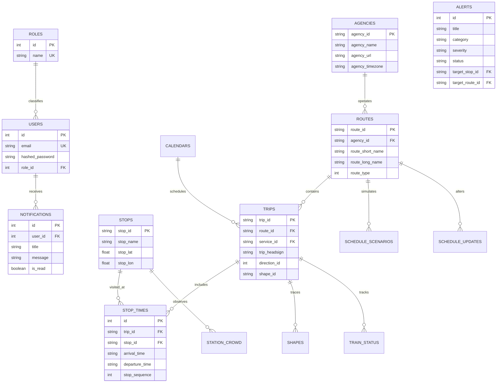

# MetroFlow Database Relationships & Entity-Relationship Architecture

## Overview
MetroFlow manages both static transit network topologies (GTFS specification) and dynamic operational data (crowd metrics, vehicle telemetry, alerts, and user accounts).

---

## 1. Entity-Relationship (ER) Diagram

---

## 2. Foreign Key & Index Optimization Strategies

1. **`stop_times` Composite Index:** Index on `(trip_id, stop_sequence)` accelerates timetable reconstruction to sub-millisecond query time.
2. **`stops` Spatial Coordinates:** Indices on `(stop_lat, stop_lon)` support fast geographic radius queries and interactive map bounding box filtering.
3. **`trips` Route Lookup:** Index on `(route_id, direction_id)` enables instant timetable run queries for scheduling optimization.
4. **`alerts` & `notifications` Time-Series:** Index on `created_at DESC` ensures that active operational dashboards always fetch the freshest state without table scans.

