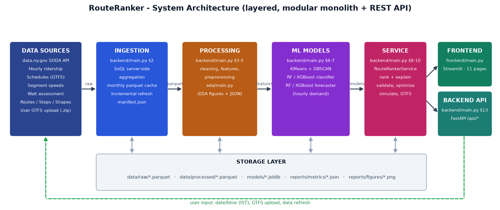
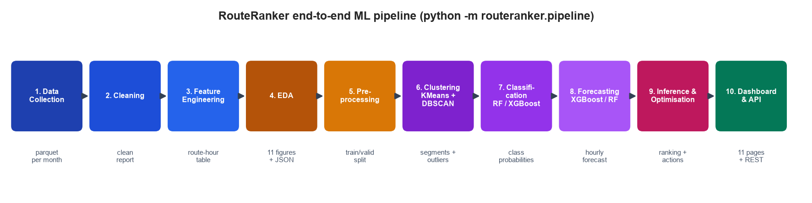

# 🚌 RouteRanker – AI-Powered Public Transit Route Optimisation

RouteRanker analyses **hourly bus ridership** and service data to find inefficient bus routes,
recommend fixes (frequency changes, merges, splits), and predict the **best route for any date and time
(IST)**, explaining *why* it is best and validating it against the alternatives.

It ships as a **Streamlit dashboard** (11 pages) plus a **FastAPI REST backend**, both running on localhost.



---

## ✨ Features

| Page | What you get |
|---|---|
| **Network Overview** | KPIs, route map coloured by segment / predicted status / borough / type, today's forecast curve |
| **Best Route Today (Live)** | Pick a date & time in **IST** → real-time/date-specific prediction, winning route, *why it wins*, radar & score comparison, hourly forecast, **back-test validation** against other routes. Journey mode (stop A → stop B) |
| **Productivity Ranking** | League table (forecast date or historical), top/bottom routes, efficiency vs comfort, CSV export |
| **Route Comparison** | 2–6 routes side by side: forecasts, occupancy, speed, frequency, history, weekday profile |
| **Historical Replay** | Animated hour-by-hour map of any past day, actual vs forecast |
| **EDA Insights** | Hourly curves, route density heatmaps, distributions, correlations, outliers, overlaps |
| **Scenario Simulator** | What-if: demand %, frequency multiplier, speed (bus lanes), vehicle size → current vs simulated loads |
| **Optimisation Actions** | Increase / reduce / rebalance frequency, merge, split – with network impact |
| **Model Performance** | KMeans/DBSCAN quality, RF vs XGBoost classifier, XGBoost vs RF forecaster vs baseline |
| **Data & Coverage** | Sources, granularity, completeness, live freshness check, **GTFS upload analyser** (e.g. Indian city feeds) |
| **Pipeline & Architecture** | Architecture + pipeline diagrams, stage timings |

All forecast timestamps are shown in **IST (Asia/Kolkata)**; the model converts them to the bus network's local time.

---

## 📊 Data

**Granularity: HOURLY** – one row per route per clock hour (daily = sum of hours).

| Dataset (data.ny.gov) | ID | Used for |
|---|---|---|
| MTA Bus Hourly Ridership: Beginning 2025 | `gxb3-akrn` | target – boardings per route per hour |
| MTA Bus Schedules: 2026 (GTFS-derived) | `4fnn-qsea` | trips per route per hour, route length, stops |
| MTA Bus Route Segment Speeds: Beginning 2025 | `kufs-yh3x` | hourly speed per route / weekday |
| MTA Bus Speeds: Beginning 2015 | `cudb-vcni` | fallback speed |
| MTA Bus Wait Assessment | `v4z4-2h6n` | reliability |
| MTA Bus Fare Evasion | `uv5h-dfhp` | paid → total rider correction |
| MTA Bus Routes / Stops (GTFS routes, shapes, stops) | `bzwk-3hb4`, `2ucp-7wg5` | names, geometry, stop overlap |

*Why MTA and not Lepton GTFS?* GTFS contains schedules only (no ridership) and the Lepton feed is commercial.
The MTA portal provides **ridership per route per hour** plus GTFS-derived tables. Indian GTFS feeds can still be
analysed in the app via the GTFS upload analyser.

---

## 🧠 Methods

| Stage | Module | Highlights |
|---|---|---|
| 1. Data collection | `data_collection.py` | SoQL server-side aggregation, monthly parquet cache, incremental refresh |
| 2. Cleaning | `cleaning.py` | ID normalisation, duplicates, negatives, hourly grid completion, outlier capping |
| 3. Feature engineering | `feature_engineering.py` | hour/weekday/holiday/peak, cyclical encodings, trips, speed, load, occupancy, productivity, wait |
| 4. EDA | `eda.py` | descriptive stats, hourly curves, heatmaps, Spearman correlation, IQR outliers, Jaccard overlap |
| 5. Preprocessing | `preprocessing.py` | chronological split (last 28 days = validation), target/profile encoding, one-hot, scaling |
| 6. Clustering | `clustering.py` | **KMeans** (k by silhouette) + **DBSCAN** (eps by k-distance knee, outlier routes) |
| 7. Classification | `supervised.py` | **Random Forest vs XGBoost** → Underutilized / Balanced / Overcrowded |
| 8. Forecasting | `supervised.py` | **XGBoost vs Random Forest vs seasonal baseline** – hourly boardings per route |
| 9. Inference & optimisation | `inference.py`, `optimization.py` | RouteRank score, explanation, validation, recommendations, simulator |
| 10. Apps | `streamlit_app.py`, `app/`, `api/` | Streamlit UI and FastAPI |

<!-- RESULTS:START -->
## 📈 Results (last pipeline run: 2026-11-27 17:00:06 IST)

Data: **2025-10-01 → 2026-11-17**, 340 routes, 3,370,080 route-hours (hourly).
Validation = last 28 days (chronological hold-out).

| Model | Metric | Result |
|---|---|---|
| KMeans (k=7) | silhouette / Davies-Bouldin | 0.216 / 1.290 |
| DBSCAN (eps=2.38) | dense clusters / outlier routes | 2 / 13 |
| Random Forest classifier | accuracy / macro-F1 | 0.888 / 0.870 |
| XGBoost classifier | accuracy / macro-F1 | 0.887 / 0.870 |
| Seasonal baseline forecaster | MAE / R² / WAPE | 27.7 / 0.921 / 20.2% |
| Random Forest forecaster | MAE / R² / WAPE | 18.4 / 0.964 / 13.3% |
| XGBoost forecaster | MAE / R² / WAPE | 18.5 / 0.962 / 13.5% |

Selected: classifier **XGBoost**, forecaster **RandomForest**.
Optimiser on the hold-out: overcrowded route-hours 13.0% → 0.0%,
underutilised 21.8% → 10.8%,
vehicle-hours 291,000 → 327,088.
<!-- RESULTS:END -->



---

## 🚀 Run locally

```bash
# 1. install (Python 3.10+)
pip install -r requirements.txt

# 2. download data + train all models (first run ≈ 30-45 min, later runs only fetch the newest month)
#    Windows:  scripts\run_pipeline.bat        Linux/macOS: ./scripts/run_pipeline.sh
set PYTHONPATH=src                 # macOS/Linux: export PYTHONPATH=src
python -m routeranker.pipeline

# 3. start the dashboard  ->  http://localhost:8501
streamlit run streamlit_app.py

# 4. (optional) start the REST API  ->  http://localhost:8000/docs
uvicorn api.main:app --port 8000

# 5. tests
pytest -q                          # unit tests
python tests/smoke_pages.py        # headless test of every dashboard page
```

### REST API

| Endpoint | Description |
|---|---|
| `GET /api/health` | status, IST time, data window |
| `GET /api/routes` | routes with segment & KPIs |
| `GET /api/predict?route_id=M15&date_ist=2026-11-27` | 24-hour forecast for a route |
| `GET /api/best-route?date_ist=2026-11-27&time_ist=19:30&origin=FLATBUSH AV&destination=ATLANTIC AV` | best route + why + validation |
| `GET /api/ranking?date_ist=...` | RouteRank league table |
| `GET /api/recommendations?date_ist=...` | optimisation actions & impact |
| `POST /api/simulate` | scenario simulation |

---

## 📁 Project structure

```
Route Ranker/
├── streamlit_app.py           # Streamlit entry point (navigation)
├── app/
│   ├── common.py              # shared UI helpers, IST clock, maps, pickers
│   └── views/                 # 11 dashboard pages
├── api/main.py                # FastAPI backend
├── src/routeranker/           # ML package
│   ├── config.py              # paths, sources, assumptions
│   ├── data_collection.py     # Module 1
│   ├── cleaning.py            # Module 2a
│   ├── feature_engineering.py # Module 2b
│   ├── eda.py                 # Module 3
│   ├── preprocessing.py       # Module 4
│   ├── clustering.py          # Module 5a (KMeans, DBSCAN, overlap)
│   ├── supervised.py          # Module 5b (RF / XGBoost classifier + regressor)
│   ├── inference.py           # Module 6a (prediction, ranking, explanation, validation)
│   ├── optimization.py        # Module 6b (recommendations, simulator)
│   ├── gtfs.py                # GTFS upload analyser
│   ├── diagrams.py            # architecture / pipeline / model figures
│   └── pipeline.py            # end-to-end orchestration
├── tests/                     # pytest unit tests + page smoke test
├── reports/figures/           # EDA, model and architecture figures (PNG)
├── reports/metrics/           # EDA summary, model metrics, pipeline manifest (JSON)
├── docs/                      # project report (.docx/.pdf), report generator, project brief
├── scripts/                   # run_pipeline / run_app / run_api (.bat & .sh)
├── data/  models/             # generated – git-ignored
├── requirements.txt  pyproject.toml  LICENSE  .gitignore
└── .streamlit/config.toml
```

## 📄 Documentation

* `docs/RouteRanker_Project_Report.docx` (and `.pdf`) – full methodology, every module and function, models,
  metrics, architecture. Re-generate after retraining with `python docs/build_report.py`.

## ⚠️ Assumptions & limitations

* Occupancy is estimated from boardings (peak-load factor, vehicle capacity, fare-evasion correction); class
  thresholds are calibrated from the data (25th / 90th percentile).
* Hourly ridership is published with ~1 week delay; "real-time" = model forecast for the current hour.
* Journey mode considers direct routes only.

## License

MIT
