# RouteRanker: AI-Powered Public Transit Route Optimisation (MTA Hourly Bus Demand, Route Ranking & Schedule Optimisation)

**Author:** Sahithi Priya  
**Program:** Infosys Springboard Virtual Internship  
**Domain:** Transit Data Engineering, Unsupervised Route Profiling, Performance Classification & Hourly Demand Forecasting  

---

## 1. Executive Summary

**RouteRanker** is an end-to-end transit analytics, route-ranking and schedule-optimisation platform built on real-world **MTA (New York City) hourly bus ridership** and **GTFS-derived schedule, route, stop and speed data** from the NY Open Data portal.

It reconciles **4,354,344 raw hourly ridership records** with scheduled service, operating speeds, reliability and fare-evasion rates into an hourly **route x clock-hour** analytical table. On top of that it runs **K-Means + DBSCAN route clustering**, a **Random Forest / XGBoost performance classifier** (Underutilized / Balanced / Overcrowded), a **Random Forest / XGBoost hourly demand forecaster**, a **RouteRank scoring engine** that picks the best route for any date and time in **IST** and explains why, a **frequency optimiser**, a **what-if scenario simulator**, and an **11-page Streamlit dashboard + FastAPI REST backend**.

### Key Performance Highlights
* **Analytical dataset (hourly granularity):** **3,370,080** route-hour observations across **413 calendar days** and **340 active routes** (`2025-10-01` to `2026-11-17`), **425.7 million** boardings.
* **Demand forecasting (Random Forest, selected):** **13.35% WAPE**, **R² 0.964**, MAE **18.4** boardings per route-hour on a strict 28-day chronological hold-out. The seasonal-profile baseline scores **20.15% WAPE**, R² 0.921.
* **Performance classification (XGBoost, selected):** **88.7% accuracy**, **0.871 macro-F1**, **91.4% balanced accuracy** across Underutilized / Balanced / Overcrowded.
* **Structural network segmentation:** K-Means (**k = 7**, silhouette 0.216) groups the 340 routes into 7 operational segments. DBSCAN flags **13 atypical routes** as density outliers.
* **Optimisation impact (hold-out period):** overcrowded route-hours **13.0% → 0.0%**, underutilised route-hours **21.8% → 10.8%**, balanced route-hours **65.3% → 89.2%**. The trade-off is **+12.4% vehicle-hours**.
* **Best-route validation:** on the Flatbush Av → Atlantic Av corridor (11 direct routes), the recommended route **B46** ranked **#1 on actual ridership in 6 of 6** previous same-weekday back-tests.

---

## 2. System Architecture & Data Engineering Flowcharts

### 2.1 End-to-End Pipeline Architecture
**Architecture type:** a layered **modular monolith**, organised into three folders, each with **one `main.py` that holds all of that folder's code**:

| Folder | Main file | Contents |
|---|---|---|
| `backend/` | `backend/main.py` | configuration, data collection, cleaning, feature engineering, preprocessing, clustering, classification & forecasting models, optimisation, inference service (`RouteRankerService`), GTFS analyser, diagrams, training pipeline, **FastAPI REST API**, CLI |
| `eda/` | `eda/main.py` | all exploratory data analysis → `eda/figures/*.png`, `eda/eda_summary.json` |
| `frontend/` | `frontend/main.py` | UI helpers + all **11 Streamlit pages** + navigation |

A batch ML pipeline (offline training) feeds the shared service layer, which serves the Streamlit frontend and the REST API. Storage is file-based (Parquet, joblib, JSON), so the whole system runs on a laptop.

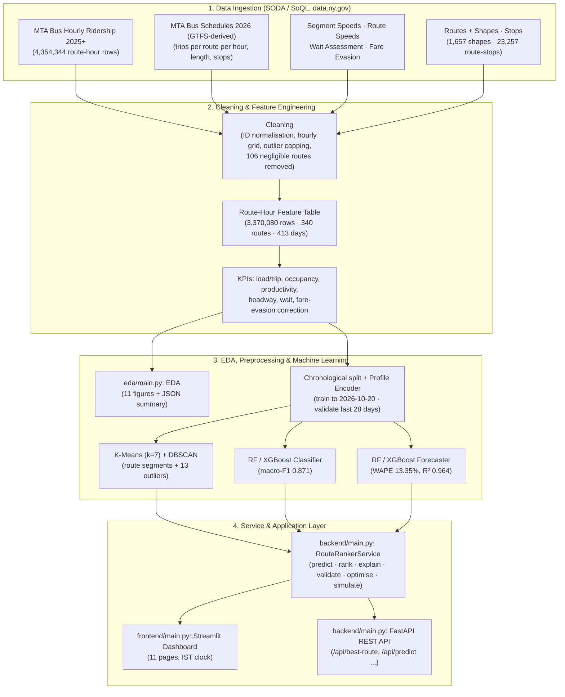


### 2.2 Best-Route Inference & Validation Workflow (IST)
The user picks a date and time in **IST**. The service converts it to the bus network's local time (America/New_York), forecasts every route hour by hour, scores the candidates, explains the winner and back-tests the choice on actual data.

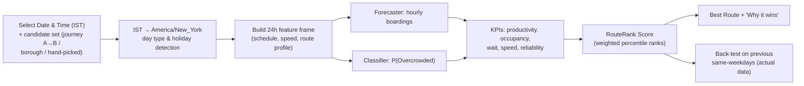

---

## 3. Methodology & Technical Implementation

### 3.1 Data Sources (all hourly-capable, NY Open Data)

| Dataset | ID | Granularity | Role |
|---|---|---|---|
| MTA Bus Hourly Ridership: Beginning 2025 | `gxb3-akrn` | hourly x route x fare class | **Target**: boardings per route per hour |
| MTA Bus Schedules: 2026 (GTFS-derived) | `4fnn-qsea` | trip / stop | Trips per route per hour, route length, stops |
| MTA Bus Route Segment Speeds: Beginning 2025 | `kufs-yh3x` | hourly x route x weekday | Operating speed |
| MTA Bus Speeds: Beginning 2015 | `cudb-vcni` | monthly x route | Speed fallback |
| MTA Bus Wait Assessment | `v4z4-2h6n` | monthly x route x period | Reliability |
| MTA Bus Fare Evasion | `uv5h-dfhp` | quarterly x trip type | Paid → total rider correction |
| MTA Bus Routes / Stops (GTFS routes, shapes, stops) | `bzwk-3hb4`, `2ucp-7wg5` | route / stop | Names, geometry, stop overlap |

> **Why MTA instead of the Lepton GTFS feed?** GTFS contains schedules only, with **no ridership counts**, and the Lepton feed for Indian cities is commercial. MTA publishes **hourly ridership per route** plus GTFS-derived tables. Indian GTFS feeds can still be profiled, clustered and screened for overlaps through the built-in **GTFS upload analyser**.

### 3.2 Data Cleaning & Reconciliation
* **Server-side aggregation:** hourly ridership is summed over payment method and fare class with SoQL, downloaded month by month and cached as Parquet. Refreshes are incremental.
* **Route-ID normalisation:** `-SBS` becomes `+`, values are upper-cased, so ridership, schedules, speeds and reliability all join.
* **Quality checks:** 0 missing values, 0 negative counts, 0 duplicate route-hours. **6** extreme spikes were capped at 3 x the route's 99.9th percentile. The hourly grid was completed per route.
* **Filtering:** **106** negligible routes (< 20 boardings/day: shuttles, school or retired routes) and **4** routes without a schedule were removed, leaving **340 routes**.
* **Fare-evasion correction:** the ridership table counts **paid** boardings. MTA's own evasion rates (Local **49.0%**, SBS **50.6%**, Express **5.5%**) convert paid boardings into estimated total riders for load and crowding.

### 3.3 Feature Engineering (route x hour)
| Group | Features |
|---|---|
| Time | hour, day of week, month, week of year, weekend, **US/NY holiday** (holidays run on the Sunday schedule), AM/PM peak, night, summer, sin/cos cyclical encodings |
| Service | scheduled trips per hour (Weekday / Saturday / Sunday), speed (mph), trip minutes, route length, stops, stop density, vehicle capacity |
| KPIs | load per trip, **occupancy** (= load x 0.55 peak-load factor / capacity), **productivity** (riders per revenue vehicle-hour), headway, average wait, transfer rate |
| Label | `perf_class`: **Underutilized** (occupancy < 0.061, 25th percentile) · **Balanced** · **Overcrowded** (> 0.422, 90th percentile). Thresholds are calibrated on the training period. |
| Route profile | average daily/weekday/weekend riders, AM/PM peak share, night share, weekend ratio, mean and p90 occupancy, % hours overcrowded/underutilised, speed, reliability, 4-week trend |

### 3.4 Exploratory Data Analysis
Methods: descriptive statistics (incl. skewness and kurtosis), hour-of-day curves per day type, daily trend with a 7-day rolling mean, day-of-week box plots, a **route density heatmap**, an occupancy distribution, class share by hour, **Spearman correlation**, the **IQR outlier rule** (1.2% of route-days), borough and route-type comparison, and **stop-set Jaccard overlap** (215 overlapping pairs, e.g. BX1 ↔ BX2 with Jaccard 0.84).

* **Weekday peaks:** 07:00 and 08:00, then 17:00 and 16:00 (≈ 112,700 boardings in the 07:00 hour, ≈ 1.19 M per weekday).
* **Weekends:** a single midday peak at 15:00 (≈ 758 k boardings on Saturday, ≈ 639 k on Sunday).
* **Busiest routes:** M15+ (≈ 19,450 riders/day), Q25, Q44+, B6, M15.
* **Most productive routes:** M79+, M42, M14D+, M34+, M86+ (> 600 riders per vehicle-hour).

| | |
|---|---|
| 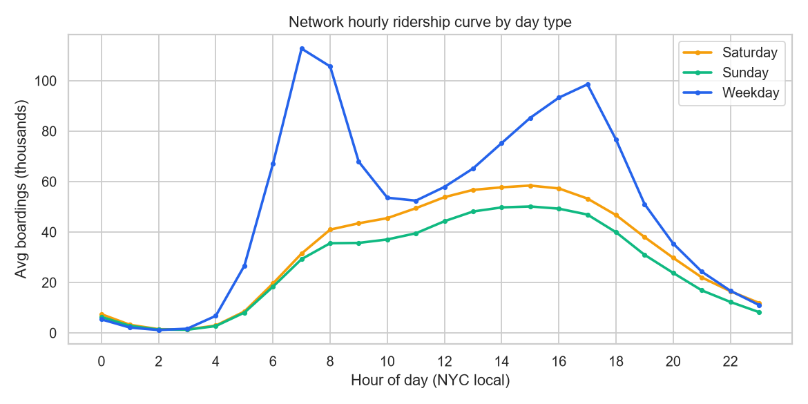 | 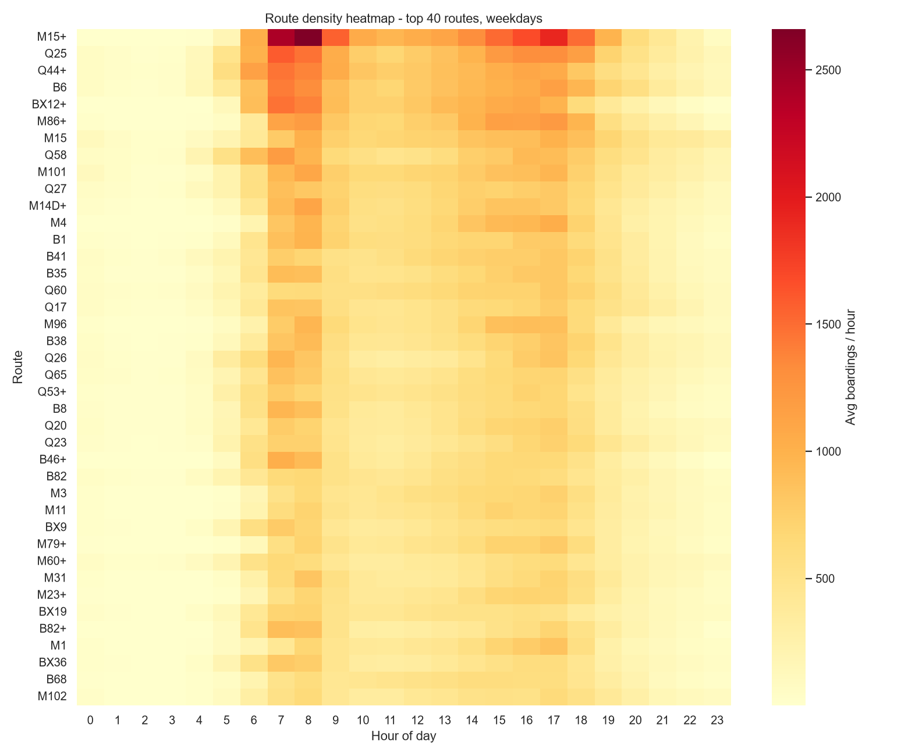 |
| 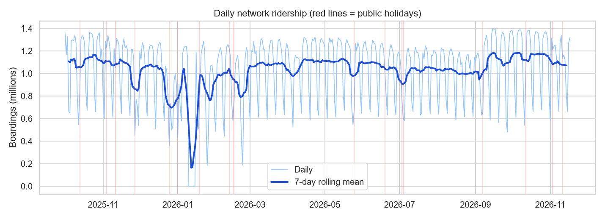 | 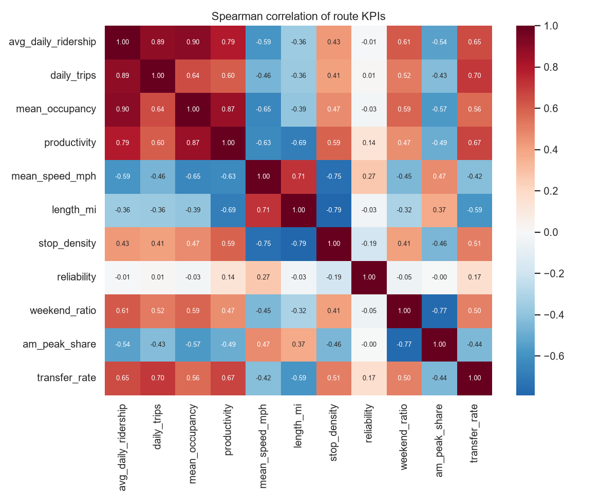 |

### 3.5 Unsupervised Route Profiling (K-Means + DBSCAN)
**K-Means** (partitional, centroid-based, k chosen by silhouette over k = 4…10) runs on 15 standardised route-profile features. **DBSCAN** (density-based, eps = 2.38 from the k-distance knee, min_samples = 6) is used as an outlier detector.

| Segment (auto-named from centroid) | Routes | Median daily riders |
|---|---:|---:|
| Unreliable / Slow | 102 | 2,783 |
| Reliable / Night-Owl | 75 | 2,541 |
| High-Volume / Crowded | 60 | 6,702 |
| Express Long-Haul / Fast | 40 | 683 |
| Express AM-Peak Commuter / Weekday-Focused | 35 | 238 |
| Express Long-Haul / AM-Peak Commuter | 25 | 510 |
| Limited Off-Peak / Unreliable | 3 | 61 |

**DBSCAN outlier routes (13):** B39, BX20, M35, Q42, QM64, S66, S81, S84, S86, SIM1C, SIM33C, SIM3C, SIM4C.

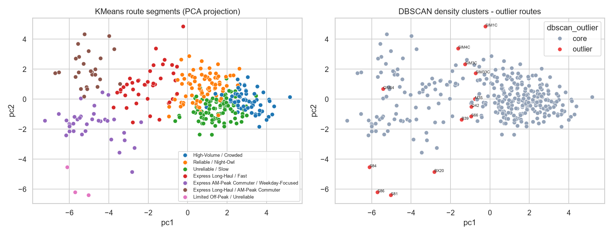

### 3.6 Performance Classification (Random Forest vs XGBoost)
The classifier predicts each service hour's class **before** it happens, using calendar, schedule, speed, route attributes and training-period profile encodings only.

| Model | Accuracy | Balanced Acc. | Macro-F1 | F1 Under / Balanced / Over |
|---|:---:|:---:|:---:|:---:|
| Random Forest (200 trees, depth 20) | 0.888 | 0.902 | 0.870 | 0.853 / 0.910 / 0.847 |
| **XGBoost (selected)** (hist, depth 8, early stopping) | **0.887** | **0.914** | **0.871** | 0.857 / 0.909 / 0.845 |

### 3.7 Hourly Demand Forecasting (XGBoost vs Random Forest vs Baseline)
The target is log1p(boardings) per route-hour. The chronological split trains on `2025-10-01 → 2026-10-20` (3.14 M rows) and validates on `2026-10-21 → 2026-11-17` (228 k rows).

| Model | MAE | RMSE | R² | WAPE |
|---|:---:|:---:|:---:|:---:|
| Seasonal-profile baseline | 27.72 | 57.93 | 0.921 | 20.15% |
| **Random Forest (selected)** | **18.36** | **39.22** | **0.964** | **13.35%** |
| XGBoost | 18.51 | 40.06 | 0.962 | 13.46% |

Top forecaster features: route x day-type x hour profile, route x weekday x hour profile, scheduled trips, route x hour profile.

| | |
|---|---|
| 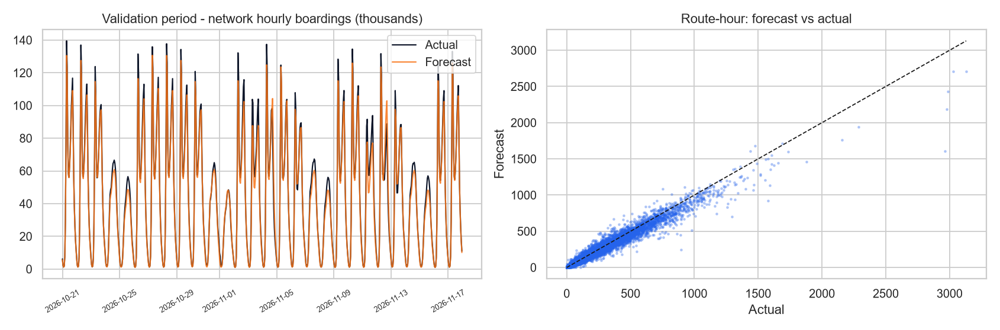 | 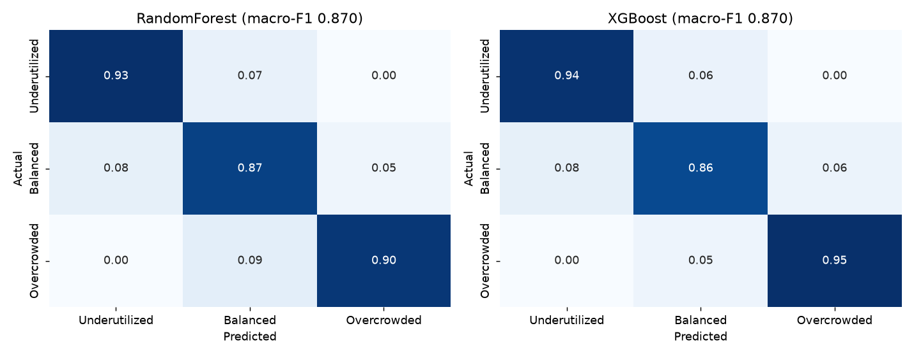 |

### 3.8 RouteRank Score, Explanation & Validation
For the selected window, each candidate route gets five components. Each is converted to a percentile among the candidates and weighted. The weights are adjustable, with presets: *Balanced*, *Rider*, *Planner*.

| Component | Measure | Default weight |
|---|---|:---:|
| Productivity | predicted riders per revenue vehicle-hour | 25% |
| Speed | expected mph for that weekday/hour | 20% |
| Reliability | wait-assessment share (peak value in peak windows) | 20% |
| Frequency | scheduled buses per hour | 15% |
| Comfort | 1 − P(Overcrowded) from the classifier | 20% |

The app then writes a plain-language **"why it's the best"** explanation (winner vs median of alternatives, per component). It also **back-tests** the pick by re-scoring every candidate on **actual** ridership for the previous six same-weekdays.

### 3.9 Optimisation Rules & Scenario Simulator
* **Increase frequency** in overcrowded hours up to the target occupancy. **Reduce frequency** in underutilised hours, keeping at least 2 trips/hour. **Rebalance** when a route needs both.
* **Merge** a mostly underutilised route with a partner serving > 40% of its stops. **Split / short-turn** long (≥ 90th percentile), unreliable, crowded routes.
* **Scenario simulator:** demand %, frequency multiplier, speed change (bus lanes) and vehicle size. Every KPI is recomputed, current vs simulated.

---

## 4. User Interface & Operational Modules

The Streamlit dashboard has **11 pages** in 4 groups. A live **IST clock** (with the matching New York time) sits in the sidebar, and every forecast is stamped with its IST generation time.

### 4.1 Network Overview
KPIs, route map coloured by K-Means segment, predicted status, borough or route type, a segment table, borough share, today's forecast curve and the predicted class mix by hour.

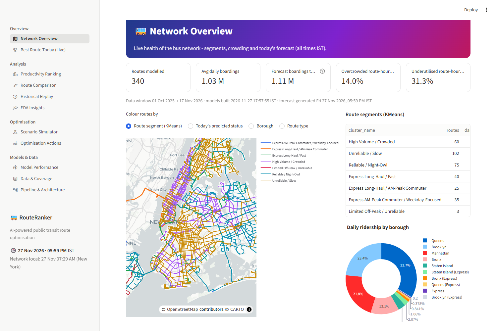

### 4.2 Best Route Today (Live): Date/Time Selection in IST
Pick any date and time in IST: today gives a real-time forecast, past dates are compared with actuals, future dates are planning forecasts. Choose a journey (stop A → stop B), a borough or hand-picked routes, and get the winning route, **why it wins**, radar and score comparisons, the hourly forecast and **back-test validation**. The page auto-refreshes every 5 minutes.

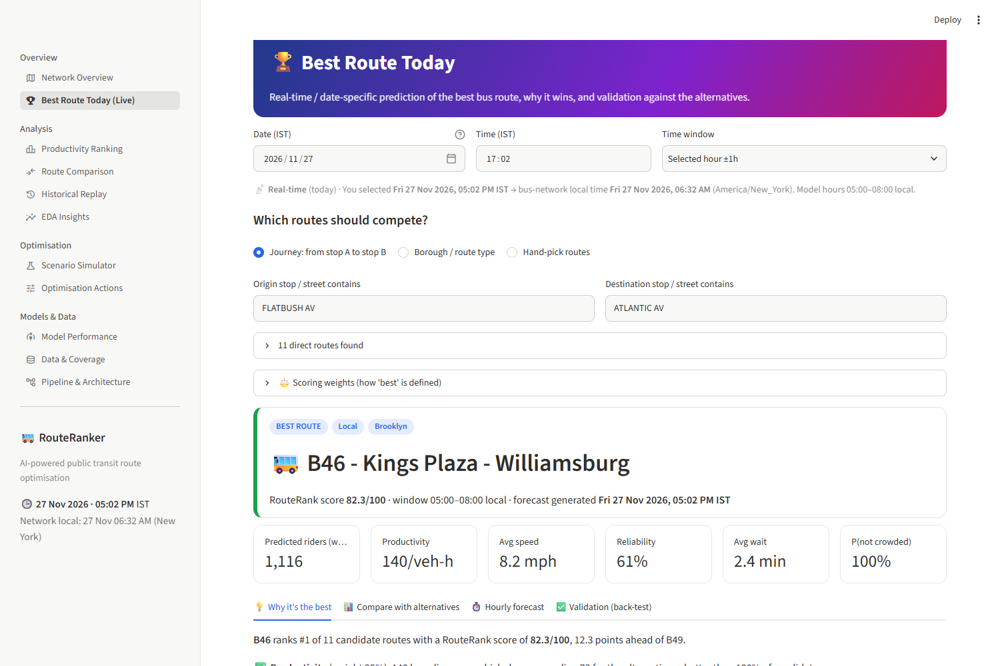

### 4.3 Productivity Ranking
A league table by forecast date or historical average, top/bottom N routes, an efficiency vs comfort bubble chart and CSV export.

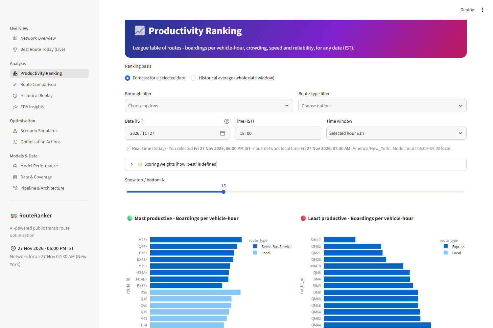

### 4.4 Route Comparison
Compare 2 to 6 routes side by side: indicator table, radar, map, hourly forecasts, occupancy, speed, trips, daily history, weekday profile and class mix.

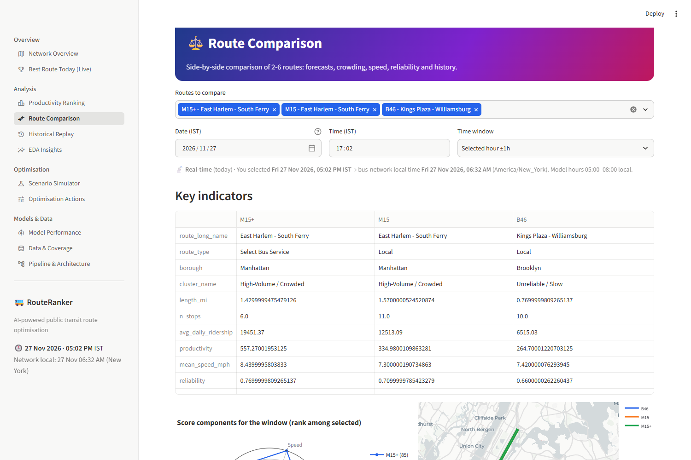

### 4.5 Historical Replay
An animated map (▶) of any past day, hour by hour, with actual boardings and status, plus network actual vs forecast and an hour inspector.

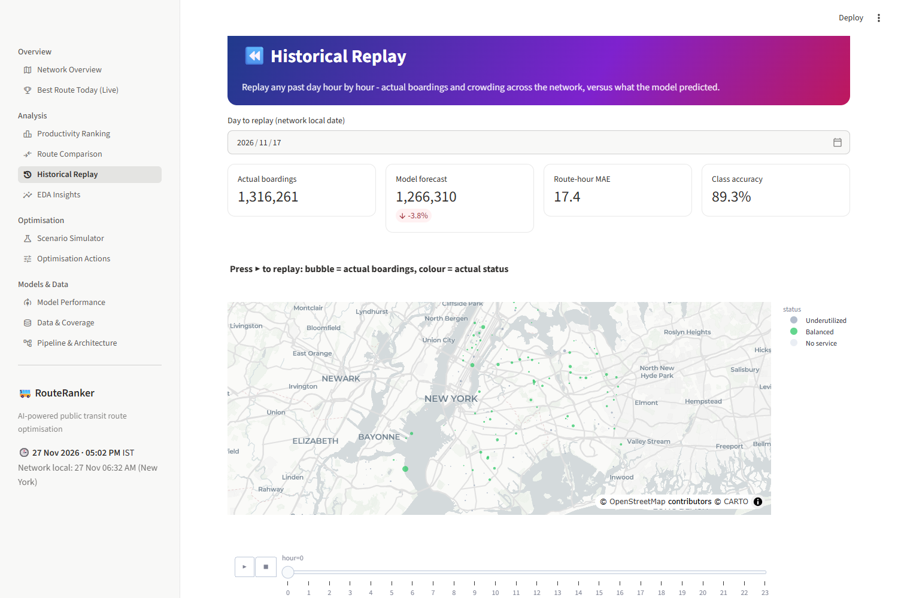

### 4.6 Scenario Simulator
What-if sliders for demand, frequency, speed and vehicle size, with current vs simulated occupancy, class mix, waits and vehicle-hours.

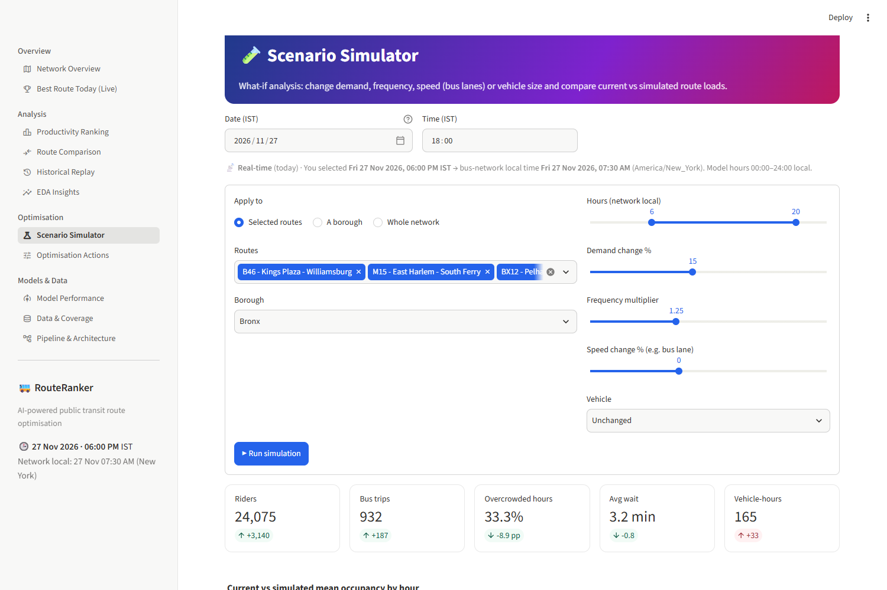

### 4.7 Optimisation Actions
Network impact, action mix, trips per hour (current vs optimised), a prioritised action table with rationale, route drill-down and overlapping pairs.

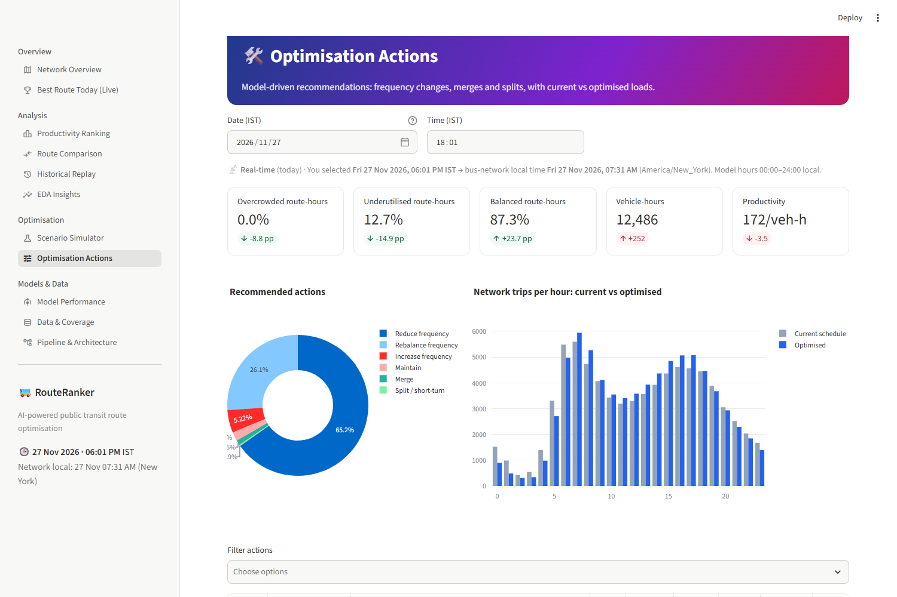

### 4.8 Model Performance · EDA Insights · Data & Coverage · Pipeline & Architecture
Clustering, classifier and forecaster diagnostics; interactive EDA; data sources, freshness check against the live API and a completeness heatmap; a **GTFS upload analyser** for any city feed (e.g. Indian Lepton feeds); and the architecture/pipeline diagrams.

| | |
|---|---|
| 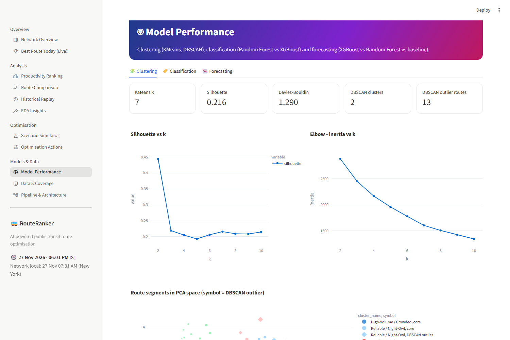 | 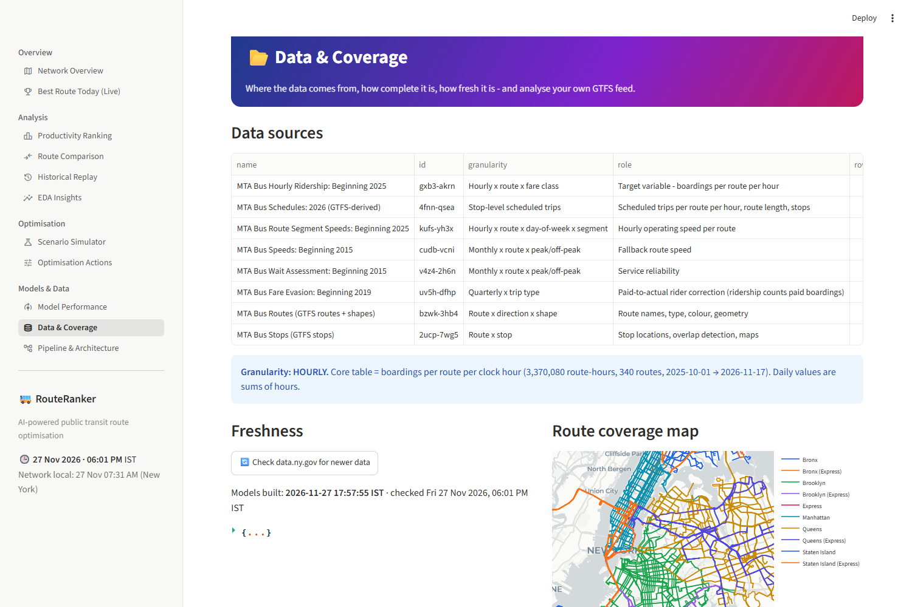 |
| 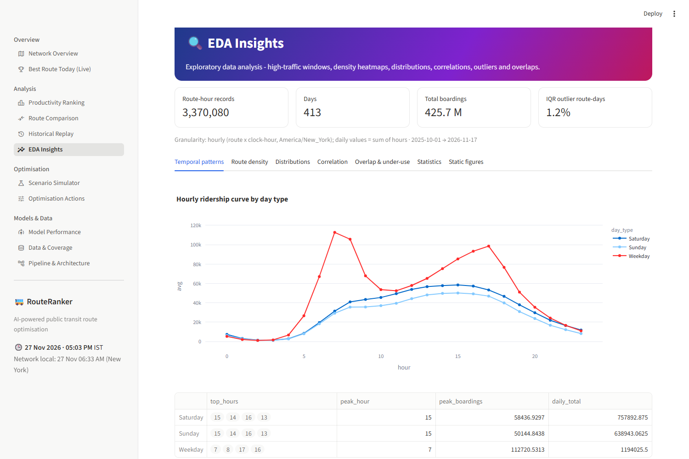 | 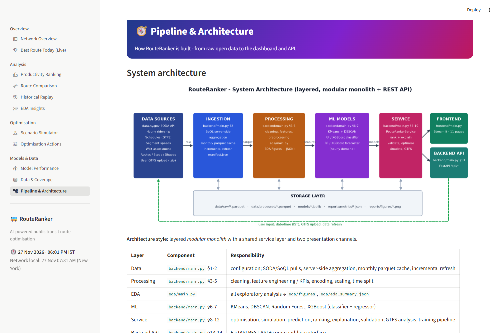 |

---

## 5. REST API (FastAPI)

| Endpoint | Description |
|---|---|
| `GET /api/health` | status, current IST time, data window |
| `GET /api/routes` | routes with segment and KPIs (filters: borough, route_type) |
| `GET /api/predict?route_id=M15&date_ist=2026-11-27` | 24-hour forecast + class probabilities |
| `GET /api/best-route?date_ist=2026-11-27&time_ist=19:30&origin=FLATBUSH AV&destination=ATLANTIC AV` | best route + explanation + ranking + validation |
| `GET /api/ranking?date_ist=...&start_hour=6&end_hour=22` | RouteRank league table |
| `GET /api/recommendations?date_ist=...` | optimisation actions and network impact |
| `POST /api/simulate` | scenario simulation (JSON body) |

Start it with `python backend/main.py serve`; interactive docs are at `http://localhost:8000/docs`.

---

## 6. Technology Stack & Repository Structure

* **Data engineering & analytics:** Python, Pandas, NumPy, PyArrow, Socrata SODA/SoQL, holidays
* **Machine learning:** scikit-learn (K-Means, DBSCAN, Random Forest, PCA, scalers), XGBoost
* **Visualisation & UI:** Streamlit, Plotly (MapLibre / OpenStreetMap maps), Matplotlib, Seaborn
* **Backend API:** FastAPI, Uvicorn, Pydantic
* **Quality & docs:** pytest (18 unit tests + headless smoke test of all 11 pages), python-docx, Playwright (screenshots)

```text
Route Ranker/
├── backend/
│   ├── main.py                 # ALL backend code, in numbered sections:
│   │                           #  1 config · 2 data collection · 3 cleaning · 4 feature engineering
│   │                           #  5 preprocessing · 6 clustering · 7 classification + forecasting
│   │                           #  8 optimisation · 9 inference service · 10 GTFS analyser
│   │                           #  11 diagrams · 12 training pipeline · 13 FastAPI · 14 CLI
│   └── README.md
├── eda/
│   ├── main.py                 # ALL exploratory data analysis
│   ├── figures/                # 11 EDA figures (PNG)
│   ├── eda_summary.json        # statistics, peak windows, outliers, correlations ...
│   └── README.md
├── frontend/
│   ├── main.py                 # ALL frontend code: UI helpers + 11 Streamlit pages + navigation
│   └── README.md
├── tests/                      # unit tests (backend) + headless smoke test of every page
├── reports/figures/            # model + architecture figures, app screenshots
├── reports/metrics/            # model metrics, pipeline manifest, cleaning report (JSON)
├── docs/                       # Project report (.docx / .pdf) + generator
├── scripts/                    # run_pipeline / run_app / run_api (.bat / .sh)
├── requirements.txt · pyproject.toml · LICENSE
└── README.md
```

> `data/` (~57 MB) and `models/` (~1 GB) are generated by the pipeline and are git-ignored.

---

## 7. Local Setup & Execution

### 1. Install dependencies (Python 3.10+)
```bash
python -m venv .venv
.venv\Scripts\activate          # macOS/Linux: source .venv/bin/activate
pip install -r requirements.txt
```

### 2. Backend: download data & train all models
First run ≈ 35 min download + ≈ 15 min training. Later runs only fetch the newest month.
```bash
python backend/main.py train      # or: python backend/main.py collect  (download only)
```

### 3. EDA: run the exploratory data analysis
```bash
python eda/main.py                # -> eda/figures/*.png, eda/eda_summary.json
```

### 4. Frontend: start the dashboard
```bash
streamlit run frontend/main.py    # http://localhost:8501
```

### 5. Backend API (optional)
```bash
python backend/main.py serve      # http://localhost:8000/docs   (or: uvicorn backend.main:app --port 8000)
```

### 6. Tests & documentation
```bash
pytest -q                          # unit tests
python tests/smoke_pages.py        # headless test of every dashboard page
python docs/build_report.py        # regenerate the Word/PDF project report
```

---

## 8. Assumptions & Limitations
* Occupancy is **estimated** from boardings (peak-load factor 0.55, vehicle capacity, fare-evasion correction). The class thresholds are data-calibrated percentiles, not measured on-board loads.
* MTA publishes hourly ridership with roughly a one-week delay, so "real-time" means a model forecast for the current hour.
* Journey mode considers **direct** routes only. Transfers are future work.
* Full methodology, every function and all metrics are in **`docs/RouteRanker_Project_Report.docx`** (PDF copy alongside).

## License
MIT
