# RouteRanker: CTA bus route analysis

RouteRanker helps a transit planner review Chicago Transit Authority (CTA) bus routes using two public sources: the daily ridership counts per route, and eight dated GTFS timetables.
- It rebuilds which service was scheduled on each day and matches it to the rides recorded that day.
- It forecasts each route's rides for the next day and groups similar routes.
- It ranks routes on named indicators: rides per day, per scheduled trip and per scheduled hour.
- It replays June–July 2026 day by day, showing each forecast before its actual rides are revealed.
- It calculates "what if" service scenarios with every assumption stated.

The pipeline is Python, the data is stored in PostgreSQL and served by FastAPI, and the screens are built in React.

**Demo video:** [5-minute walkthrough](https://drive.google.com/file/d/1EK1dEJ_O9BOaILPffNkP6HZWYw2oIwRY/view?usp=sharing)

## Contents
[Objectives](#objectives) · [Key results](#key-results) · [Architecture](#architecture) · [Technologies](#technologies-used) · [Data sources](#data-sources) · [Implementation](#implementation-9-stages) · [Features](#features-the-screens) · [Supported dates and assumptions](#supported-dates-model-cutoffs-and-assumptions) · [Setup](#setup-windows-from-a-fresh-clone) · [Reproduce the pipeline](#reproduce-the-pipeline) · [Usage](#usage-the-5-minute-demo-path) · [Testing](#testing) · [Limitations](#limitations-and-future-work) · [Project structure](#project-structure)

More detail: [docs/SETUP.md](docs/SETUP.md) · [docs/ARCHITECTURE.md](docs/ARCHITECTURE.md) · [docs/DATA_DICTIONARY.md](docs/DATA_DICTIONARY.md) · [docs/INTEGRATION_WALKTHROUGH.md](docs/INTEGRATION_WALKTHROUGH.md) · [reports/stage9_evaluation_report.md](reports/stage9_evaluation_report.md)

## Objectives
**The problem.** A planner deciding where to look first has rides per route per day in one dataset and timetables in another. The two don't line up by themselves:
- timetables change several times a year;
- a route can run on a day with no ride record, or have rides recorded on a day it wasn't scheduled;
- a raw ride count says nothing about how much service carried those riders.

**For whom.** A transit planner or analyst who needs to answer, with evidence:
- Which routes deserve a closer look, and on which measure?
- How is one route doing, and which routes are like it?
- Which routes share stops?
- How good would a next-day forecast have been, judged only on what was known at the time?
- What happens to the service ratios if trips change, and what is assumed?

**What it does not claim.**
- A whole-day ride count can't show crowding on a bus.
- A ranking is a prompt to look, not a verdict on a route.
- A scenario is arithmetic under stated assumptions, not a prediction of rider response.

## Key results
All figures are from the committed reports and were re-checked against the database for this release ([evaluation report](reports/stage9_evaluation_report.md)).

| Result | Value | Evidence |
|---|---|---|
| Forecast model vs the best simple rule, **validation** (1 Apr – 31 May 2026) | Random Forest **345.5** vs 4-week average **360.4** rides per route-day (MAE), on the same 6,560 route-days | [Stage 4a report](reports/stage4a_quality_report.md) §3 |
| The same, **test** (1 Jun – 31 Jul 2026, scored once after freezing) | **398.0** vs **421.2** (WAPE 7.67 % vs 8.12 %), on the same 6,542 route-days | Stage 4a report §5 |
| Replay reproduces the test score | Forecasts stored one day at a time in the replay give **exactly** 398.0115 vs 421.1546 on the same 6,542 route-days | [Stage 7 report](reports/stage7_replay_report.md) §5 |
| Leakage test | Every ride after 30 Jun was changed and the forecasts were rebuilt. Forecasts up to 30 Jun stay **bit-identical**, and forecasts that do use the changed rides move | Stage 7 report §4 |
| Day by day | The model has the smaller average miss on **29 of 61** days, but is 5.5 % lower over the whole period | Stage 7 report §3 |
| Neural networks (an extra experiment) | Best network (GRU) 364.9 on validation: behind both the Random Forest and the 4-week average, so serving is unchanged | [Stage 4b report](reports/stage4b_quality_report.md) |

The test period was looked at while the method was being developed, so it is a reused holdout, not an untouched test.

## Architecture
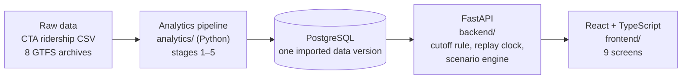

- **Raw data.** The ridership export and the eight timetable archives are downloaded once into `data/raw/`, with their sha256 values in a source register. A raw file is never overwritten. A newer download becomes a new version beside the old one.
- **Analytics pipeline.** One command per stage. It rebuilds the scheduled trips and hours for each route and day from the timetable that applied that day, matches them with the recorded rides, builds the forecasting features, trains and evaluates the models, and builds the route profiles, groups and rankings. Each stage writes a versioned folder under `data/processed/` and a quality report under `reports/`.
- **PostgreSQL.** An importer checks the processed files against their manifests and loads one data version. Stored forecasts and saved scenarios are append-only, and the database itself refuses to change or delete them.
- **FastAPI.**
  - Read endpoints for coverage, routes, rankings, groups, comparisons, maps and the model card.
  - A server-side replay clock and a scenario engine.
  - Every query is limited in SQL to the data allowed by the cutoff date or the replay day, so later data can't leak into a response.
- **React.** Each screen answers one planner question. Every sentence on a screen is built from API values when it loads, and a missing value reads "unavailable – reason", never 0.

More in [docs/ARCHITECTURE.md](docs/ARCHITECTURE.md).

## Technologies used
Versions are pinned exactly in `requirements.txt` and `frontend/package.json`.

| Layer | Technology | Version | Used for |
|---|---|---|---|
| Language | Python | 3.12.10 | pipeline, API, tests |
| Data | pandas | 3.1.1 | daily tables |
| Data | NumPy | 2.5.4 | numeric work |
| Data | DuckDB | 2.0.0 | large GTFS `stop_times` processing |
| ML | scikit-learn | 1.9.1 | Ridge, Random Forest, KMeans, preprocessing |
| ML | joblib | 1.6.0 | saving fitted pipelines |
| ML (extra experiment) | PyTorch (CPU) | 2.15.0 | MLP, LSTM, GRU, 1D CNN in Stage 4b |
| Database | PostgreSQL | 17 | imported data, forecasts, replay sessions, scenarios |
| Database driver | psycopg | 3.3.9 | plain SQL, no ORM |
| API | FastAPI | 0.165.0 | HTTP API |
| API server | uvicorn | 0.54.0 | runs the API |
| Tests | pytest | 9.2.0 | pipeline and API tests |
| Frontend | React / React DOM | 19.3.1 | screens |
| Frontend | TypeScript | 7.0.2 | typed frontend code |
| Frontend | Vite | 8.3.8 | dev server and build |
| Frontend | react-router-dom | 7.18.6 | screen routing |
| Maps | Leaflet / react-leaflet | 1.9.4 / 5.0.0 | route maps on OpenStreetMap tiles |
| Charts | Recharts | 3.11.0 | charts |
| Styling | Tailwind CSS | 4.3.5 | styling |
| Frontend tests | vitest | 5.1.1 | unit tests |
| Lint | oxlint | 1.94.0 | linting |
| Browser checks (dev only) | Playwright | 1.65.1 | click-throughs and screenshots |
| Runtime | Node.js | 22 | frontend tooling |

## Data sources
| Source | Version used | Records / dates | sha256 |
|---|---|---|---|
| [CTA – Ridership – Bus Routes – Daily Totals by Route](https://data.cityofchicago.org/api/views/jyb9-n7fm/rows.csv?accessType=DOWNLOAD) | export downloaded 2026-11-13 (publisher last update 2026-10-28) | 1,124,170 rows, 2001-01-01 to 2026-08-31; this release uses rows to 2026-07-31 | `d9675570e50a1b3d1fe7142ea9b10ba76099c1312ab0c227745ac57205eb5c04` |
| CTA GTFS archive `mdb-389-202511230128` ([Mobility Database](https://mobilitydatabase.org)) | captured 23 Nov 2025 | 69,053,782 bytes | `4a34e0c78a12d797ae5b3f5075005e91db8b6e6715eda9b146fa3946b1136964` |
| `mdb-389-202512190112` | 19 Dec 2025 | 100,125,733 bytes | `1d49526cbce5bf3188cad4524cafdae581e3ad6a4920d256d4577a51e3c3bb4d` |
| `mdb-389-202601080131` | 8 Jan 2026 | 50,436,962 bytes | `41cc4ddabefed327cd0093ba9f707f8ce9f2fd39405d95abdffb8a4702099156` |
| `mdb-389-202602100132` | 10 Feb 2026 | 49,900,671 bytes | `a2115731f779a6c12d27ed72d45027d5a5c213ad99945da10452994a451d281c` |
| `mdb-389-202603260020` | 26 Mar 2026 | 99,398,559 bytes | `57715a5a369542ec95dcfe6b1f519e9c37dbf8032801912eb88379cccbcf9aba` |
| `mdb-389-202604240144` | 24 Apr 2026 | 50,957,347 bytes | `b3e31c8fb050b9a3d32d7851e2d8b5c4a0fb39776ba1574f85fecd4f65cd8502` |
| `mdb-389-202605300003` | 30 May 2026 | 98,307,739 bytes | `3253ed0b0e19ced092c97d800acb07a7ae9df2bcfb593039e170c684639773d5` |
| `mdb-389-202607110020` | 11 Jul 2026 | 67,896,351 bytes | `cf14e64fa93bb3f5bed661c70d5834beb0be98a677f0b3e3487343bf42a76aa0` |

- All eight archives match the reference fingerprints. The ridership export is a newer download than the reference file, so its checksum differs, but its rows up to 31 Jul 2026 match every reference count ([Stage 1 report](reports/stage1_quality_report.md)).
- **Publication delay.** When the export was downloaded on 2026-11-13, its newest ride date was 2026-08-31, **74 days** earlier. The public data is therefore not a next-day feed. The replay *assumes* a one-day delay, and it says so on screen.

## Implementation (9 stages)
| Stage | What it does | Report |
|---|---|---|
| 1. Source foundation | Downloads, registers (sha256) and validates the ridership export and the 8 timetable archives | [stage1_quality_report.md](reports/stage1_quality_report.md) |
| 2. Daily reconstruction | One timetable per date; scheduled trips and hours per route and day; exact matching with ridership. 28,374 matched route-days; 424 with rides but no schedule and 24 with a schedule but no rides, all listed. 51 reference checks match, 0 differ | [stage2_quality_report.md](reports/stage2_quality_report.md) |
| 3. Feature contracts | Exact-date lags (a missing date stays missing, a real 0 stays 0), forecast-time schedule, chronological splits. 50 reference checks match, 0 differ | [stage3_quality_report.md](reports/stage3_quality_report.md) |
| 4. Forecast experiment | Two seasonal baselines, Ridge and Random Forest on identical rows, chosen on validation and frozen before the test (4a). Four neural networks as a documented extra (4b) | [stage4a](reports/stage4a_quality_report.md), [stage4b](reports/stage4b_quality_report.md) |
| 5. Route groups and ranking | Development-period route profiles; KMeans: 2 groups of 67 and 56 routes (silhouette 0.38, moderate separation); three named rankings with ties and reasons; stop overlap | [stage5_quality_report.md](reports/stage5_quality_report.md) |
| 6. Application foundation | PostgreSQL import, read-only API with one cutoff rule enforced in SQL, the analysis screens | [stage6_import_report.md](reports/stage6_import_report.md), [stage6_application_report.md](reports/stage6_application_report.md) |
| 7. Replay | Server-side virtual clock over June–July 2026; 14,036 forecasts stored before each day is revealed; every screen limited to revealed data | [stage7_replay_report.md](reports/stage7_replay_report.md) |
| 8. Scenarios | Trip and trip-hour changes with demand held fixed, an explicit labelled demand assumption, re-ranking with the same rules, immutable saved scenarios | [stage8_scenarios_report.md](reports/stage8_scenarios_report.md) |
| 9. Delivery | This README, setup guide, architecture, data dictionary, integration walkthrough, final evaluation and a fresh-setup check | [stage9_evaluation_report.md](reports/stage9_evaluation_report.md) |

The decision log, with the reason for each choice, is in `NOTES.md`.

## Features (the screens)
The top bar switches between **Historical analysis** (everything up to 31 Jul 2026) and **Historical replay** (only what was known on the replay day).

| Screen and what it answers | Screenshot |
|---|---|
| **Start**: where to begin. Each planner question with a live one-line answer, and the network over time. | 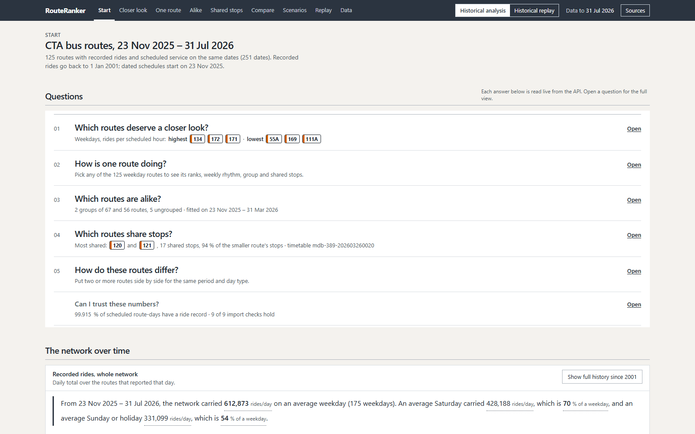 |
| **Closer look**: which routes deserve a closer look. Ranks routes on a chosen measure and day type, shows how stable each rank is, and lists unranked routes with their reasons. | 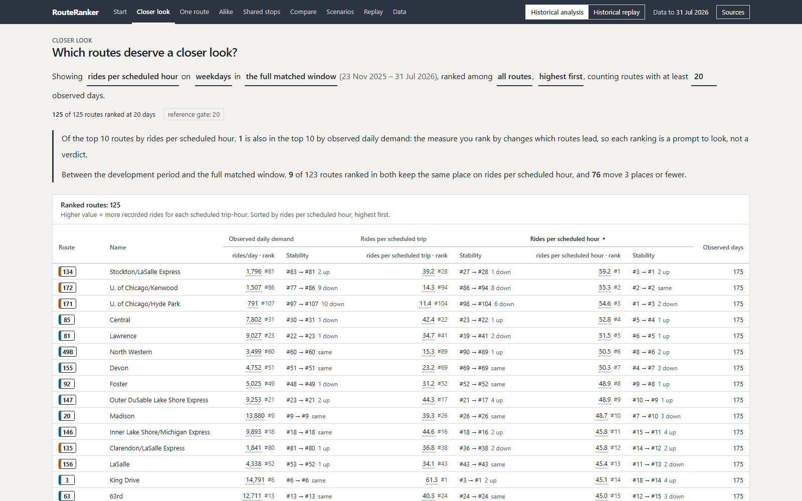 |
| **One route** (22 shown): how one route is doing. Its ranks on three measures, recorded rides, weekly rhythm, map, group and shared stops. | 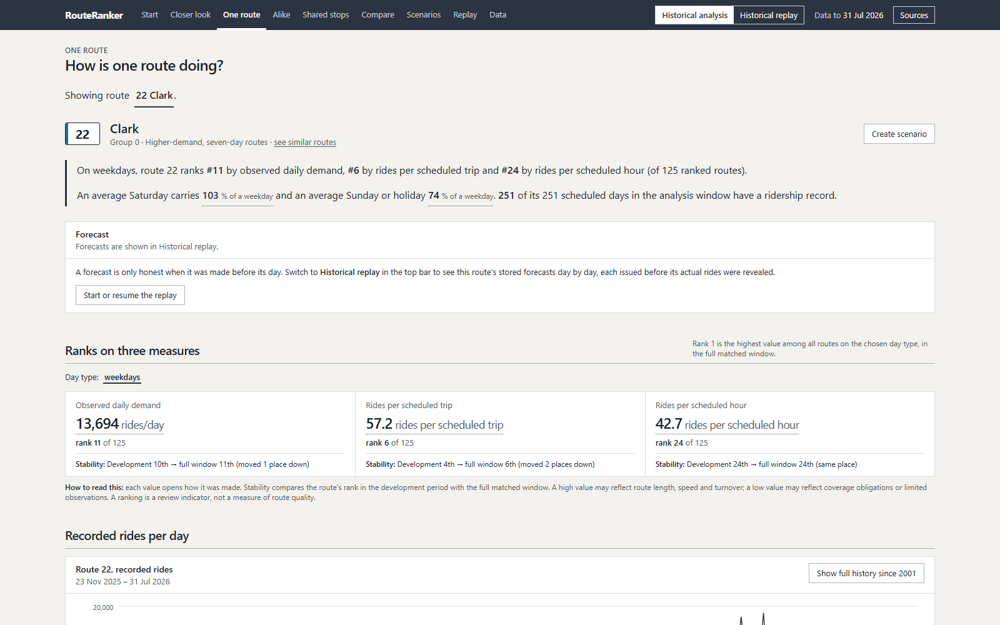 |
| **Alike**: which routes are alike. The two route groups, how far each spreads, and weekend service by group. | 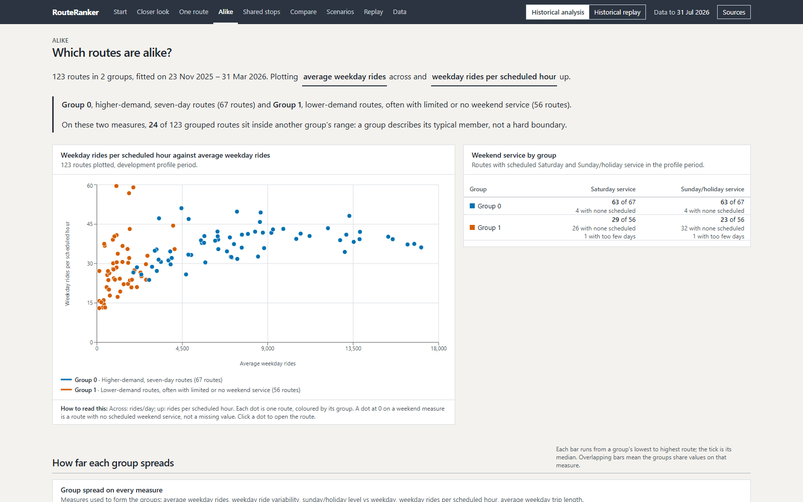 |
| **Shared stops**: which route pairs share stops, by Jaccard overlap and by share of the smaller route, with a map of the chosen pair. | 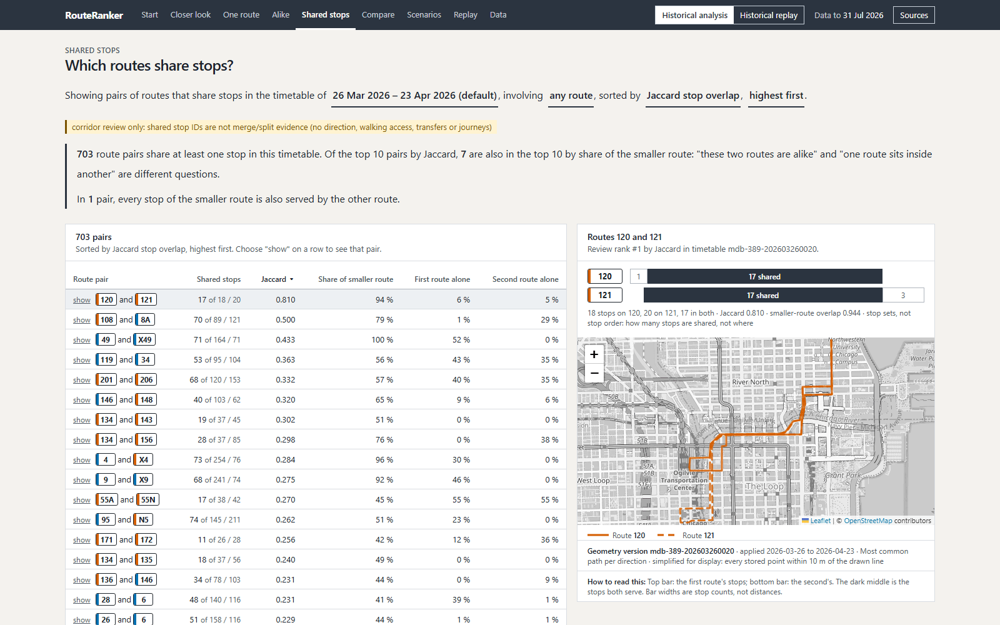 |
| **Compare** (49 and X49 shown): how routes differ, measured over the same period and day type. | 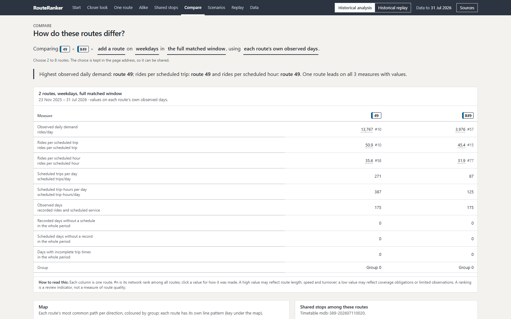 |
| **Scenarios** (saved route 49 example): what if the service changed. The baseline → scenario table, rank changes and every assumption. | 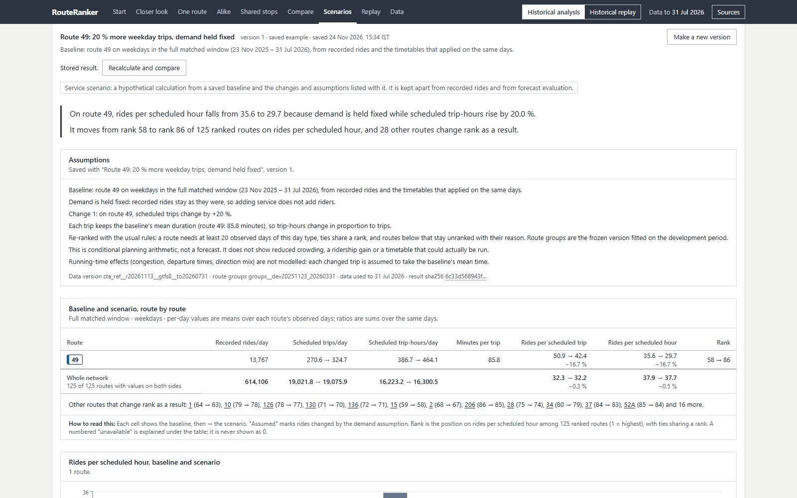 |
| **Replay**, on 8 Jun 2026: how good the forecasts were, day by day. Running error against the 4-week average, today's forecasts and yesterday's misses. | 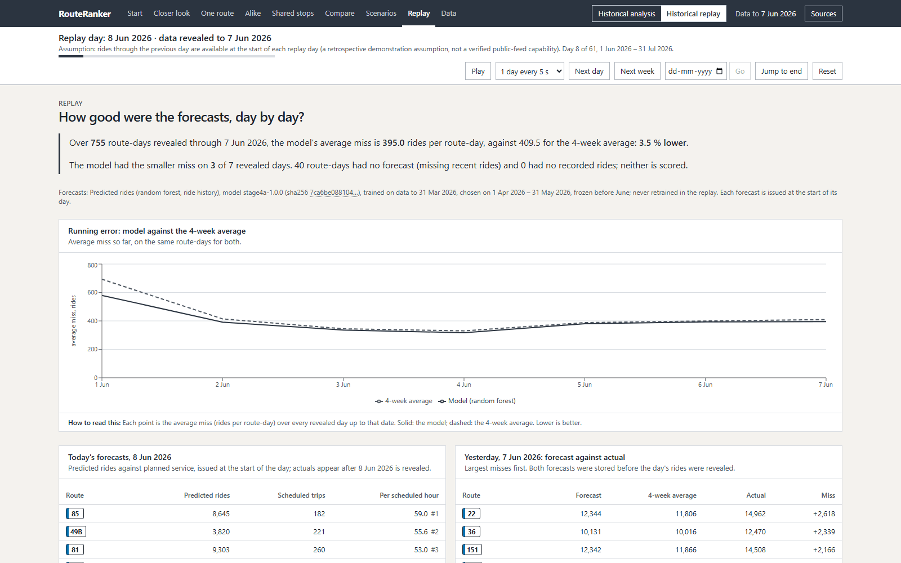 |
| **Replay**, at the end: the final score over all 61 days. | 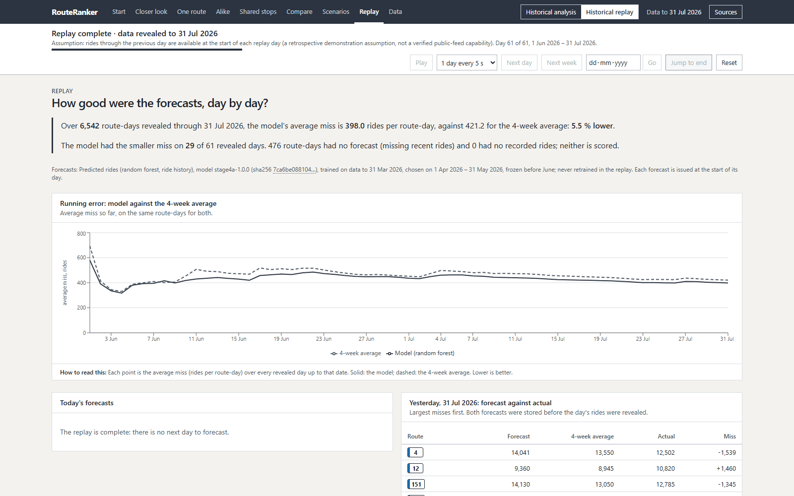 |
| **Data**: can I trust these numbers. Coverage, import checks, timetables and the forecast model card (shown). | 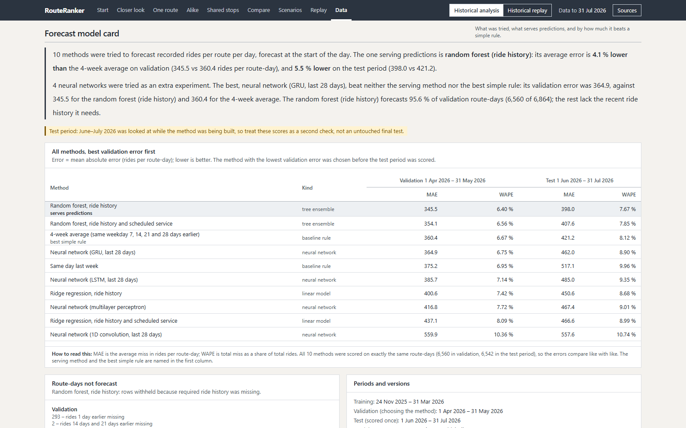 |

Every number can be clicked to show how it was calculated, and every chart has a "How to read this" line.

## Supported dates, model cutoffs and assumptions
Data version `cta_ref__r20261113__gtfs8__to20260731`.
- **Recorded rides:** 2001-01-01 to 2026-07-31. **Dated schedules** (and every ratio): 2025-11-23 to 2026-07-31.
- **Forecast models:** trained to 2026-03-31, chosen on validation (2026-04-01 to 2026-05-31), and scored once on the test period (2026-06-01 to 2026-07-31). The serving model is `stage4a-1.0.0`, the Random Forest on ride history.
- **Route groups:** fitted on 2025-11-23 to 2026-03-31, then frozen.
- **Replay:** 1 Jun to 31 Jul 2026, with a session starting on any of those days.
  - On replay day D, rides through D−1 are available. This is a stated demonstration assumption, not a verified feed capability, and only this 1-day delay is supported.
  - Each forecast uses the timetable captured strictly before its day.
  - The model is never retrained during the replay.
- **Scenarios:**
  - Demand is held fixed unless an explicit, labelled demand assumption is added.
  - Trip-hours follow trips at the baseline's mean trip duration.
  - Re-ranking uses the same 20-day gate and tie rule.
  - Saved scenarios are never changed. An edit is a new version.
- **Historical analysis:** every endpoint accepts an optional `cutoff`. Results built from later data (the groups, the model card) are hidden under an earlier cutoff, with the reason.

## Setup (Windows, from a fresh clone)
Step by step, with troubleshooting: [docs/SETUP.md](docs/SETUP.md). In short, using CMD:

**Prerequisites:** Git, Python 3.12, Node.js 22 with npm, PostgreSQL 17, and about 2 GB of free disk for data.

```
git clone https://github.com/springboardmentor441p-coder/Powered-Public-Transit-Route-Optimization.git
cd Powered-Public-Transit-Route-Optimization
git checkout tayyaba-haroon

python -m venv .venv
.venv\Scripts\activate
pip install -r requirements.txt
```

**Database (once).** As the `postgres` superuser in `psql`, create a role that is *not* a superuser, and two databases:
```
CREATE ROLE routeranker LOGIN PASSWORD '<choose a password>';
CREATE DATABASE routeranker OWNER routeranker;
CREATE DATABASE routeranker_test OWNER routeranker;
```
Copy `backend\.env.example` to `backend\.env` and put the role's own password in both URLs. `backend\.env` is gitignored. Never commit it, and never use the superuser's password there.

**Data and import.** Run the pipeline once, as in [Reproduce the pipeline](#reproduce-the-pipeline). Then load it into PostgreSQL:
```
python -I backend\importer\import_data.py --create-schema
python -I backend\importer\import_stage7.py
python -I backend\replay\build_forecasts.py
python -I backend\importer\import_stage8.py
python -I backend\scenarios\save_examples.py
```

**Run the app** in two CMD windows, both from the repo root:
```
:: window 1: the API, http://127.0.0.1:8000 (interactive docs at /docs)
.venv\Scripts\activate
python -m uvicorn backend.app.main:app --host 127.0.0.1 --port 8000

:: window 2: the screens
cd frontend
npm ci
npm run dev
```
Open **http://localhost:5173**. Vite forwards `/api` to the API. `npm ci` is only needed the first time.

## Reproduce the pipeline
From the repo root, in order. Raw data (about 610 MB) goes to `data/raw/`. Scripts that read downloaded data run with `python -I` (isolated mode). `DV` is the data version folder.
```
set DV=data\processed\cta_ref__r20261113__gtfs8__to20260731
:: Stage 1: download, register, validate
python -I analytics\source\download_sources.py --config analytics\config\sources.json --raw data\raw
python -I analytics\source\build_register.py --config analytics\config\sources.json --raw data\raw --out reports
python -I analytics\source\validate_raw.py --config analytics\config\sources.json --register data\raw\source_register.csv --out reports
:: Stage 2: daily reconstruction
python -I analytics\reconstruction\build_stage2.py --config analytics\config\sources.json --register data\raw\source_register.csv --out reports
:: Stage 3: feature contracts
python -I analytics\features\build_stage3.py --config analytics\config\sources.json --features analytics\config\features.json --register data\raw\source_register.csv --out reports
:: Stage 4a: baselines, Ridge, Random Forest (training and evaluation)
python -I analytics\models\train_stage4a.py --features %DV%\features__delay1d --models analytics\config\models.json --sources analytics\config\sources.json --artifacts artifacts\stage4a --out reports
:: Stage 4b: neural networks (optional extra; needs 4a)
python -I analytics\models\train_stage4b.py --features %DV%\features__delay1d --neural analytics\config\neural.json --models analytics\config\models.json --sources analytics\config\sources.json --register data\raw\source_register.csv --stage4a artifacts\stage4a --artifacts artifacts\stage4b --out reports
:: Stage 5: route groups and rankings
python -I analytics\groups\build_stage5.py --features %DV%\features__delay1d --groups analytics\config\groups.json --names analytics\config\group_names.json --sources analytics\config\sources.json --register data\raw\source_register.csv --artifacts artifacts\stage5 --out reports
:: Route lines for the maps
python -I analytics\geometry\build_geometry.py --sources analytics\config\sources.json --register data\raw\source_register.csv --version-dir %DV%
```
Then run the import commands under [Setup](#setup-windows-from-a-fresh-clone).
- Every import and build is safe to repeat. A second run refuses to import twice, or stores nothing and only re-verifies.
- After the Stage 7 and Stage 8 steps, restart the API.

## Usage: the 5-minute demo path
1. **Start**, in **Historical analysis** (the top-bar default). Read the network summary, then open **Closer look**. Switch the measure between rides per scheduled hour and observed daily demand, and watch the leading routes change.
2. Open **One route** and pick route **22**: its three ranks, rides over time, weekly rhythm and map. Click any number to see how it was calculated.
3. **Alike** shows the two groups and how much they overlap. **Shared stops** lists the most-shared route pairs; pick one to see it on the map. **Compare** opens two or more routes side by side (try 49 and X49).
4. **Scenarios**: open the saved example **"Route 49: 20 % more weekday trips, demand held fixed"** from the saved list. Read why rides per scheduled hour falls (35.6 → 29.7) and which assumptions it states. **Don't press Save** during a demo. Saved scenarios can never be deleted, so only open the saved examples.
5. Switch the top bar to **Historical replay**. It starts on 1 Jun 2026 with data revealed to 31 May.
   - Press **Next week** and open **Replay**: on 8 Jun the model is 3.5 % ahead after 7 days, but won only 3 of them.
   - Open **One route → 22** to see today's forecast, issued before its actual.
   - Press **Jump to end** to see the final score: 398.0 vs 421.2, 29 of 61 days.
   - Use **Next day**, **Next week** or **Jump to end** rather than **Play**. If you do press **Play**, press **Pause** before leaving; **never leave Play running**.
   - Finish with **Reset**, which starts a clean session on 1 Jun and keeps the old one, then switch back to **Historical analysis**.
6. **Data**: coverage, import checks, the timetables, and the model card with every method's validation and test error.

The end-to-end path through every stage, with the commands, is in [docs/INTEGRATION_WALKTHROUGH.md](docs/INTEGRATION_WALKTHROUGH.md).

## Testing
| Suite | Command (from) | Current result |
|---|---|---|
| Pipeline + API tests (pytest; database tests use `routeranker_test`) | `python -m pytest` (repo root) | 389 passed |
| Frontend unit tests | `npx vitest run` (`frontend\`) | 117 passed |
| Type check, lint, build | `npx tsc -b`, `npm run lint`, `npm run build` (`frontend\`) | clean |
| Browser click-through, all screens | `node scripts\clickthrough.mjs` | 8 of 8 |
| Replay and scenario browser checks (test database only) | `node scripts\replay_check.mjs <folder>`, `node scripts\scenario_check.mjs <folder>` | all checks pass |

- The integration tests skip until the stage they check has been run.
- A full pytest run takes about 30 minutes and empties `routeranker_test` afterwards.
- The replay and scenario browser checks create sessions and scenarios that can never be deleted. So they refuse to run unless the API reports `routeranker_test`.
- How to run them on temporary ports: [docs/SETUP.md](docs/SETUP.md#browser-checks).

## Limitations and future work
- **The data can't show crowding.** It has whole-day rides per route: no occupancy, alightings, hours, directions or actual trips run. Rides per scheduled trip describes turnover, not load.
- **The reporting delay is assumed.** The public export ran 74 days behind when it was downloaded. The replay's one-day delay is a stated assumption, and a live version would need a faster feed or a model built for a longer horizon.
- **The test period was reused.** June–July 2026 was looked at during development. The replay reproduces its scores, but it isn't an untouched final test.
- **The model wins over a period, not every day.** It is 5.5 % better over June–July, yet has the smaller miss on only 29 of 61 days. Unseen routes (10 and 130) are forecast, but with much larger errors.
- **There is no fallback forecast.** 476 route-days per method are "unavailable" because a required recent ride is missing. The 4-week average is stored for comparison, but it was never validated as a fallback.
- **Groups and rankings are review aids.** The two groups separate moderately (silhouette 0.38), and k = 2 vs 3 is a near tie. Shared stops are corridor evidence only, not a case to merge or split routes.
- **Scenarios are arithmetic.** There is no elasticity, crowding or running-time model.
- **Future work:**
  - an hourly or stop-level data source to study load;
  - a forecast built and evaluated for the real publication delay;
  - a validated fallback for missing inputs;
  - uncertainty intervals, only once they've been evaluated;
  - an importer for a second city's data.

## Project structure
```
analytics/   pipeline: source, reconstruction, features, models, groups, geometry; configs and tests
artifacts/   fitted pipelines (gitignored) and their JSON manifests (committed)
backend/     FastAPI app, importer, replay, scenarios, SQL schemas, tests; .env.example
data/        raw downloads and processed versions (gitignored)
docs/        setup, architecture, data dictionary, integration walkthrough, screenshots
frontend/    React + TypeScript screens, API client, unit tests, Playwright dev checks
reports/     quality and evaluation reports for every stage
NOTES.md     step-by-step decision log
```

---

## Contributing Guidelines (For Interns / Collaborators)

All interns added as collaborators to this repository must follow the branch workflow below. **Direct commits or pushes to the `main` branch are not allowed.**

> Note: `main` only contains the `LICENSE` and `README.md` — it is not used for active development. There is no need to pull the latest `main` into your branch at any point.
 


### 1. Branch Naming

- Every intern must create their own branch off `main`, named after themselves.
- Suggested naming convention: `firstname-lastname` (all lowercase, hyphen-separated).
  - Example: `john-doe`, `aisha-khan`

### 2. How to Create Your Branch

**Option A — Clone and push (recommended)**

```bash
# Clone the repository
git clone https://github.com/springboardmentor441p-coder/Powered-Public-Transit-Route-Optimization.git

# Move into the project folder
cd Powered-Public-Transit-Route-Optimization

# Create and switch to your own branch (off main)
git checkout -b your-name

# ... make your changes ...

# Stage, commit, and push your changes to YOUR branch only
git add .
git commit -m "Describe your change here"
git push origin your-name
```

**Option B — GitHub UI upload**

1. Go to the repository on GitHub.
2. Switch the branch dropdown from `main` to your own branch (create it first via **Branch: main → View all branches → New branch**, named after yourself).
3. Once on your branch, use **Add file → Upload files** to upload your code.
4. Commit directly to your branch (not `main`).

### 3. Rules

- ❌ Do **not** push or upload code directly to `main`.
- ❌ Do **not** push code to another intern's branch.
- ✅ Only push/upload code to the branch that carries your own name.
- Keep uploading/pushing your code to your branch regularly as you make progress. No pull requests are required — your branch itself is the deliverable.

### 4. Summary

| Action | Allowed? |
|---|---|
| Push to `main` directly | ❌ No |
| Create your own branch from `main` | ✅ Yes |
| Push/upload code to your own branch | ✅ Yes |
| Push/upload code to someone else's branch | ❌ No |
| Open a Pull Request | Not required |
