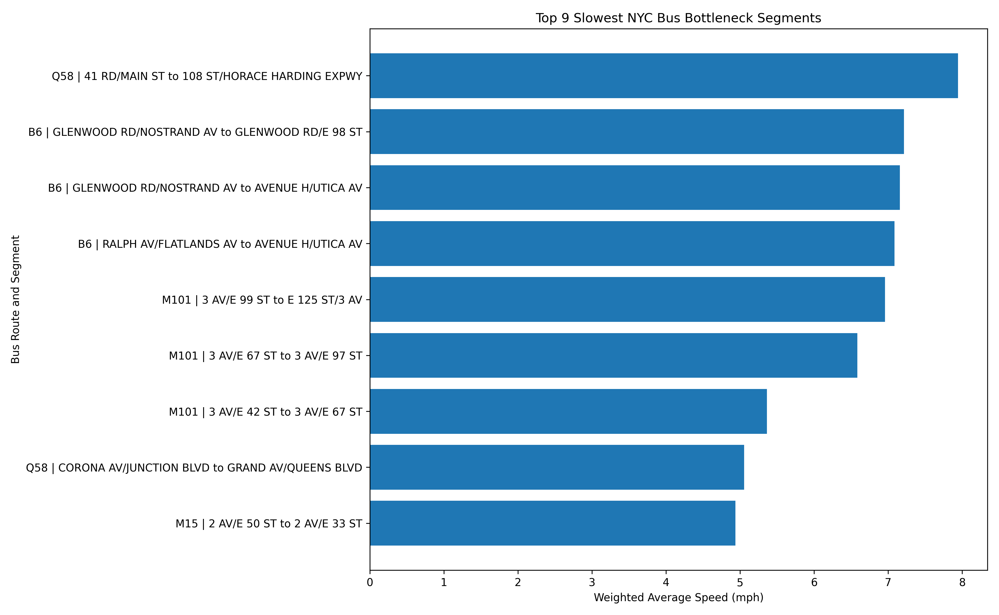
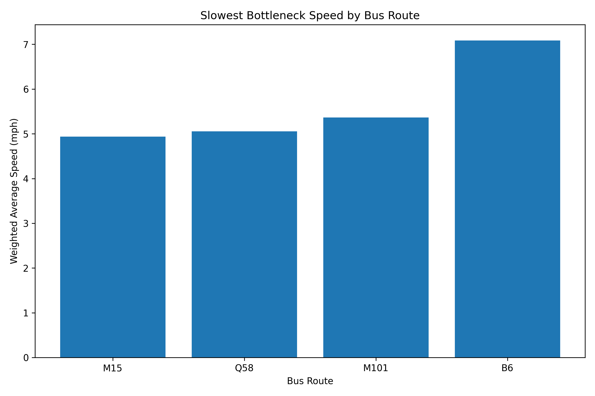
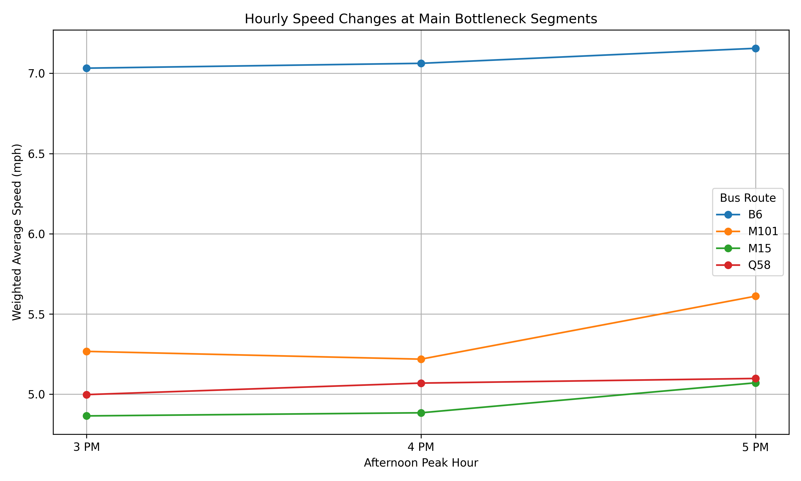
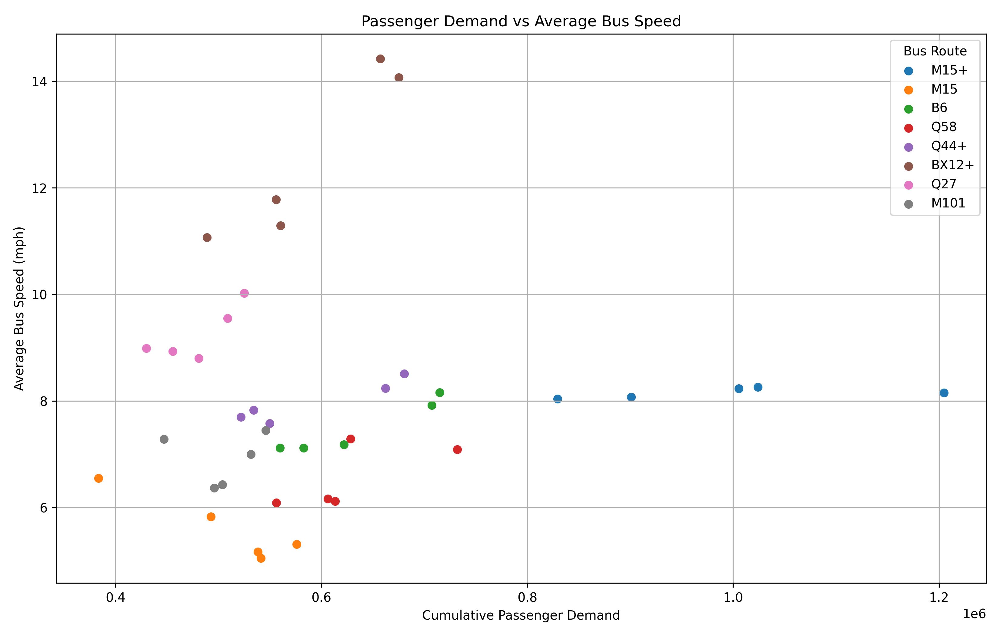

# Powered Public Transit Route Optimization

## Project Overview

Public transportation is an important part of everyday life in New York City. However, some bus routes experience slow speeds, heavy passenger demand, and traffic congestion, especially during peak hours.

This project uses public transportation data to study passenger demand, bus speeds, and slow-moving route segments. The goal is to identify areas where bus services could be improved and develop data-driven recommendations for better public transit operations.

Our work is being completed in stages. This README will be updated as each stage is completed and pushed to the project repository.

---

## Project Progress

**Current stage:** Data analysis, bottleneck identification, and visualizations completed.

**Overall project status:** In progress. The optimization and recommendation stages are still pending.

## 1. Work Completed So Far

### 1.1 Dataset Collection and Exploration

We worked with two main datasets:

- **Bus ridership data:** Used to understand passenger demand across routes and different hours.
- **Bus speed data:** Used to examine bus speeds, travel times, and road segments.

We explored the available columns and identified the fields needed for the analysis, including:

- Route ID
- Borough
- Hour of Day
- Average Road Speed
- Average Travel Time
- Road Distance
- Bus Trip Count
- Timepoint Stop Name
- Next Timepoint Stop Name

We also checked the date coverage of both datasets to make sure comparisons were made over a common period.

### 1.2 Passenger Demand Analysis

We analyzed passenger ridership to identify:

- The busiest bus routes.
- The hours with the highest passenger demand.
- The busiest routes during morning and afternoon peak hours.

**Key findings:**

The top passenger-demand routes included:

| Route | Passenger Count |
|---|---:|
| M15+ | 12,891,630 |
| Q25 | 9,469,397 |
| B6 | 9,377,700 |
| Q58 | 9,234,004 |
| Q44+ | 8,847,952 |

The busiest hours identified were:

- 7 AM
- 8 AM
- 5 PM
- 4 PM
- 3 PM

*Note: These passenger counts represent cumulative totals across the available dataset period, not average daily passenger counts.*

### 1.3 Bus Speed Analysis

We analyzed bus speeds to understand how traffic conditions affect bus movement across different boroughs and hours.

The analysis included:

- Average bus speeds by hour.
- Speed comparisons across boroughs.
- Identification of slow-moving route segments.
- Examination of travel time and trip counts.

We also identified the exact columns needed to calculate trip-weighted average speeds.

### 1.4 Passenger Demand and Speed Comparison

We compared passenger demand and average bus speeds for selected routes during peak hours.

The selected routes were:

- M15+
- M15
- B6
- Q58
- Q44+
- BX12+
- Q27
- M101

The comparison focused on 7 AM, 8 AM, 3 PM, 4 PM, and 5 PM.

**Key observation:**

Some routes experienced high passenger demand along with relatively low average bus speeds. This suggests a possible relationship between passenger demand and slower bus movement, although the analysis does not establish that passenger demand directly causes lower speeds.

### 1.5 Slow Segment Identification

We performed a segment-level analysis to identify road sections where buses consistently travel slowly.

The analysis focused on these priority routes:

- M15
- Q58
- M101
- B6

We concentrated on afternoon peak hours (3 PM to 5 PM).

To make the results more reliable, we filtered out segments with fewer than 50 recorded observations.

### 1.6 Final Bottleneck Ranking

We ranked the slowest road segments using their trip-weighted average speeds.

The ranking included segments observed across all three afternoon peak hours.

**Top identified bottlenecks:**

| Rank | Route | Road Segment | Average Speed |
|---:|---|---|---:|
| 1 | M15 | 2 AV/E 50 ST → 2 AV/E 33 ST | 4.94 mph |
| 2 | Q58 | CORONA AV/JUNCTION BLVD → GRAND AV/QUEENS BLVD | 5.05 mph |
| 3 | M101 | 3 AV/E 42 ST → 3 AV/E 67 ST | 5.36 mph |
| 4 | M101 | 3 AV/E 67 ST → 3 AV/E 97 ST | 6.58 mph |
| 5 | M101 | 3 AV/E 99 ST → E 125 ST/3 AV | 6.96 mph |

These segments are potential priorities for further investigation and improvement.

### 1.7 Data Visualizations

We created four visualizations to make the findings easier to understand.

The charts are saved in the `charts/` folder.

**1. Top Bottleneck Segments**



**2. Route Speed Comparison**



**3. Hourly Speed Comparison**



**4. Passenger Demand vs Speed**



---

## 2. Current Project Structure

```text
Powered-Public-Transit-Route-Optimization/
│
├── charts/
│   ├── hourly_speed_comparison.png
│   ├── passenger_demand_vs_speed.png
│   ├── route_speed_comparison.png
│   └── top_bottleneck_segments.png
│
├── data/
│   ├── borough_hourly_speed_findings.txt
│   ├── final_bottleneck_ranking.csv
│   ├── peak_hourly_demand.txt
│   ├── peak_routes_comparison.txt
│   ├── reliable_slow_segments.csv
│   ├── slow_segments_analysis.csv
│   └── top_bus_routes.txt
│
├── scripts/
│   ├── analyze_slow_segments.py
│   ├── check_date_coverage.py
│   ├── check_route_matches.py
│   ├── check_trip_column.py
│   ├── compare_demand_speed.py
│   ├── create_visualizations.py
│   ├── filter_reliable_segments.py
│   ├── final_bottleneck_ranking.py
│   ├── inspect_bus_speeds.py
│   ├── inspect_peak_hours.py
│   ├── inspect_peak_routes.py
│   └── inspect_ridership.py
│
├── bus_route_counts.csv
├── LICENSE
└── README.md
```

The large `export.csv` speed dataset is currently stored locally and is not included in this structure because it is approximately 360 MB.

---

## 3. What We Are Working on Next

The analysis stage is complete, but the main optimization part of the project still needs to be developed.

Our next tasks are:

### Stage 2: Optimization and Improvement Recommendations

- Develop a method to prioritize bottleneck segments.
- Identify which routes and road sections should receive improvement attention first.
- Evaluate possible operational improvements using the available demand and speed data.
- Compare the current situation with proposed improvement scenarios.
- Present practical recommendations based on the analysis.

### Stage 3: Optimization Evaluation

- Evaluate whether the proposed improvements could increase bus speeds.
- Estimate potential travel-time improvements using clearly stated assumptions.
- Compare baseline and proposed scenarios.
- Present the results through tables and charts.

### Stage 4: Final Results and Documentation

- Prepare the final optimization results.
- Add final comparison charts and findings.
- Document the methodology and limitations.
- Update this README with the completed optimization work.
- Perform a final project review.

*Note: Full route redesign or bus fleet allocation optimization may require additional information, such as route-network connections, vehicle capacity, fleet availability, and service schedules. We will confirm the scope based on the data available.*

---

## 4. Technologies Used

- **Python** – Data analysis and processing.
- **Pandas** – Data cleaning, filtering, and aggregation.
- **Matplotlib** – Data visualization.
- **CSV datasets** – Passenger ridership and bus speed information.
- **Git and GitHub** – Version control and project management.

---

## 5. Running the Project

Run the Python scripts from the project root directory.

```powershell
python scripts/inspect_ridership.py
python scripts/inspect_bus_speeds.py
python scripts/inspect_peak_hours.py
python scripts/inspect_peak_routes.py
python scripts/compare_demand_speed.py
python scripts/analyze_slow_segments.py
python scripts/filter_reliable_segments.py
python scripts/final_bottleneck_ranking.py
python scripts/create_visualizations.py
```

The large speed dataset, `export.csv`, must be available in the project root for the scripts that process it. Install the required Python libraries before running the scripts.

---

## 6. Important Notes and Limitations

- Passenger counts are cumulative across the dataset period and should not be interpreted as daily passenger counts.
- The passenger-demand and speed comparison shows an association, not proof of causation.
- A minimum of 50 records was used as an initial segment reliability filter; it is not a formal statistical reliability test.
- Trip-weighted average speeds depend on the `Bus Trip Count` field.
- The current analysis identifies potential bottlenecks. It does not yet prove that a particular intervention will improve traffic conditions.

---

## 7. Project Goal

The ultimate goal is to move beyond identifying slow bus routes and use data-driven methods to determine where improvements should be prioritized.

By combining passenger demand, bus speed analysis, bottleneck identification, and optimization techniques, this project aims to support more efficient and reliable public transportation.

**Project status: Analysis and visualizations completed. Optimization and final evaluation in progress.**