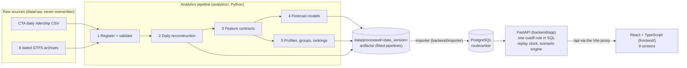

# Architecture

RouteRanker has five layers. Data moves through them in one direction: from immutable downloads, through a versioned analytics pipeline, into PostgreSQL, out through a FastAPI service, and onto React screens. Each layer only reads what the layer before it produced.



## 1. Raw sources (`data/raw/`)
- One CTA ridership export (`data/raw/ridership/<dated_export>.csv`) and eight GTFS timetable archives (`data/raw/gtfs/<snapshot_id>/original.zip`, extracted beside it).
- `analytics/source/build_register.py` records each file's URL, download time, byte size and sha256 in `data/raw/source_register.csv` (copied to `reports/source_register.csv`).
- A raw file is never overwritten. A newer export becomes a new snapshot beside the old one, and a new data version.

## 2. Analytics pipeline (`analytics/`)
Each stage is one command that reads the previous stage's outputs and writes a versioned folder plus a quality report in `reports/`.

| Stage | Package | Output |
|---|---|---|
| 1 | `analytics/source` | source register, raw validation report |
| 2 | `analytics/reconstruction` | one selected timetable per date; scheduled trips and hours per route/day; ridership ↔ schedule matching (matched / ridership without schedule / schedule without ridership) |
| 3 | `analytics/features` | exact-date lags, forecast-time schedule inputs, Sunday-like flag, chronological splits, eligibility, feature schema |
| 4a / 4b | `analytics/models` | seasonal baselines, Ridge, Random Forest (4a); MLP, LSTM, GRU, 1D CNN as a documented extra (4b); evaluation on identical rows; frozen pipelines in `artifacts/` |
| 5 | `analytics/groups`, `analytics/geometry` | development-period route profiles, KMeans groups, three named rankings, stop overlap; route lines for the maps |

The data version name records what went in: `cta_ref__r20261113__gtfs8__to20260731` means the CTA reference case, the ridership export of 13 Nov 2026, 8 GTFS archives and data through 31 Jul 2026.

DuckDB handles the large `stop_times.txt` files. pandas and NumPy handle the daily tables. scikit-learn provides Ridge, the Random Forest and KMeans.

## 3. Database (PostgreSQL 17)
- `backend/importer/import_data.py` loads one data version into the schema in `backend/db/schema.sql`. It checks the files' hashes against the manifests first, and refuses a version that is already imported.
- `import_stage7.py` adds the replay tables (`schema_stage7.sql`), and `import_stage8.py` adds the scenarios table (`schema_stage8.sql`).
- The app connects as a `routeranker` role that is not a superuser. A separate `routeranker_test` database is used by every automated test and browser check.
- Two kinds of table are append-only, and the database itself refuses UPDATE and DELETE on them:
  - stored forecasts are written once, before their day is revealed;
  - saved scenarios are never changed, and an edit is a new version.

Column-level detail is in [DATA_DICTIONARY.md](DATA_DICTIONARY.md).

## 4. API (FastAPI, `backend/app/`)

| Endpoint | What it returns |
|---|---|
| `GET /api/health`, `GET /api/health/database` | liveness; which database the API reads (the browser checks use this to refuse the app database) |
| `GET /api/data/coverage` | matched / missing counts and import checks for the data version |
| `GET /api/routes`, `GET /api/routes/{route}/history` | the route list; one route's dated rides, schedule and ratios |
| `GET /api/rankings` | a named ranking (mean rides/day, rides per scheduled trip, rides per scheduled hour) or the stop-overlap review, with eligibility and reasons |
| `GET /api/routes/compare` | comparable evidence for 2+ routes over the same days, with the geometry version |
| `GET /api/route-groups` | group summaries, period, group version and memberships |
| `GET /api/map/lines`, `GET /api/network/trend` | route geometry for a timetable version; the network over time |
| `GET /api/models/summary` | the model card: methods tried, validation and test results, cutoffs |
| `POST /api/replays`, `GET /api/replays/{id}`, `POST /api/replays/{id}/control` | create a replay session; read its state; start, pause, advance, next week, select date, speed, jump to end, reset |
| `GET /api/forecasts`, `POST /api/forecasts`, `GET /api/forecasts/review` | stored forecasts and permitted outcomes; running forecast-vs-actual review |
| `POST /api/scenarios/calculate`, `POST /api/scenarios`, `GET /api/scenarios`, `GET /api/scenarios/{id}`, `GET /api/scenarios/{id}/recompute` | calculate, save, list, open and recompute service scenarios |

Interactive docs are served at `http://127.0.0.1:8000/docs` while the API runs.

### One cutoff rule, enforced in SQL
- Every analysis endpoint accepts either a `cutoff` date (historical analysis) or a replay `session`, never both.
- `backend/app/db.py` turns that into one "permitted through" date. Every query filters on it in SQL, so later rows are never read.
- Periods are clipped to it. A range that starts after it is refused with a reason.
- Results that were built from later data are withheld, with the reason: route groups, and the model card's test scores.
- The frontend never filters dates itself. It only forwards the scope.

### Replay clock (`backend/replay/`)
- A session is stored in `replay_sessions`, and the server owns its virtual date. On replay day D, rides through D−1 are revealed: a stated one-day reporting delay.
- Controls are requests to the server. A browser refresh returns to the same day, and no client can set the date directly.
- Reset makes a new session and keeps the old one as audit evidence.
- Forecasts for every June–July route-day were built in advance by `backend/replay/build_forecasts.py`.
  - Each uses rides through the day before and the timetable captured strictly before its day. It goes through Stage 3's own feature builder and the frozen Random Forest, whose sha256 is checked against the manifest.
  - Each forecast is stored once, never rewritten, and only shown once the clock reaches its day. Its actual is only shown after that day is revealed.

### Scenario engine (`backend/scenarios/`)
- Scenarios are service arithmetic on a dated baseline. Scheduled trips and/or trip-hours change by a % or to a new value per day.
- Demand is held fixed unless an explicit, labelled demand assumption (rides ± x %) is added.
- Trip-hours follow trips at the baseline's mean duration per trip.
- Routes are re-ranked with Stage 5's own ranking function: the same 20-day gate and shared-rank ties.
- A saved scenario stores its inputs, assumptions, versions, cutoff and a result hash. Recomputing it gives the same hash.

## 5. Frontend (React + TypeScript + Vite, `frontend/`)
- There are nine screens, one per planner question: Start, Closer look, One route, Alike, Shared stops, Compare, Scenarios, Replay and Data. A style reference page is also included.
- In development, Vite forwards `/api` to the API. `src/api/` holds the typed client and the request scope (historical, or the replay session). `src/lib/` holds the pure functions that build every insight sentence from API values, and they are unit-tested with vitest.
- Leaflet draws the route lines on OpenStreetMap tiles. Recharts draws the charts. Tailwind provides the styling.
- Display rules:
  - colour means the route group and nothing else;
  - a missing value reads "unavailable – reason" and is never drawn as 0;
  - every chart has one "How to read this" line;
  - every number can be opened to show how it was calculated.

## 6. Where things live
```
data/raw/          immutable downloads + source register (gitignored)
data/processed/    versioned daily tables, features, profiles (gitignored)
analytics/         pipeline code, configs and pipeline tests
artifacts/         fitted pipelines (gitignored) + their JSON metadata (committed)
backend/           FastAPI app, importer, replay, scenarios, SQL schemas, API tests
frontend/          React screens, typed API client, unit tests, Playwright dev checks
reports/           quality, evaluation and demonstration reports per stage
docs/              setup, architecture, data dictionary, integration walkthrough, screenshots
```
