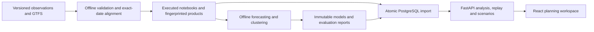

# Planning application architecture

Offline jobs reconstruct scheduled supply, validate source relationships and train models. Requests use imported tables and small inference operations. They do not unpack GTFS or retrain models.

PostgreSQL stores dataset versions, routes, daily observations/schedules, geometry, profiles, models, immutable forecasts, replay sessions and saved scenarios. Replay locks the session row; reset creates another session while retaining earlier evidence.

The React interface links versioned maps, review indicators, paired comparisons, daily history, forecasts and baseline/proposed scenario tables. Maps show scheduled geometry. Future-period geometry/profiles are withheld in replay. Scenario assumptions remain separate from observations.

Development uses Vite on port5173 and FastAPI on port8000. Packaged builds serve React from FastAPI on one origin. compose.yaml defines PostgreSQL and the application. Container execution remains unverified because Docker is not installed. Earlier Streamlit work is retained separately.
