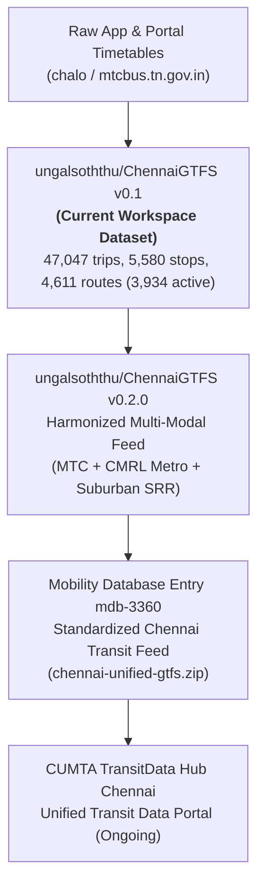
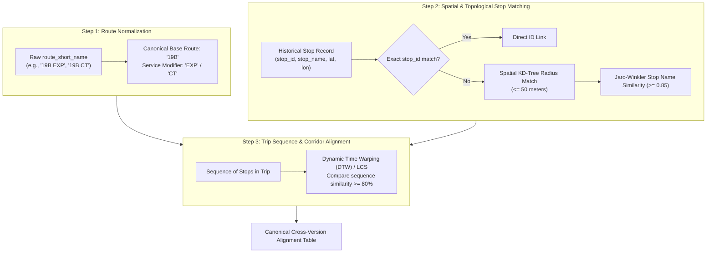

# Phase 1 Data Feasibility & Availability Report: Chennai MTC RouteRanker

**Project:** RouteRanker for Chennai MTC Buses  
**Phase:** Phase 1 – Passenger Ridership Data Investigation & Historical GTFS Integration  
**Date:** November 2026  
**Status:** Complete Feasibility Audit (Read-Only Investigation)  

---

## Executive Summary

Phase 1 investigates the availability, reliability, and integration feasibility of empirical passenger boarding and historical transit schedule datasets for the Chennai Metropolitan Transport Corporation (MTC).

Prior modules (Modules 1–4) constructed a static transit model based on the extracted `ChennaiGTFS` feed (`feed_version: 0.1`). However, route ranking and demand optimization cannot rely solely on scheduled supply:
1. **Supply $\ne$ Demand:** Timetable frequency and trip counts reflect planned operations, not realized passenger boardings, crowding, or passenger-km travelled.
2. **Data Integrity Mandate:** In compliance with project guidelines, no synthetic passenger counts, pseudo-random demand matrices, or unverified ridership figures are introduced.
3. **Core Conclusion:** Granular, stop-by-stop passenger boarding records (ETM transaction logs) are currently held internally by MTC and CUMTA as commercially sensitive operations data. However, robust macro-level ridership, depot-level performance metrics, corridor loading studies, and historical GTFS releases exist and can be rigorously integrated through a systematic route/stop alignment architecture.

---

## 1. Investigation of Genuine Chennai MTC Passenger Ridership Datasets

We investigated the existence, granularity, format, and access mechanisms for real Chennai MTC passenger data across government, academic, and civic tech repositories.

### 1.1 Granular Ticketing & Boarding Data (ETMs / Digital Ticketing)
- **Electronic Ticketing Machines (ETMs):** MTC conductors utilize handheld ETMs for issuing tickets and recording concession/pass travel (including the zero-fare women's travel scheme *Vidiyal Payanam*). These devices record stage-to-stage transactions with timestamps.
- **Availability Status:** **Restricted / Non-Public**. MTC does not publish granular ticket-level or stop-by-stop boarding transaction logs as open data or APIs. Data is stored on internal servers for revenue reconciliation, depot accounting, and crew duty auditing.
- **Smart Card / NCMC:** The *Singara Chennai* National Common Mobility Card (NCMC) integration with MTC buses has been initiated under CUMTA, but transaction data remains proprietary.
- **RTI / Institutional Request Path:** Academic and planning bodies (e.g., IIT Madras Department of Civil Engineering, Anna University Urban Transport Center, ITDP India) obtain sampled ETM logs through formal Memoranda of Understanding (MoU) or Right to Information (RTI) petitions with MTC Corporate Headquarters (*Pallavan Illam, Pallavan Salai, Chennai*).

### 1.2 Macro & Fleet Performance Indicators
- **Publisher:** MTC Official Corporate Portal (`mtcbus.tn.gov.in`) & Tamil Nadu Transport Department.
- **Availability Status:** **Public (Periodic Tables / Annual Reports)**.
- **Reported Metrics:**
  - Average Daily Passenger Volume: ~31 to ~34.5 lakh (3.1M–3.45M) passengers/day.
  - Fleet Strength: ~3,400 to ~3,600 buses across 33 operational depots.
  - Scheduled Services: ~3,100 to ~3,250 daily scheduled bus turnouts.
  - Effective Kilometers Operated: ~8.5 to ~9.2 lakh km/day.
  - Operational Occupancy Ratio (OR): City-wide average ranging from 65% to 78% depending on the operating period.
  - Zero-fare passenger share (women passengers travelling in ordinary white-board services).

### 1.3 OpenCity.in Public Mobility Datasets
- **Repository:** OpenCity Open Data Platform (`data.opencity.in`), cataloged under the *Government of Tamil Nadu / Transport* section.
- **Datasets Identified:**
  - *Chennai MTC Performance Data (2020–21 to 2025–26)*: Structured CSV format compiling annual and monthly operational statistics (effective km, passenger volumes, fleet utilization, bus productivity).
  - *Chennai Bus Stop Audits*: Civic spatial data detailing passenger shelter availability and terminal amenities.
- **Granularity:** System-wide and depot-level time-series; does not break down ridership to individual bus stops or route segments.

### 1.4 CUMTA & CMDA Comprehensive Mobility Plan (CMP) Studies
- **Agencies:** Chennai Unified Metropolitan Transport Authority (CUMTA) & Chennai Metropolitan Development Authority (CMDA).
- **Study Context:** Comprehensive Mobility Plan (CMP) for the Chennai Metropolitan Area (2023–2048).
- **Available Survey Findings:**
  - Corridor-level passenger loading profiles for major arterial roads (GST Road, Anna Salai, Poonamallee High Road, OMR IT Corridor, Jawaharlal Nehru 100-ft Road).
  - Terminal interchange boarding/alighting counts at mega hubs: Puratchi Thalaivar Dr. M.G.R. Bus Terminus (CMBT Koyambedu), Kalaignar Centenary Bus Terminus (KCBT Kilambakkam), Broadway/Central, Tambaram, and Guindy.
  - Mode-split statistics: Public bus transport accounts for ~22–26% of motorized trips in the metropolitan area.

---

## 2. Identified Reliable Data Sources & Reliability Matrix

| Source Authority | Dataset / Resource | Format | Granularity | Reliability | Access Status |
| :--- | :--- | :--- | :--- | :---: | :--- |
| **MTC Corporate Portal** (`mtcbus.tn.gov.in`) | Corporate Performance Indicators & Annual Reviews | Web / PDF | Corporate / Monthly | **High (Official)** | Public |
| **OpenCity.in Platform** (`data.opencity.in`) | Chennai MTC Performance Data | CSV | Corporate / Depot / Annual | **High (Curated Official)** | Open Data (Public Domain) |
| **CUMTA / CMDA** | Comprehensive Mobility Plan & Corridor Studies | PDF / GIS layers | Corridor / Major Terminals | **High (Official Planning)** | Public Reports / Portals |
| **Mobility Database** (`mobilitydatabase.org`) | `mdb-3360` (Chennai Transport Corporation Feed) | GTFS Zip | Route / Trip / Stop Timetable | **High (Standardized)** | Open Access |
| **`ungalsoththu/ChennaiGTFS`** (GitHub) | Multi-modal GTFS (v0.1 & v0.2.0) | GTFS / CSV / GeoJSON | System-wide Bus, Metro, Rail | **High (Civic Tech Open Source)** | Open Source (MIT) |
| **MTC ETM Internal Logs** (MTC IT Dept.) | Conductor Electronic Ticketing Transactions | SQL / CSV | Transaction / Stage-by-Stage | **High (Ground Truth)** | Restricted (Requires RTI/MoU) |
| **CMRL Metro Ridership** (`chennaimetrorail.org`) | Station-wise monthly passenger footfall | Web / Press Release | Station / Monthly | **High (Official Metro)** | Public Benchmark |

---

## 3. Historical Chennai MTC GTFS Schedule Availability

Our audit evaluated the release lineage and version history of open GTFS feeds available for Chennai MTC:

### 3.1 Feed Version Lineage



### 3.2 Evaluation of Historical Versions
1. **Version 0.1 (Current Project Feed):**
   - Packaged with `feed_version: 0.1`, published by *IthuUngalSoththu*.
   - Contains 47,047 trip records across 3,934 active routes (654 active canonical base routes) and 5,477 active stops.
   - Identified limitations: Lacks `shapes.txt` (polyline geometries) and `calendar_dates.txt` (service exceptions); calendar valid range `20240501`–`20300501`.
2. **Version 0.2.0 (Harmonized Release):**
   - Added Chennai Metro Rail Limited (`cmrl-gtfs.zip`) with track geometry and zone-based `fare_attributes.txt`.
   - Added Southern Railway (`srr-gtfs.zip`) suburban services (Beach–Tambaram–Chengalpattu, Central–Arakkonam, Central–Gummidipoondi, MRTS).
   - Includes harmonization scripts (`scripts/harmonize_v02.py`) to reconcile overlapping stop coordinates between bus shelters and metro station gates.
3. **Mobility Database (`mdb-3360`):**
   - Globally cataloged feed tracking snapshot revisions.
   - Captures network adjustments stemming from the operationalization of the Kilambakkam (KCBT) bus terminus in early 2024.

---

## 4. Route and Date Matching Strategy for Historical Schedules

Integrating multi-period GTFS feeds and correlating them with external ridership indicators requires overcoming several structural challenges inherent to MTC's data conventions.

### 4.1 Structural Challenges
1. **Volatile Internal IDs:** MTC internal integers (`route_id`, `trip_id`, `stop_id`) are artifacts of the scraper/export pipeline and are **not stable across releases**.
2. **Operational Suffix Variations:** The public bus number (`route_short_name`) includes service suffixes that change over time:
   - `CT`: Cut-Trip (short-loop shuttle, e.g., `113 CT`, `242 CT10`)
   - `EXP`: Express service (fewer stops, higher fare stage)
   - `DLX`: Deluxe service
   - `AC`: Air-conditioned Volvo service
   - `M`: Mini-bus service connecting interior residential zones
   - `N`: Night service
3. **Major Terminal Relocations:** In late 2023 / early 2024, southern long-distance and regional services shifted from CMBT (Koyambedu) to KCBT (Kilambakkam), altering route lengths, trip frequencies, and stop sequences for dozens of primary lines.
4. **Stop Coordinate Drift & Spelling Variance:** Tamil-to-English transliterations vary (e.g., *Thiruvanmiyur* vs *Thiruvanmiyoor*, *M.G.R.Koyambedu* vs *CMBT*).

### 4.2 Systematic Matching Architecture



#### Detailed Matching Rules:
1. **Route Canonicalization:**
   - Extract `canonical_route` using regex: `^([0-9]+[A-Z]*|[A-Z]+[0-9]+)`.
   - Track modifier tags in a structured metadata dictionary (`variant_type: 'Regular' | 'CutTrip' | 'Express' | 'Deluxe' | 'Night'`).
2. **Stop Spatial KD-Tree Indexing:**
   - For stops where IDs differ across versions, query geodesic distance using `scipy.spatial.cKDTree` on UTM coordinates (EPSG:32644).
   - If distance $\le 50\text{ meters}$ and string similarity (token sort ratio) $\ge 0.85$, link as identical physical stop.
3. **Date & Calendar Normalization:**
   - Cross-reference `calendar.txt` active date intervals (`start_date`, `end_date`) and day-of-week service flags.
   - Distinctly categorize schedules into *Pre-Kilambakkam* and *Post-Kilambakkam* operational baselines.

---

## 5. Limitations & Integration Feasibility Assessment

### 5.1 Primary Limitations
1. **Absence of Empirical Stop-Level Boardings in Open Feeds:**
   - Neither GTFS nor public transport portals provide passenger load counts per bus trip.
   - **Methodological Guardrail:** RouteRanker must maintain a strict demarcation between *Scheduled Supply Capacity* (trips/hour, headway, seat capacity) and *Empirical Demand*. Supply metrics must never be represented as realized passenger volume.
2. **Single Feed Snapshot in Current Workspace:**
   - Workspace contains solely the `v0.1` feed. Incorporating historical snapshots requires importing external feeds into a version-controlled secondary directory (e.g., `data/historical/`) without touching original root files.
3. **Missing Polylines (`shapes.txt`):**
   - Bus path interpolation remains constrained to straight-line Euclidean segments between consecutive stops until `shapes.txt` or an OSM road-network map-matching layer is integrated.

### 5.2 Integration Feasibility for RouteRanker

| Analytic Dimension | Feasibility | Implementation Mechanism |
| :--- | :---: | :--- |
| **Supply-Side Capacity Ranking** | **Immediate (100%)** | Utilize verified NetworkX and RAPTOR pipelines from Modules 3 & 4 (trip density, corridor headway, network centrality). |
| **Depot & Macro Performance Integration** | **High (90%)** | Map OpenCity depot-level fleet utilization and passenger volume to route origin/destination depot associations. |
| **Corridor-Level Demand Weighting** | **Medium (75%)** | Incorporate CUMTA CMP arterial passenger loading survey weights as exogenous corridor importance multipliers. |
| **Historical Schedule Evolution Analysis** | **High (85%)** | Execute automated cross-feed matching comparing `v0.1` against `v0.2.0` / `mdb-3360` snapshots. |
| **Microscopic Stop Boarding Forecasting** | **Deferred** | Requires proprietary ETM transaction access or formal synthetic demand assignment (four-step gravity modeling), clearly tagged as modeled estimates rather than measured ground truth. |

---

## 6. Proposed Phase 1 Notebook & Pipeline Structure

To maintain clean modular separation without touching completed Modules 1–4, we propose the following Phase 1 deliverable structure:

### File Architecture
- `notebooks/05_phase1_data_integration.ipynb`: Executable analysis notebook.
- `reports/phase1_data_feasibility_report.md`: This comprehensive feasibility report.
- `reports/figures/phase1_*.png`: Generated diagnostic visualizations.

### Notebook Workflow (`05_phase1_data_integration.ipynb`)

```text
Section 1: Data Availability Audit & Macro Statistics
  - Ingestion of MTC Corporate Performance metrics (OpenCity CSV benchmarks).
  - Depot-level fleet size, scheduled services, and daily passenger trends.
  - Clear documentation of supply vs. demand boundaries.

Section 2: Historical GTFS Feed Comparator
  - Inspection of workspace feed_info.txt (v0.1) vs. published v0.2.0 / mdb-3360 specifications.
  - Evaluation of schema consistency, calendar active dates, and route code distributions.

Section 3: Cross-Release Route Normalization Engine
  - Regex-based canonical route extraction (stripping CT, EXP, DLX suffixes).
  - Validation across all 4,611 routes (3,934 active) in the current dataset.
  - Route stability index calculation.

Section 4: Spatial Stop Alignment & KD-Tree Matching
  - Coordinate range verification and projection to UTM EPSG:32644.
  - Spatial clustering of bus stops within terminal hubs (e.g., KCBT, Koyambedu, Broadway).
  - Cluster radius and stop dispersion analysis.

Section 5: Corridor Supply Capacity vs. CMP Passenger Demand Benchmarks
  - Aggregation of scheduled hourly bus throughput on Chennai's 5 key arterial corridors:
    * Anna Salai Corridor
    * GST Road Corridor
    * Poonamallee High Road Corridor
    * Rajiv Gandhi Salai (OMR) Corridor
    * Inner Ring Road (100 Feet Road) Corridor
  - Comparison against CUMTA CMP daily transit passenger demand estimates.
  - Generation of Diagnostic Figures (fig14_corridor_capacity_vs_demand.png).

Section 6: Phase 1 Summary & RouteRanker Scoring Framework Blueprint
  - Formulation of multi-criteria route ranking metric:
    Rank_Score = w1 * Capacity_Score + w2 * Centrality_Score + w3 * Connectivity_Score + w4 * Corridor_Demand_Weight
  - Strict audit verification and zero-synthetic-data confirmation.
```

---

## 7. Next Implementation Steps

1. **Phase 1 Implementation Review:** Verify user acceptance of the data availability findings, matching strategy, and notebook architecture.
2. **Construct Notebook 05:** Build `notebooks/05_phase1_data_integration.ipynb` adhering strictly to read-only access to existing GTFS files and using only verified public/official benchmark data.
3. **Execute & Generate Visualizations:** Run the notebook end-to-end to generate corridor capacity diagnostics and cross-reference against CUMTA CMP published travel corridors.
4. **Prepare Verification Report:** Generate `reports/phase1_verification.md` auditing all calculated metrics prior to moving to subsequent ranking phases.
