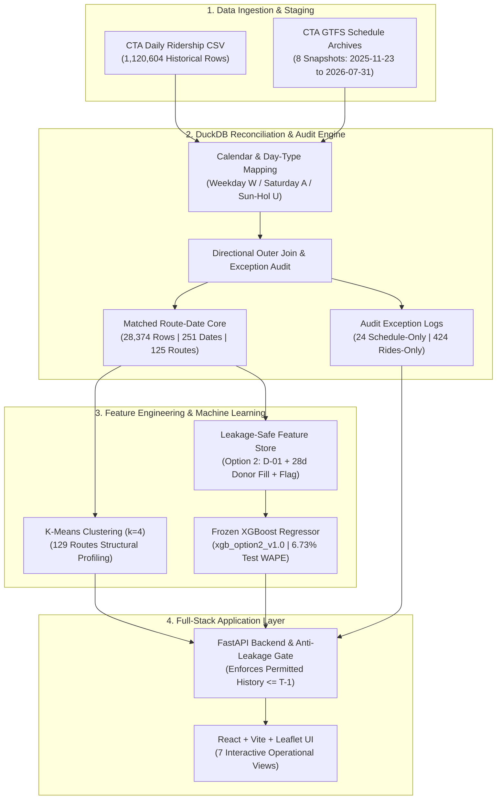
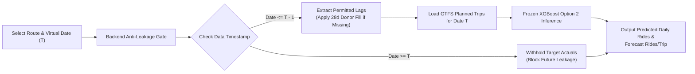

# RouteRanker (CTA v3.8): Chicago Transit Authority Demand Forecasting & Schedule Optimization Platform

**Author:** Md Zaid Hamid Khan  
**Program:** Infosys Springboard Virtual Internship  
**Domain:** Transit Data Engineering, Unsupervised Route Profiling & Time-Series Demand Forecasting  

---

## 1. Executive Summary

**RouteRanker (CTA v3.8)** is an end-to-end transit analytics, demand forecasting, and operational scenario modeling platform built on real-world **Chicago Transit Authority (CTA)** daily bus ridership and **General Transit Feed Specification (GTFS)** schedule archives. 

Designed to bridge the gap between historical passenger boardings and scheduled transit supply, the platform reconciles **1,120,604 historical demand records** across **8 GTFS schedule snapshots** into an audited, anti-leakage analytical warehouse. On top of this pipeline, RouteRanker integrates **K-Means structural route clustering**, an **XGBoost Option 2 demand regressor**, a **strict anti-leakage historical replay simulator**, and an **interactive React/FastAPI decision-support dashboard**.

### Key Performance Highlights
* **Reconciled Analytical Dataset:** **28,374** matched route-date observations across **251 calendar dates** and **125 active routes** (within a 2-year observation window of `2024-08-01` to `2026-07-31` and matched schedule window of `2025-11-23` to `2026-07-31`).
* **Forecasting Accuracy (XGBoost Option 2):** Achieves **6.73% Test WAPE** (**98.37% Test $R^2$**) and **6.45% Validation WAPE** (**98.72% Validation $R^2$**) under a 1-day reporting delay constraint (`D-01`).
* **Structural Network Segmentation:** Unsupervised K-Means clustering segments **129 routes** into 4 operational archetypes: *Local Feeders (51.2%)*, *Urban Connectors (34.9%)*, *High-Density Trunks (12.4%)*, and *Weekend Outliers (1.6%)*.

---

## 2. System Architecture & Data Engineering Flowcharts

### 2.1 End-to-End Pipeline Architecture
The system processes raw CTA ridership logs and multi-snapshot GTFS feeds through a DuckDB-backed reconciliation engine before feeding trained ML artifacts into a FastAPI service layer and React/Leaflet frontend.



### 2.2 Anti-Leakage Historical Replay & Inference Workflow
To guarantee realistic operational evaluation, the **Forecast & Replay** engine enforces a strict temporal boundary (`Permitted History <= Virtual Date - 1 day`) and withholds ground-truth target outcomes until the simulated day completes.



---

## 3. Methodology & Technical Implementation

### 3.1 Directional Data Reconciliation & Provenance
Rather than silently imputing missing schedule or ridership records as zero—which distorts route productivity metrics—the DuckDB ETL pipeline preserves directional mismatches as explicit audit exceptions:
* **Matched Route/Date Observations:** `28,374` rows across `251` calendar dates and `125` routes.
* **Scheduled Service Without Rides:** `24` rows (e.g., Route 169—retained as missing rather than zero-filled).
* **Rides Without Selected Schedule:** `424` rows (including Routes 1001, 19, 130, and 10).
* **Active Geometry Snapshot:** `google_transit_2026_09` used for stop-level geospatial alignment and corridor overlap analysis.

### 3.2 Unsupervised Route Profiling (K-Means)
All **129 routes** in the broader demand summary are segmented using K-Means clustering across mean daily rides, scheduled trips/day, rides per trip, and weekend-to-weekday demand ratios:
1. **Local Feeders (`66 routes` | `51.2%`):** Neighborhood circulators and rail-station feeder lines with lower daily volume and high stop density.
2. **Urban Connectors (`45 routes` | `34.9%`):** Mid-tier crosstown routes balancing steady weekday and weekend ridership.
3. **High-Density Trunks (`16 routes` | `12.4%`):** Major arterial corridors (e.g., Route 9 at `16,301.2` mean daily rides, Route 66 at `15,681.7`, Route 79 at `15,517.2`, and Route 22 at `12,615.6`).
4. **Weekend Outliers (`2 routes` | `1.6%`):** Specialized recreational/event corridors exhibiting atypical weekend demand spikes.

### 3.3 Demand Forecasting Model (`xgb_option2_v1.0`)
Because real-world transit farebox reporting experiences a 1-day operational lag (`D-01`), the model is trained strictly on lag features available prior to the forecast date. Under **Option 2 Policy (`28d Donor Fill + Flag`)**, missing short-term lags caused by schedule transitions or holidays are imputed using a 28-day same-day-type donor value accompanied by a binary indicator flag (`28-Day Lag Donor Flag`).

| Evaluation Metric | Validation Set | Test Set | Operational Interpretation |
| :--- | :---: | :---: | :--- |
| **WAPE** *(Weighted Absolute Percentage Error)* | **6.45%** | **6.73%** | High network-wide volume accuracy; lower is better |
| **$R^2$** *(Coefficient of Determination)* | **98.72%** | **98.37%** | Captures >98% of variance across route scales and day types |

---

## 4. User Interface & Operational Modules

The frontend provides seven specialized analytical views synchronized by global **Route** and **Day-Type (`Weekday (W)`, `Saturday (A)`, `Sun/Hol (U)`)** selectors.

### 4.1 Network Overview & Structural Clustering
Displays top-level KPIs, top 8 demand leaders, K-Means cluster distribution, XGBoost accuracy gauges, and an interactive Demand vs. Supply scatter plot.


*Figure 1: Network Overview displaying reconciled row counts, XGBoost Option 2 WAPE (6.73%), top demand leaders, and K-Means cluster breakdown across 129 routes.*

### 4.2 Route Detail, Geospatial Alignment & Historical Trend
Integrates an interactive **Leaflet / OpenStreetMap** corridor view rendered from `google_transit_2026_09` GTFS shapes alongside stop exclusivity metrics and a 30-observation historical boarding trend chart.


*Figure 2: Route 22 (Clark) corridor alignment showing 156 served stops (67.3% exclusive) mapped against the CTA network.*

### 4.3 Anti-Leakage Forecast & Historical Replay Simulator
Allows transit planners to step forward day-by-day through historical dates (`+1 Day` / `Start Replay`) using the frozen `xgb_option2_v1.0` model while enforcing backend anti-leakage controls.


*Figure 3: Historical Replay Simulation on Virtual Date `2026-06-03` for Route 22, forecasting `14,690` rides across `239` planned trips while withholding actuals until day completion.*

### 4.4 Service Scenarios & What-If Assumption Engine
Enables planners to adjust proposed daily trips and simulate hypothetical demand stress (`%`) to evaluate impacts on total scheduled trip-hours, rides per trip, and rides per scheduled hour.


*Figure 4: Service Scenario simulation testing an increase from 239 to 303 daily trips (+10% demand stress) on Route 22, projecting a shift from 55.03 to 47.75 rides/trip.*

### 4.5 Data Coverage, Provenance & Model Contract Audit
Provides full transparency into directional reconciliation exceptions, active GTFS geometry versions, and locked model contract parameters.


*Figure 5: Source provenance audit confirming 28,374 matched observations, 24 schedule-only rows, 424 rides-only rows, and Option 2 policy metadata.*

---

## 5. Additional Analytical Views


* **Review Priorities:** Ranks all eligible routes (`>= 20 matched days`) by **Rides per Scheduled Hour** and **Rides per Scheduled Trip** (led by Route 134 at `59.16 rides/hr` and Route 172 at `55.25 rides/hr`) to identify overcrowding bottlenecks.
* **Compare Routes:** Performs side-by-side corridor benchmarking (e.g., Route 22 vs. Route 8), computing total ridership, service productivity (`rides/hr`), and **Jaccard / Smaller-Route stop-set overlap**.

---

## 6. Technology Stack & Repository Structure

* **Data Engineering & Analytics:** Python, DuckDB, Pandas, NumPy, Scikit-Learn (K-Means), XGBoost (`xgb_option2_v1.0`)
* **Backend API:** FastAPI, Uvicorn, Pydantic (with anti-leakage temporal validation)
* **Frontend & Visualization:** React, Vite, Tailwind CSS, Leaflet.js (OpenStreetMap), Custom SVG Charts

```text
route-ranker/
├── backend/                    # FastAPI server, DuckDB queries & anti-leakage replay API
├── notebooks/                  # ETL reconciliation, K-Means clustering & XGBoost training (03_*)
├── frontend1/                  # React + Vite operational dashboard application
│   ├── src/
│   └── package.json
└── README.md                   # Comprehensive project report & technical documentation
```

---

## 7. Local Setup & Execution

### 1. Start the Backend API
```bash
cd backend
python -m venv .venv
.venv\Scripts\activate
pip install -r requirements.txt
uvicorn main:app --reload --port 8000
```

### 2. Start the Frontend Dashboard
Ensure you navigate into the directory containing `package.json`:
```bash
cd frontend1
npm install
npm run dev
```
Open the local URL printed in the terminal (typically `http://localhost:5173`) to access the dashboard.
