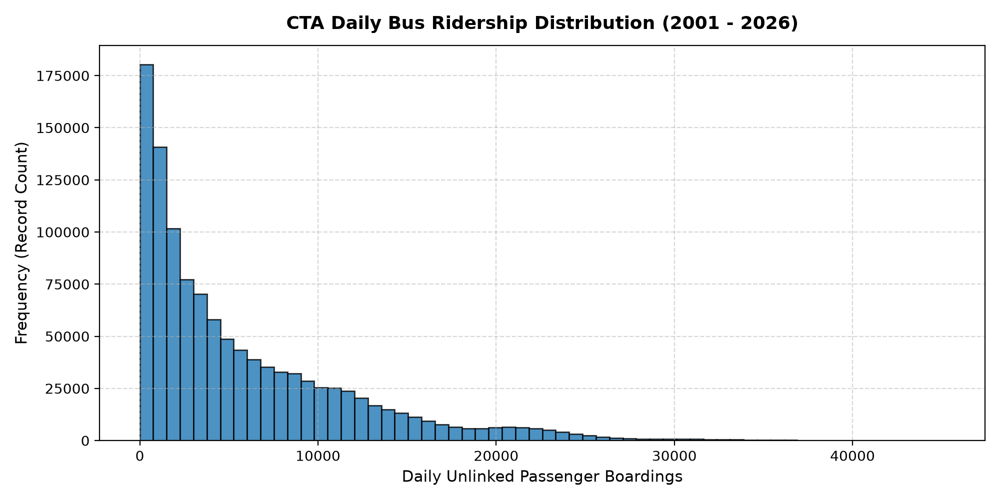
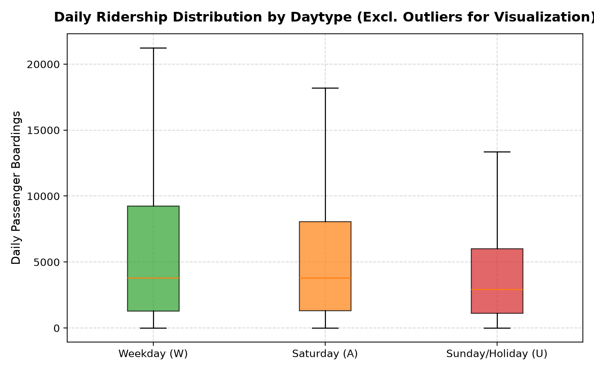
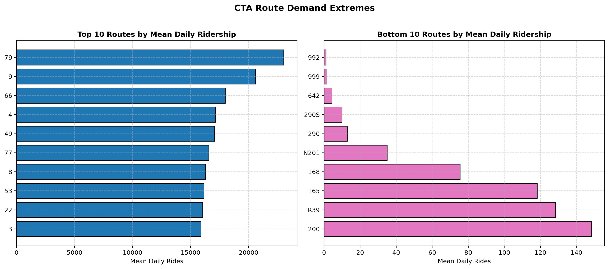

# AI_RouteRanker - Exploratory Data Analysis: Ridership Overview

**Milestone 4: Exploratory Data Analysis & Feature Engineering**  
*Source Dataset:* `data/processed/ridership/cta_ridership_clean.parquet`  
*Analysis Timestamp:* 2026-11-20 18:00:16  

---

## 1. Dataset Overview & High-Level Summary

The cleaned historical CTA bus ridership spans **25.6 years** of daily operational records with complete data integrity.

| Metric | Statistical Value | Description / Note |
| :--- | :--- | :--- |
| **Total Observations** | 1,124,170 | Verified clean records (0 quarantined, 0 duplicates) |
| **Distinct Routes** | 188 | Preserved string route identifiers (leading zeros/prefixes) |
| **Temporal Range** | 2001-01-01 to 2026-08-31 | 25.6 years historical coverage |
| **Cumulative Passenger Rides** | 6,537,621,660.0 | Total recorded boardings |
| **Mean Daily Boardings** | 5815.51 | Average per route-day observation |
| **Median Daily Boardings** | 3668.00 | 50th percentile (reflects positive skew) |
| **Standard Deviation** | 6010.02 | High route-to-route and daytype dispersion |
| **Minimum Rides** | 0 | 36 genuine zero-ride rows preserved (service interruptions) |
| **Maximum Daily Rides** | 45,177 | Peak route single-day record |
| **Skewness** | 1.5629 | Strong positive right-skew (heavy-tailed transit demand) |
| **25th Percentile (Q1)** | 1266.0 | Lower quartile |
| **75th Percentile (Q3)** | 8645.0 | Upper quartile (IQR = 7379.0) |
| **95th Percentile** | 18732.0 | High-demand threshold |
| **99th Percentile** | 25288.0 | Ultra-heavy corridor threshold |
| **Statistical Outliers (> Q3 + 1.5*IQR)** | 48,621 (4.33%) | Retained valid peak observations |

---

## 2. Ridership Distribution & Outlier Characteristics

The ridership distribution exhibits the classic transit power-law profile: a high concentration of moderate-volume feeder and neighborhood routes paired with a long right tail of ultra-high-volume arterial trunk lines (e.g., Route 79 - 79th, Route 9 - Ashland, Route 4 - Cottage Grove).

### Daytype Distribution:
- **Weekday (`W`):** 865,376 records (77.0%)
- **Saturday (`A`):** 127,570 records (11.3%)
- **Sunday/Holiday (`U`):** 131,224 records (11.7%)

Outliers are not data errors; they reflect real-world peak commuter surges, major civic events (e.g. Lollapalooza, Chicago Marathon), and seasonal corridor peaks. They must not be clipped or dropped during feature engineering.

---

## 3. Route Demand Rankings

### Top 10 Routes by Mean Daily Ridership

| Rank | Route | Mean Daily Rides | Median Rides | Std Deviation | Total Recorded Rides | Observations | CV (Std/Mean) |
| :---: | :---: | :---: | :---: | :---: | :---: | :---: | :---: |
| 1 | **79** | 23,032.3 | 23,947.5 | 8,718.5 | 215,904,463.0 | 9,374 | 0.38 |
| 2 | **9** | 20,597.7 | 19,222.5 | 7,621.6 | 193,082,913.0 | 9,374 | 0.37 |
| 3 | **66** | 17,991.3 | 19,296.5 | 6,198.5 | 168,650,778.0 | 9,374 | 0.34 |
| 4 | **4** | 17,146.2 | 18,259.0 | 6,163.7 | 160,728,363.0 | 9,374 | 0.36 |
| 5 | **49** | 17,056.8 | 16,367.0 | 6,388.4 | 159,890,953.0 | 9,374 | 0.37 |
| 6 | **77** | 16,567.8 | 17,412.0 | 5,871.2 | 155,306,462.0 | 9,374 | 0.35 |
| 7 | **8** | 16,295.4 | 17,299.5 | 6,095.4 | 152,753,437.0 | 9,374 | 0.37 |
| 8 | **53** | 16,155.9 | 16,993.0 | 5,484.0 | 151,445,234.0 | 9,374 | 0.34 |
| 9 | **22** | 16,046.7 | 16,392.5 | 5,127.4 | 150,421,585.0 | 9,374 | 0.32 |
| 10 | **3** | 15,891.5 | 16,306.0 | 6,005.7 | 148,966,420.0 | 9,374 | 0.38 |

### Bottom 10 Routes by Mean Daily Ridership

| Rank | Route | Mean Daily Rides | Median Rides | Std Deviation | Total Recorded Rides | Observations | Notes / Context |
| :---: | :---: | :---: | :---: | :---: | :---: | :---: | :--- |
| 1 | **992** | 1.1 | 1.0 | 0.8 | 12.0 | 11 | Discontinued / Short-term service |
| 2 | **999** | 1.5 | 1.5 | 0.7 | 3.0 | 2 | Discontinued / Short-term service |
| 3 | **642** | 4.3 | 4.0 | 2.2 | 121.0 | 28 | Discontinued / Short-term service |
| 4 | **290S** | 9.9 | 6.0 | 19.4 | 7,308.0 | 739 | Discontinued / Short-term service |
| 5 | **290** | 12.8 | 11.0 | 9.1 | 4,440.0 | 346 | Discontinued / Short-term service |
| 6 | **N201** | 35.0 | 30.0 | 19.4 | 44,737.0 | 1,280 | Low-demand feeder / specialized route |
| 7 | **168** | 75.4 | 73.0 | 37.9 | 164,912.0 | 2,187 | Low-demand feeder / specialized route |
| 8 | **165** | 118.2 | 105.0 | 53.8 | 592,617.0 | 5,016 | Low-demand feeder / specialized route |
| 9 | **R39** | 128.4 | 148.5 | 70.0 | 2,569.0 | 20 | Discontinued / Short-term service |
| 10 | **200** | 148.2 | 96.0 | 152.6 | 234,800.0 | 1,584 | Low-demand feeder / specialized route |

---

## 4. Key Analytical Insights
1. **Trunk Corridors Anchor System Volume**: The top 10 routes alone account for a disproportionate volume of total CTA ridership, driven by critical east-west and north-south arterials.
2. **Observation Count Context is Essential**: Bottom-ranked routes frequently have very low observation counts (<500 days), indicating discontinued historical services rather than inherently inefficient current operations.
3. **High Volatility on Major Routes**: The standard deviation on trunk lines approaches 5,000–8,000 daily rides, indicating massive swings between peak weekday operations and holiday/weekend service spans.

*Report generated in 1.71s.*
