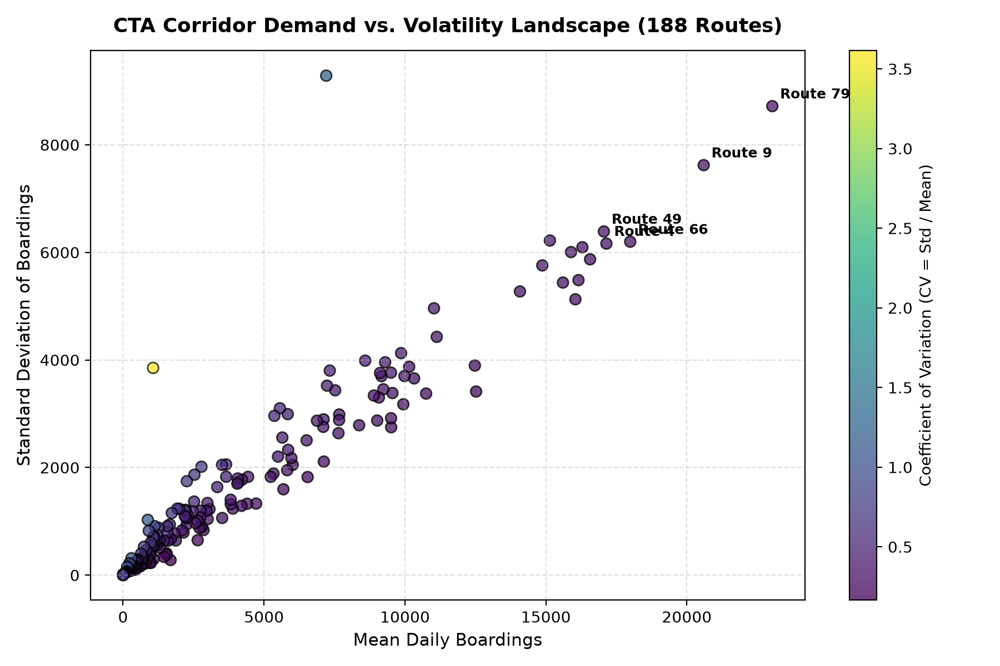
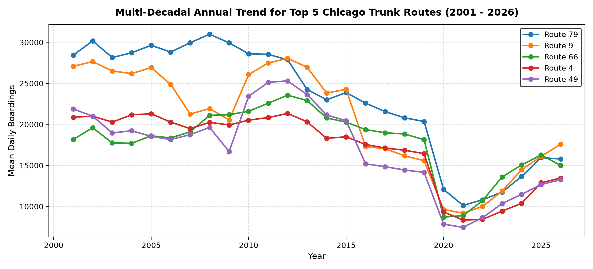
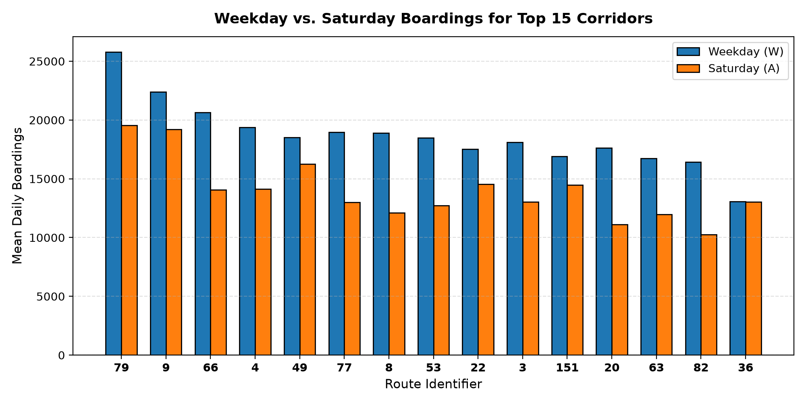

# AI_RouteRanker - Exploratory Data Analysis: Route-Level Dynamics

**Milestone 4: Exploratory Data Analysis & Feature Engineering**  
*Source Dataset:* `data/processed/integrated/daily_ridership.parquet`  
*Scope:* 188 CTA Historical Bus Corridors  

---

## 1. Network Demand Overview & Route Classification

Across 188 historical bus routes, passenger volume is characterized by extreme tiering:
- **Trunk Heavy Arterials (>15,000 rides/day)**: Corridors like **Route 79 (79th)**, **Route 9 (Ashland)**, **Route 4 (Cottage Grove)**, and **Route 49 (Western)** serve as the backbone of Chicago's surface transit grid.
- **Secondary Arterials (7,000–14,000 rides/day)**: Medium-high volume routes providing cross-town grid connectivity (e.g. Route 66 - Chicago, Route 77 - Belmont, Route 8 - Halsted).
- **Feeder & Community Circulators (<3,000 rides/day)**: Localized connectors, industrial shuttles, and neighborhood circulators.

---

## 2. Top Corridors and Multi-Decadal Stability

### Top 15 Corridors by Mean Daily Ridership

| Rank | Route | Mean Daily Rides | Median Rides | Weekday Mean | Saturday Mean | Sunday Mean | Weekend/Weekday Ratio | Observations | CV |
| :---: | :---: | :---: | :---: | :---: | :---: | :---: | :---: | :---: | :---: |
| 1 | **Route 79** | 23,032.3 | 23,947.5 | 25,790.2 | 19,546.4 | 14,049.4 | 0.65 | 9,374 | 0.38 |
| 2 | **Route 9** | 20,597.7 | 19,222.5 | 22,385.1 | 19,212.8 | 13,993.7 | 0.73 | 9,374 | 0.37 |
| 3 | **Route 66** | 17,991.3 | 19,296.5 | 20,654.9 | 14,062.2 | 9,818.9 | 0.57 | 9,374 | 0.34 |
| 4 | **Route 4** | 17,146.2 | 18,259.0 | 19,364.2 | 14,119.2 | 10,121.9 | 0.62 | 9,374 | 0.36 |
| 5 | **Route 49** | 17,056.9 | 16,367.0 | 18,518.0 | 16,239.7 | 11,376.6 | 0.74 | 9,374 | 0.38 |
| 6 | **Route 77** | 16,567.8 | 17,412.0 | 18,972.5 | 13,006.6 | 9,202.2 | 0.58 | 9,374 | 0.35 |
| 7 | **Route 8** | 16,295.4 | 17,299.5 | 18,901.1 | 12,104.6 | 8,611.4 | 0.54 | 9,374 | 0.37 |
| 8 | **Route 53** | 16,155.9 | 16,993.0 | 18,482.9 | 12,737.4 | 9,003.3 | 0.58 | 9,374 | 0.34 |
| 9 | **Route 22** | 16,046.7 | 16,392.5 | 17,526.4 | 14,551.0 | 10,891.9 | 0.72 | 9,374 | 0.32 |
| 10 | **Route 3** | 15,891.4 | 16,306.0 | 18,105.2 | 13,045.2 | 8,724.0 | 0.59 | 9,374 | 0.38 |
| 11 | **Route 151** | 15,605.9 | 15,637.0 | 16,906.1 | 14,486.4 | 10,902.6 | 0.74 | 9,374 | 0.35 |
| 12 | **Route 20** | 15,141.6 | 15,541.5 | 17,631.2 | 11,107.1 | 7,826.8 | 0.53 | 9,374 | 0.41 |
| 13 | **Route 63** | 14,872.3 | 15,082.5 | 16,733.3 | 11,983.2 | 9,291.6 | 0.63 | 9,374 | 0.39 |
| 14 | **Route 82** | 14,079.3 | 14,479.5 | 16,422.9 | 10,263.5 | 7,209.7 | 0.53 | 9,374 | 0.38 |
| 15 | **Route 36** | 12,524.3 | 12,745.0 | 13,053.7 | 13,044.5 | 9,736.0 | 0.87 | 9,374 | 0.27 |

---

## 3. Active Corridors with Lowest Demand

*Filtered for routes with $\ge 1,000$ active observations to distinguish sustained low-demand services from short-lived event shuttles.*

| Rank | Route | Mean Daily Rides | Median Rides | Total Recorded Rides | Observations | Active Date Range | Context / Description |
| :---: | :---: | :---: | :---: | :---: | :---: | :---: | :--- |
| 1 | **Route N201** | 35.0 | 30.0 | 44,737.0 | 1,280 | 2009-06-14 to 2012-12-15 | Neighborhood / specialized feeder |
| 2 | **Route 168** | 75.4 | 73.0 | 164,912.0 | 2,187 | 2001-11-19 to 2010-05-14 | Neighborhood / specialized feeder |
| 3 | **Route 165** | 118.1 | 105.0 | 592,617.0 | 5,016 | 2007-01-02 to 2026-08-31 | Neighborhood / specialized feeder |
| 4 | **Route 200** | 148.2 | 96.0 | 234,800.0 | 1,584 | 2003-06-23 to 2009-09-04 | Neighborhood / specialized feeder |
| 5 | **Route X98** | 149.8 | 94.0 | 824,855.0 | 5,508 | 2002-06-24 to 2023-03-17 | Neighborhood / specialized feeder |
| 6 | **Route 111A** | 192.0 | 180.0 | 908,933.0 | 4,733 | 2013-09-11 to 2026-08-31 | Neighborhood / specialized feeder |
| 7 | **Route 64** | 196.2 | 183.0 | 599,089.0 | 3,053 | 2001-01-02 to 2012-12-14 | Neighborhood / specialized feeder |
| 8 | **Route 173** | 198.4 | 190.0 | 443,496.0 | 2,235 | 2001-01-01 to 2009-06-12 | Neighborhood / specialized feeder |
| 9 | **Route 55A** | 222.9 | 233.0 | 1,117,599.0 | 5,014 | 2007-01-02 to 2026-08-31 | Neighborhood / specialized feeder |
| 10 | **Route 169** | 234.8 | 196.0 | 1,751,608.0 | 7,461 | 2001-01-02 to 2026-08-31 | Neighborhood / specialized feeder |

---

## 4. Corridor Volatility & Daytype Sensitivity

### Key Observations:
1. **Weekend Retention Varies Sharply by Geography**: High-density commercial and nightlife corridors (e.g. Route 66 - Chicago, Route 22 - Clark) retain higher Saturday ratios (~60–65% of weekday volume), whereas employment-centric industrial connectors experience drops exceeding 60%.
2. **Trunk Resilience**: Top trunk routes (79, 9, 4) demonstrate remarkably stable multi-decadal demand curves, tracking macro recovery trajectories tightly while preserving corridor rank.
3. **Route Embeddings and Category Encoding**: Feature engineering must capture both corridor-level static magnitude (historical mean/median) and dynamic volatility (rolling std/cv).

*Report generated in 1.38s.*
