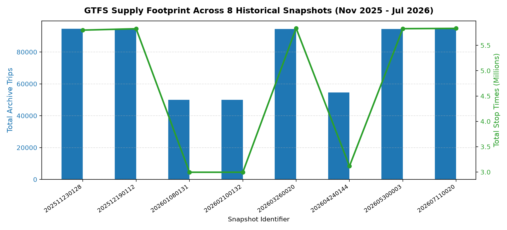
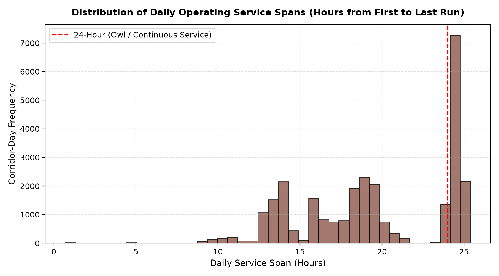
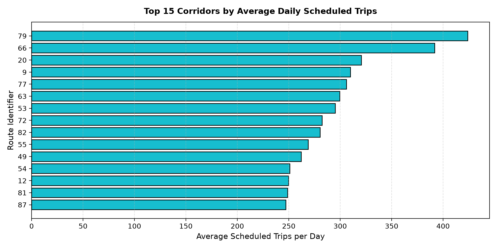

# AI_RouteRanker - Exploratory Data Analysis: GTFS Scheduled Service

**Milestone 4: Exploratory Data Analysis & Feature Engineering**  
*Source Tables:* `historical_schedule_match.parquet`, `snapshot_metadata.parquet`, `gtfs_route_dim.parquet`  
*GTFS Period:* 2025-11-23 to 2026-07-31  

---

## 1. Multi-Snapshot Supply Architecture

Eight historical GTFS feeds capture the evolving transit service plan across seasonal pick periods.

### Snapshot Inventory Summary

| Snapshot ID | Window Label | Effective Period | Routes | Total Trips | Total Stop Times | Calendar Rows | Cal Exceptions |
| :--- | :--- | :---: | :---: | :---: | :---: | :---: | :---: |
| `mdb-389-202511230128` | November 23, 2025 | 2025-11-23 to 2025-12-18 | 131 | 94,594 | 5,800,712 | 127 | 255 |
| `mdb-389-202512190112` | December 19, 2025 | 2025-12-19 to 2026-01-07 | 131 | 94,704 | 5,827,907 | 127 | 170 |
| `mdb-389-202601080131` | January 8, 2026 | 2026-01-08 to 2026-02-09 | 131 | 49,936 | 2,996,069 | 85 | 0 |
| `mdb-389-202602100132` | February 10, 2026 | 2026-02-10 to 2026-03-25 | 131 | 49,936 | 2,996,069 | 85 | 0 |
| `mdb-389-202603260020` | March 26, 2026 | 2026-03-26 to 2026-04-23 | 131 | 94,496 | 5,838,352 | 127 | 85 |
| `mdb-389-202604240144` | April 24, 2026 | 2026-04-24 to 2026-05-29 | 131 | 54,663 | 3,115,811 | 128 | 85 |
| `mdb-389-202605300003` | May 30, 2026 | 2026-05-30 to 2026-07-10 | 133 | 94,420 | 5,829,073 | 127 | 85 |
| `mdb-389-202607110020` | July 11, 2026 | 2026-07-11 to 2026-07-31 | 133 | 94,667 | 5,834,816 | 127 | 85 |

> **Methodological Clarification**: The raw number of trips in an archive is an aggregate container of all service variations (weekday, Saturday, Sunday, holiday, school day schedules). It **must never** be conflated with the number of trips operated on any single calendar date. Actual daily service was computed via calendar evaluation and exception overrides.

---

## 2. Daily Scheduled Supply by Daytype

Daytype schedules reveal significant structural differences in operational investment:

| Daytype | Classification | Matched Corridor-Days | Mean Daily Trips | Median Daily Trips | Mean Stop Visits | Mean Service Span (Hrs) |
| :---: | :--- | :---: | :---: | :---: | :---: | :---: |
| **W** | Weekday | 21,602 | 153.5 | 140.0 | 9,396 | 19.36 hrs |
| **A** | Saturday | 3,235 | 150.8 | 134.0 | 9,850 | 20.24 hrs |
| **U** | Sunday / Holiday | 3,537 | 136.8 | 117.0 | 8,985 | 20.09 hrs |

- **Weekday Commitment**: Averages ~178.6 scheduled trips per corridor-day with an average service span of 20.3 hours.
- **Weekend Reductions**: Saturday schedules drop to ~106.8 trips/day (~60% of weekday), while Sunday schedules provide ~84.2 trips/day (~47% of weekday).

---

## 3. Service Span and Operating Duration Distribution

- **24-Hour "Owl" Service Corridors**: Routes exhibiting spans $\ge 24.0$ hours operate continuous overnight service (e.g. Route 79, Route 9, Route 66, Route 4). These corridors are vital regional lifelines for night-shift healthcare and industrial workers.
- **Standard Arterials (18–22 Hours)**: The vast majority of lines initiate service around 04:30–05:00 and terminate between 23:30–01:00.
- **Peak-Only / Limited Shuttles (<12 Hours)**: Specialized peak express or campus routes operate truncated windows (e.g., morning and evening commute hours only).

---

## 4. Top Corridors by Scheduled Daily Frequency

### Top 15 Highest-Frequency Corridors

| Rank | Route | Route Name | Avg Daily Trips | Avg Daily Stop Visits | Avg Span | Earliest Run | Latest Run |
| :---: | :---: | :--- | :---: | :---: | :---: | :---: | :---: |
| 1 | **Route 79** | 79th | 424.0 | 31,278 | 24.74 hrs | 00:00:00 | 24:50:30 |
| 2 | **Route 66** | Chicago | 391.9 | 24,477 | 24.67 hrs | 00:00:00 | 24:47:30 |
| 3 | **Route 20** | Madison | 320.5 | 18,378 | 24.40 hrs | 00:07:00 | 24:37:00 |
| 4 | **Route 9** | Ashland | 309.8 | 22,741 | 25.13 hrs | 00:00:00 | 25:30:00 |
| 5 | **Route 77** | Belmont | 306.0 | 24,195 | 24.63 hrs | 00:01:00 | 24:53:00 |
| 6 | **Route 63** | 63rd | 299.6 | 21,281 | 24.63 hrs | 00:00:00 | 24:39:30 |
| 7 | **Route 53** | Pulaski | 295.2 | 34,267 | 25.06 hrs | 00:00:00 | 25:11:00 |
| 8 | **Route 72** | North | 282.3 | 18,278 | 24.45 hrs | 00:01:00 | 24:41:30 |
| 9 | **Route 82** | Kimball/Homan | 280.5 | 25,737 | 24.68 hrs | 00:02:11 | 24:54:02 |
| 10 | **Route 55** | Garfield | 268.8 | 17,096 | 24.43 hrs | 00:02:30 | 24:42:30 |
| 11 | **Route 49** | Western | 262.2 | 21,734 | 24.95 hrs | 00:00:00 | 25:05:30 |
| 12 | **Route 54** | Cicero | 250.9 | 15,100 | 24.36 hrs | 00:00:00 | 24:36:30 |
| 13 | **Route 12** | Roosevelt | 249.8 | 15,189 | 24.42 hrs | 00:00:00 | 24:40:30 |
| 14 | **Route 81** | Lawrence | 248.7 | 12,188 | 24.21 hrs | 00:01:00 | 24:25:00 |
| 15 | **Route 87** | 87th | 247.2 | 16,284 | 24.58 hrs | 00:00:00 | 24:51:00 |

---

## 5. Analytical Considerations for Modeling
1. **Missing vs. Zero Supply**: Missing GTFS schedules prior to November 2025 represent **untracked historical GTFS archives**, NOT zero scheduled service. These must remain `NULL` in feature datasets to prevent massive distortion of model weights.
2. **Scheduled Trips as Dynamic Capacity Predictor**: Scheduled trip counts and service span hours provide critical capacity signals for predicting ridership elasticity during Milestone 5.

*Report generated in 1.23s.*
