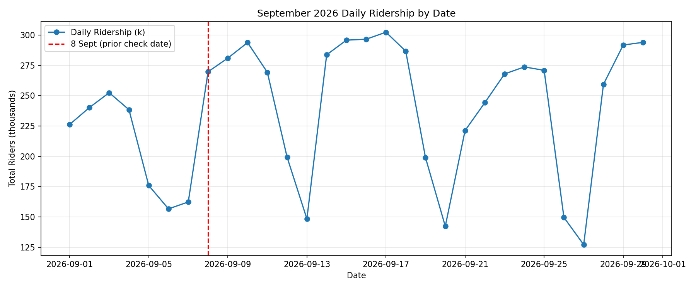
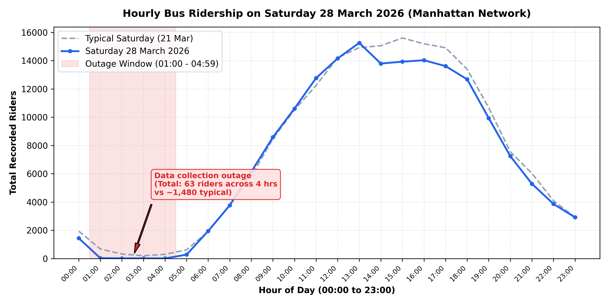

# Milestone 1 — Data Quality and Coverage Report

**Project:** Public Transit Route Optimization  
**Scope:** Manhattan Bus Network ($M*$ Routes), 4 January to 30 September 2026  
**Pipeline Deliverables:**
- Source Register: [`reports/source_register.csv`](source_register.csv)
- Route Crosswalk: [`reports/route_crosswalk.csv`](route_crosswalk.csv)
- Clean Hourly Ridership: `data/processed/ridership_hourly_clean.parquet`
- Hourly Scheduled Trips: `data/processed/schedule_hourly.parquet`
- Matched Hourly Table: `data/processed/matched_hourly.parquet`
- Route Profiles: `data/processed/route_profiles.parquet` / [`reports/route_profiles.csv`](route_profiles.csv)
- Automated Test Suite: [`tests/test_milestone1_steps6_9.py`](../tests/test_milestone1_steps6_9.py) (26/26 tests passing)

---

## 1. Study Window and Timetable Versions

### 1.1 Study Window Definition
- **Raw Ridership Extent:** 1 January 2026 through 30 September 2026 (273 calendar days).
- **Matched Study Window:** **Sunday 4 January 2026 to Wednesday 30 September 2026** (264 valid observation dates).
- **Excluded Gaps:**
  - **1–2 January 2026:** Pre-pick holiday period. No GTFS timetable in the archive covers 1–2 January.
  - **Saturday 3 January 2026:** Pre-pick boundary Saturday. The `2025-12-30` GTFS feed contains only 2 boundary marker trips (`-BM`) for this date because the winter timetable began on Sunday 4 January. Saturday 3 January full service was in the autumn 2025 timetable (not in the archive). With no full timetable available for 3 January, the matched study window begins on Sunday 4 January.
  - **10–15 January 2026:** Every route has exactly 0 riders in every hour for six consecutive days (46 routes $\times$ 24 hours $\times$ 6 days = 6,624 zero rows). This does not occur in real transit service, so these six days are treated as missing data and excluded from the matched study window.
- **September Data Check:** When checked on 22 October, data.ny.gov documentation stated data ended on 8 September. However, NY State refreshed the dataset on 19 October 2026. Daily totals run with regular weekday/weekend patterns through 30 September (closing at 294,007 riders on 30 Sep). Zero-count route-hours remain steady at 10.1% (the same share as August). The matched study window therefore extends through 30 September.
- **Hour-Level Exclusions:** In addition to the full-day exclusions above, 13 specific hours (533 route-hours) are excluded at the hourly level due to an archive carry-over boundary on 4 January and three automated collection outages detected by the 20% relative volume rule (9 Jan, 28 Mar, and 16 Aug); see [Section 4.2](#42-data-collection-outage-detection-rule-and-excluded-hours) for full documentation.

### 1.2 Timetable Version Assignment
For each date, among usable feeds downloaded on or before that date, the pipeline picks the latest version that provides regular service on that date, ignoring boundary-marker trips (trip IDs ending in `-BM`).

| Timetable Version | Operational Date Range | Days Active | Timetable Context |
|---|---|---|---|
| **`2025-12-30`** | 2026-01-04 to 2026-03-26 | 82 | Winter 2026 Schedule (winter pick starts Sun 4 Jan) |
| **`2026-03-27`** | 2026-03-27 to 2026-04-11 | 16 | Winter 2026 Extended Calendar (covers final Saturday 11 Apr) |
| **`2026-04-09`** | 2026-04-12 to 2026-06-27 | 77 | Spring 2026 Schedule (Sunday pick 12 Apr through Sat 27 Jun) |
| **`2026-06-24`** | 2026-06-28 to 2026-09-05 | 70 | Summer 2026 Schedule (Sunday pick 28 Jun through Sat 5 Sep) |
| **`2026-09-03`** | 2026-09-06 to 2026-09-30 | 25 | Fall 2026 Schedule (Sunday pick 6 Sep through 30 Sep) |

#### Audit of Dates Not Picking the Latest Downloaded Version
Across the active calendar dates, exactly **10 dates** did not pick the latest version downloaded on or before that date:
1. **3 Boundary Saturdays (11 Apr, 27 Jun, 5 Sep):** MTA seasonal schedule picks start on Sunday. Incoming GTFS feeds contain only 2 placeholder boundary marker trips (`-BM`) on the preceding Saturday, while outgoing feeds provide full Saturday service (6,919 trips across 40 routes). The selection rule keeps the outgoing feed on Saturday and switches to the incoming feed on Sunday.
2. **7 Advance Publication Weekdays (9–10 Apr, 24–26 Jun, 3–4 Sep):** The MTA uploads new seasonal feeds several days in advance of the weekend pick change. Incoming feeds have zero trips prior to the cutover weekend, so the outgoing timetable is kept until the cutover date.
3. **Sundays and Holidays:** Across all 39 Sundays and all public holidays, zero misfires occurred. Every Sunday and holiday selected the active seasonal timetable with full service.

*(Note: On Saturday 3 January, no timetable version in the archive had full service, so it was marked partial rather than falling back to an older version.)*

### 1.3 Daylight Saving Night (8 March 2026)
At 02:00:00 AM on Sunday 8 March 2026, clocks moved forward to 03:00:00 AM, so the 02:00 hour did not exist.
- **Ridership Data:** Contains 0 riders and 0 transfers for hour 2 across all 41 routes.
- **Schedule Conversion:** Nominal hour 2 trips (including Saturday overnight carry-over) shifted to clock hour 3, resulting in **0 trips starting and 0 trips running in hour 2**. Both tables match at 0 for hour 2.

---

## 2. Row Counts and Transformations at Each Step

| Step | Dataset / Table | Initial Rows | Transformations & Exclusions | Final Rows |
|---|---|---|---|---|
| **Step 2 & 5** | Raw Ridership (`data.ny.gov`) | 301,392 | Evaluated 46 route codes in [`src/route_decisions.csv`](../src/route_decisions.csv). Dropped 5 routes: M14A (0 riders), M14D (0 riders), M90 (31 riders), M99 (0 riders), M100 (1.14M riders, Bronx feed). | 268,632 |
| **Step 3 & 6** | GTFS Snapshots | 9 zip archives | 5 usable feeds kept (`2025-12-30`, `2026-03-27`, `2026-04-09`, `2026-06-24`, `2026-09-03`). 4 feeds excluded: duplicates `2026-01-09`, `2026-01-16`, and `2026-02-25`; incomplete weekday-only feed `2026-02-24`. Feed `2026-10-17` not downloaded (after study window). | 5 snapshots |
| **Step 9** | Scheduled Hourly Grid | 266,664 | 41 routes $\times$ 24 hours $\times$ 271 calendar days (2026-01-03 to 2026-09-30). Departure and arrival times $\ge \text{24:00}$ converted to next calendar clock hours. Zero rows kept to distinguish unscheduled hours from buses running with zero riders. | 266,664 |
| **Step 11 & 12** | Matched Hourly Table | 259,243 joined | Filtered to 264 study days (4 Jan to 30 Sep, excluding 10–15 Jan gap). Excluded 4 Jan early morning (hours 0–4, 205 rows) due to missing Saturday GTFS carry-over trips, and network outage hours flagged by the 20% relative median rule (9 Jan hours 22–23, 28 Mar hours 1–4, 16 Aug hours 21–22; 328 rows). Dropped 26,016 hours with neither service nor ridership (`trips_running == 0` & `ridership == 0`). Kept 3,267 hours with trips but zero riders, and 2,254 late-night timing edge hours with riders. | 233,227 |
| **Step 13** | Route Profiles | 41 routes | Aggregated spatial geometry (Haversine shape length, stop counts) and typical weekday operational metrics (frequencies, peak gaps, speed, ridership). | 41 profiles |

---

## 3. Route Matching and Crosswalk (Step 10)

**Output:** [`reports/route_crosswalk.csv`](route_crosswalk.csv)

Both the MTA ridership dataset and GTFS timetables use uppercase identifiers and the `+` suffix for Select Bus Service (SBS) routes:

| Route Category | Count | Examples | Match Status | Decision & Reason |
|---|---|---|---|---|
| **Regular Local Routes** | 32 | `M1`, `M10`, `M101`, `M11`, `M42`, `M66`, `M96` | **Matched** | Keep: active regular avenue trunk lines and crosstown feeders. |
| **Select Bus Service (+)** | 9 | `M14A+`, `M14D+`, `M15+`, `M23+`, `M34+`, `M34A+`, `M60+`, `M79+`, `M86+` | **Matched** | Keep: high-frequency limited-stop routes. Notation matches identically. |
| **Limited Peak-Only** | 1 | `M98` | **Matched** | Keep: Washington Heights – Midtown limited service. Operates during weekday commute hours (48 trips/day, 194k riders). |
| **Legacy Non-SBS Codes** | 2 | `M14A`, `M14D` | **Ridership Only** | Drop: replaced by `M14A+` and `M14D+`. Exactly 0 riders in every hour of 2026; no GTFS trips. |
| **Subway Shuttles** | 2 | `M90`, `M99` | **Ridership Only** | Drop: temporary shuttle buses for subway maintenance. M90 had 31 riders (23 May–9 Jun); M99 had 0 riders. No GTFS trips. |
| **Cross-Borough Route** | 1 | `M100` | **Ridership Only** | Drop: runs between Inwood, Harlem, and the Bronx. Timetable published in the Bronx GTFS feed. Dropped to maintain Manhattan scope. |
| **GTFS-Only Unmatched** | 0 | — | **None** | Every Manhattan route with scheduled trips in the GTFS feeds matches ridership data. |

### Hour-Level Service Matching Breakdown
In the 264-day study window across 41 routes (259,243 joined route-hours after excluding the 4 Jan hours 0–4 carry-over trips and 9 Jan, 28 Mar, and 16 Aug collection outages):
- **`trips_running > 0` and `ridership > 0`:** 227,706 route-hours (**87.83%**) — Normal active revenue service with passenger boardings.
- **`trips_running == 0` and `ridership == 0`:** 26,016 route-hours (**10.04%**) — Scheduled route dormancy (overnight non-24h routes, M98 midday/weekends). Dropped from the Step 11 table.
- **`trips_running > 0` and `ridership == 0`:** 3,267 route-hours (**1.26%**) — Scheduled buses running with zero recorded boardings. Kept as valid zero-rider observations.
- **`trips_running == 0` and `ridership > 0`:** 2,254 route-hours (**0.87%**) — Hours with boardings but no scheduled bus. Counted and kept.

#### Analysis of the 2,254 Hours with Riders but No Scheduled Bus
In the raw initial join of 259,776 route-hours, 2,294 route-hours had recorded riders but zero scheduled trips. Exactly 40 of these hours were removed by the artifact and outage exclusions:
- **36 route-hours on 4 January** (hours 00:00 to 04:59: 24 in hour 0, 11 in hour 1, 1 in hour 4), where Saturday night buses ran past midnight into Sunday without a Sunday schedule.
- **4 route-hours on 28 March** (hours 01:00 to 04:59), where residual boardings were logged on overnight routes during the automated collection drop.

This directly reconciles the count: $2,294 - 36 - 4 = 2,254$ route-hours remaining across the 264 study days:
- **88.5% (1,995 hours)** occur during late-night and dawn shoulder hours (20:00 to 06:00).
- Hour 4 alone accounts for **643 hours** (passengers tapping at fareboxes just before the first morning terminal departure, e.g. at 04:55).
- Hours 1 to 3 account for **826 hours** (passengers boarding buses completing late-night runs after midnight).
- Across the midday hours (10:00 to 18:00), fewer than 0.2 instances occur per day across the entire 41-route network.

#### Analysis of the 3,267 Hours with Scheduled Buses but Zero Riders
In the raw initial join of 259,776 route-hours, 3,379 route-hours had scheduled trips but zero recorded riders. Exactly 112 of these hours were removed across the artifact and outage exclusion blocks:
- **1 route-hour on 4 January** (hour 04:00).
- **15 route-hours on 9 January** (hours 22:00–23:00, preceding the 6-day feed blackout).
- **66 route-hours on 28 March** (hours 01:00–04:59, during the Saturday morning collection drop).
- **30 route-hours on 16 August** (hours 21:00–22:00, during the Sunday evening collection drop).

This directly reconciles the count: $3,379 - 1 - 15 - 66 - 30 = 3,267$ zero-rider route-hours remaining in the matched table.

Examining these 3,267 route-hours confirms they occur overwhelmingly in late-night/dawn hours and on low-ridership weather days:
- **97.3% (3,179 hours)** occur during late-night and dawn hours (20:00 to 06:00), with 1,056 occurring in hour 01:00 AM.
- Midday hours (08:00 to 18:00) account for under 1% of instances.
- By calendar date, zero-rider hours peak during low-ridership days: 23 February (57 route-hours), 26 January (52 route-hours), 25 January (33 route-hours), and 24 February (28 route-hours).

#### Verification of Maximum Riders per Trip
In initial unfiltered calculations, the maximum `riders_per_trip` appeared as 104.0 on route `M15` on Sunday 4 January at hour 0 (midnight to 1:00 AM). Investigation showed this was an archive artifact:
- Hour 0 on Sunday 4 January was midnight to 1:00 AM on Sunday morning.
- The buses on the road then were mostly Saturday 3 January trips running past midnight (scheduled at times like 24:30).
- Saturday 3 January's full timetable was not in the archive, so those trips were missing from `trips_running` (only 2 Sunday trips starting after midnight were counted in the schedule).
- The ridership dataset, meanwhile, included everyone who boarded those Saturday-night buses (208 boardings).
- Dividing 208 boardings by 2 trips produced an artificial value of 104.0.

Dropping the early-morning hours of 4 January (00:00 to 04:59) removes this artifact. The new maximum `riders_per_trip` value across the network is **64.86** on route **M35** on **Saturday 19 September 2026** at hour 17 (5:00 PM to 6:00 PM):
- Scheduled trips running: 14
- Total boardings: 908
- $908 / 14 = 64.86$ boardings per trip.
- Checking adjacent hours on 19 September confirms an afternoon surge spanning several hours:
  - Hour 14:00: 224 boardings across 12 trips (18.67 riders/trip; 6.6x median).
  - Hour 15:00: 611 boardings across 12 trips (50.92 riders/trip).
  - Hour 16:00: 730 boardings across 13 trips (56.15 riders/trip).
  - Hour 17:00: 908 boardings across 14 trips (64.86 riders/trip).
  - Hour 18:00: 563 boardings across 14 trips (40.21 riders/trip).
  - Hour 19:00: 133 boardings across 14 trips (9.50 riders/trip; 14.8x median).
- Normal Saturday volume for M35 at 17:00 is a **median of 17 riders** (total boardings, corresponding to ~1.2 riders per trip across 14 trips). This was likely a real event, since the rise lasts several hours; cause not confirmed. Checking 14:00 (224 riders) and 19:00 (133 riders) shows the ramp-up and tapering of the same surge. To ensure predictive models are protected across the entire event window, the data is retained in the matched dataset with an `is_outlier = True` boolean flag attached across all six surge hours (14:00 to 19:00).
- The second highest value is **64.62** on **M15+** on **Sunday 19 July 2026** at hour 14 (2:00 PM):
  - Scheduled trips running: 29
  - Total boardings: 1,874
  - $1,874 / 29 = 64.62$ boardings per trip.
  - Typical Sunday afternoon volume on M15+ at 14:00 is 1,100 to 1,300 riders across 29 trips (~38 to 45 riders/trip). With 1,874 boardings, this observation is about 45 to 70% above typical Sunday afternoons at 14:00; cause not confirmed.
- Neither of these individual route observations represents a network-wide data feed failure.

---

## 4. Anomalous Dates and Excluded Timetables

### 4.1 Missing Data Days (10–15 January)
From 10 to 15 January 2026, every route recorded exactly 0 riders in every hour (6,624 consecutive zero rows). This does not occur in normal service, so these six days are treated as missing data and excluded from the matched study window.

### 4.2 Data Collection Outage Detection Rule and Excluded Hours
To detect short automated data collection drops systematically without ad-hoc manual filtering, a relative network volume rule is applied:
- **Rule:** For each hour `(date, hour)`, compare the network's total recorded ridership with the median for the same day of week and hour over the surrounding 3 weeks (+/- 21 days).
- **Threshold:** If network ridership is **below 20% of the surrounding 3-week median**, the hour is flagged.

#### Hours Flagged by the 20% Relative Rule
Evaluating all hours across the study window flags the following 21 hours:

| Date | Hour | Day of Week | Recorded Riders | 3-Week Median | Ratio (%) | Classification & Handling |
|---|---|---|---|---|---|---|
| **2026-01-09** | 22:00 | Friday | 385 | 3,955.0 | 9.7% | Collection Outage (pre-blackout feed collapse) -> **Marked Missing** |
| **2026-01-09** | 23:00 | Friday | 55 | 2,593.0 | 2.1% | Collection Outage (pre-blackout feed collapse) -> **Marked Missing** |
| **2026-02-23** | 07:00–17:00 (11 hrs) | Monday | 1,035–3,653 | 11,154–23,741 | 8.8%–17.7% | Low-Ridership Weather Day -> **Kept (`is_storm = True`)** |
| **2026-03-28** | 01:00 | Saturday | 29 | 618.0 | 4.7% | Collection Outage (feed failure) -> **Marked Missing** |
| **2026-03-28** | 02:00 | Saturday | 14 | 239.0 | 5.9% | Collection Outage (feed failure) -> **Marked Missing** |
| **2026-03-28** | 03:00 | Saturday | 12 | 174.0 | 6.9% | Collection Outage (feed failure) -> **Marked Missing** |
| **2026-03-28** | 04:00 | Saturday | 8 | 282.0 | 2.8% | Collection Outage (feed failure) -> **Marked Missing** |
| **2026-05-25** | 07:00–08:59 (2 hrs) | Monday | 3,620–4,746 | 20,333–23,837 | 17.8%–19.9% | Public Holiday (Memorial Day Sunday schedule) -> **Kept (`is_public_holiday = True`)** |
| **2026-08-16** | 21:00 | Sunday | 44 | 4,435.5 | 1.0% | Collection Outage (feed failure) -> **Marked Missing** |
| **2026-08-16** | 22:00 | Sunday | 493 | 2,942.0 | 16.8% | Collection Outage (feed failure) -> **Marked Missing** |

*Note on Weather and Holidays:* Low-ridership weather days (23 February) and public holidays (25 May) reflect real service conditions where buses ran but demand was lower than typical working weekdays; these are retained in the matched dataset with appropriate indicator flags.

*Baseline Calculation Safeguard:* The 6 missing data days (10–15 January) are completely excluded from the dataset prior to calculating the rolling 3-week baselines. This ensures that zero-ridership blackout days do not pull down the baseline medians or allow partial collection drops on adjacent dates to slip below the 20% detection threshold.

*Excluded Outage Hours:* The confirmed collection outage blocks (9 Jan hours 22–23, 28 Mar hours 1–4, and 16 Aug hours 21–22) total 8 hours across 41 routes (328 route-hours). Combined with the 5 archive carry-over boundary hours on 4 Jan (205 route-hours), a total of 13 hours across 41 routes (533 route-hours) are marked as missing and excluded from the matched dataset ($259,776 - 533 = 259,243$ joined rows evaluated).

#### System-Wide Check for Zero-Rider Hours
An exhaustive check was run across all 6,552 hours of the 271 calendar days for any hour where total ridership across all routes was 0 while buses were scheduled:
- Exactly **144 hours** met this condition: the 6 full days from **10 to 15 January 2026** (24 hours/day $\times$ 6 days).
- Outside of 10–15 January, there are **0 hours** where total ridership across all routes was strictly zero while buses were scheduled.
- The only other hour where system-wide ridership was 0 occurred on 8 March 2026 at hour 02:00, which was the Daylight Saving Time spring forward transition (clocks jumped from 01:59:59 to 03:00:00; both scheduled trips and ridership were 0 because the hour did not exist).

### 4.3 Low-Ridership Days (25–26 January, 22–24 February)
- **25–26 January 2026:**
  - Sunday 25 Jan: 37,626 riders (31% of typical Sunday volume).
  - Monday 26 Jan: 87,722 riders (38% of typical Monday volume).
- **22–24 February 2026:**
  - Sunday 22 Feb: 90,194 riders (69% of typical Sunday volume).
  - Monday 23 Feb: 37,962 riders (16% of typical Monday volume).
  - Tuesday 24 Feb: 181,586 riders (75% of volume, recovery phase).
- *Handling:* Tagged in [`matched_hourly.parquet`](../data/processed/matched_hourly.parquet) with `is_storm = True`.

### 4.4 Public Holidays and Special Schedules
To distinguish legal holidays from actual timetable adjustments, the pipeline provides two separate indicator columns:
- `is_public_holiday`: True for legal public holidays.
- `holiday_schedule`: True when the timetable operated a special holiday schedule.

| Date | Holiday Name | Public Holiday (`is_public_holiday`) | Special Timetable (`holiday_schedule`) | Timetable Pick Code | Timetable Schedule Operated | Scheduled Trips | Daily Riders | vs Typical Day |
|---|---|---|---|---|---|---|---|---|
| **2026-01-19** | Martin Luther King Jr. Day | True | True | `H6` | Modified Weekday | 7,575 | 177,847 | 76% |
| **2026-02-16** | Presidents' Day | True | True | `A6` | Saturday Schedule | 6,921 | 165,836 | 69% |
| **2026-05-25** | Memorial Day | True | True | `B6` | Sunday Schedule | 6,231 | 154,226 | 61% |
| **2026-06-19** | Juneteenth | True | **False** | `B6` | Normal Weekday | 8,566 | 214,242 | 84% |
| **2026-07-03** | Independence Day (Observed) | True | True | `C6` | Saturday Schedule | 6,922 | 164,452 | 67% |
| **2026-07-04** | Independence Day | True | **False** | `C6` | Regular Saturday | 6,921 | 136,520 | 82% |
| **2026-09-07** | Labor Day | True | True | `D6` | Sunday Schedule | 6,231 | 162,388 | 72% |

*Why MLK Day shows H6 while other winter dates show A6:* In the Winter GTFS feed (`2025-12-30`), `calendar.txt` contains an explicit service ID prefix `*_H6-Weekday` valid only on `20260119` (`start_date = 20260119`, `end_date = 20260119`), operating a dedicated holiday modified weekday schedule (7,575 trips vs 8,571 regular weekday trips). For Presidents' Day (`2026-02-16`), the MTA instead used `calendar_dates.txt` exception rules to cancel the regular weekday service (`*_A6-Weekday-SDon`) and substitute the winter Saturday service (`*_A6-Saturday`). Thus `H6` is the MTA's explicit code for the MLK holiday schedule, while `A6` represents the winter pick timetable code.

*Juneteenth Note:* On Juneteenth (19 June), `is_public_holiday` is True, but `holiday_schedule` is False because the MTA operated regular weekday service (8,566 trips).

*Memorial Day Sunday Equivalence:* Memorial Day (2026-05-25) scheduled exactly **6,231 trips** across 40 routes, matching Sunday 24 May and Sunday 31 May from the same timetable feed with **0 route-level trip differences**.

### 4.5 Excluded Timetable Snapshots
Out of the 9 snapshots downloaded from Mobility Database (`mdb-513`):
- **`2026-01-09` (81.68 MB):** Timetable files identical to `2025-12-30` (only route_color values changed in routes.txt; stored uncompressed). Excluded as duplicate.
- **`2026-01-16` (9.59 MB):** Timetable files identical to `2025-12-30` (only route_color values changed). Excluded as duplicate.
- **`2026-02-24` (1.75 MB / 1.67 MiB):** Incomplete feed. Contains all 41 routes but only 6,144 trips (vs 37,864 in the full winter feed) and only 5 service IDs, all weekday `_P6-Weekday` services. It contains no Saturday or Sunday service. Excluded because it lacks weekend service and only covers a subset of trips. The winter feed `2025-12-30` continued to cover this period.
- **`2026-02-25` (9.59 MB):** Byte-identical duplicate of `2026-01-16` (same SHA-256). Excluded as duplicate.
- **`2026-10-17`:** Not downloaded; falls after the 30 September close of the ridership data.

*Late-Evening Trips with `-BM` Service IDs:*  
Trips with `-BM` service IDs are regular late-evening trips with full stop schedules (2 to 3 per day across the network), some running past midnight. For example:
- On route `M15`, trip `OH_A6-Weekday-BM-141800_M15_201` serves 61 stops departing South Ferry at 23:38 and arriving at 24:39.
- On route `M103`, trip `OH_A6-Weekday-BM-143300_M101_1` (confirmed as route `M103` in `trips.txt` despite the trip ID containing "M101") serves 53 stops departing City Hall at 23:53.
- On route `M104`, trip `MV_A6-Saturday-BM-139500_M104_101` serves 41 stops departing at 23:15 and arriving at 23:56.

These trips are counted in `trips_running` and `trips_starting` like any other scheduled trip. They are ignored only when deciding which timetable version applies to a date, because on the Saturday before a timetable change, the incoming version contains nothing but these trips (e.g. 2 trips in `2026-04-09` on Saturday 11 April). The 2-trip difference on Saturday 28 March (6,919 trips in `2025-12-30` vs 6,921 trips in `2026-03-27`) reflects these two late-evening trips present in the newer feed.

---

## 5. Route Profiles Summary (Step 13)

**Script:** [`src/build_route_profiles.py`](../src/build_route_profiles.py)  
**Outputs:** `data/processed/route_profiles.parquet`, [`reports/route_profiles.csv`](route_profiles.csv)

Profiles were built using a typical operational weekday (Wednesday 13 May 2026 under the Spring GTFS timetable `2026-04-09`):
- **Route Length (km):** Sum of Haversine distances along `shapes.txt` points using the most common shape per direction.
- **Morning Peak Headways (7 to 9 AM):** Calculated separately for each direction and terminal departure stop, then averaged across both operating directions ("Peak Gap").
- **Operational Speed (km/h):** Scheduled run time from terminal departure to final stop arrival divided into route length.
- **24-Hour Routes:** Routes that operate round-the-clock are designated as **"24 hours"** for first and last departure.

### Representative Profile Table (Top 10 Routes by Ridership)

| Route ID | Service Type | Route Length | Unique Stops | Weekday Trips | First Dep | Last Dep | Peak Gap (min) | Scheduled Speed | Weekday Daily Riders | Peak Riders / Trip |
|---|---|---|---|---|---|---|---|---|---|---|
| **M15+** | SBS (+) | 13.89 km (8.6 mi) | 42 | 340 | 04:45 | 23:15 | 4.6 min | 13.1 km/h | 22,811 | 36.55 |
| **M86+** | SBS (+) | 3.74 km (2.3 mi) | 31 | 404 | **24 hours** | **24 hours** | 3.7 min | 10.3 km/h | 13,619 | 27.98 |
| **M15** | Local | 13.86 km (8.6 mi) | 122 | 264 | **24 hours** | **24 hours** | 12.4 min | 10.9 km/h | 13,207 | 26.74 |
| **M101** | Local | 17.29 km (10.7 mi) | 155 | 336 | **24 hours** | **24 hours** | 9.6 min | 11.4 km/h | 12,362 | 22.95 |
| **M14D+** | SBS (+) | 5.35 km (3.3 mi) | 44 | 414 | **24 hours** | **24 hours** | 3.4 min | 10.3 km/h | 11,249 | 20.65 |
| **M4** | Local | 15.82 km (9.8 mi) | 152 | 262 | 05:00 | 24:30 | 7.7 min | 10.5 km/h | 10,808 | 21.34 |
| **M96** | Local | 2.99 km (1.9 mi) | 24 | 414 | **24 hours** | **24 hours** | 4.2 min | 8.6 km/h | 9,808 | 22.52 |
| **M3** | Local | 17.18 km (10.7 mi) | 162 | 193 | 05:30 | 25:26 | 12.7 min | 10.0 km/h | 8,322 | 20.15 |
| **M11** | Local | 12.14 km (7.5 mi) | 123 | 182 | 04:40 | 24:30 | 9.8 min | 9.7 km/h | 8,310 | 22.82 |
| **M79+** | SBS (+) | 4.24 km (2.6 mi) | 27 | 334 | **24 hours** | **24 hours** | 4.8 min | 10.3 km/h | 8,103 | 18.67 |

---

## 6. Known Data Limitations

1. **Unrecorded Fare Evasion:**  
   Ridership counts rely on automated fare payment (MetroCard swipes and OMNY taps). Passengers who board without paying are not counted, so reported ridership represents a lower bound on actual passenger demand.
2. **Cross-Borough Route M100:**  
   Route `M100` traverses both Upper Manhattan (Inwood and Harlem) and the Bronx. Its timetable is archived exclusively in the Bronx GTFS feed, so it was excluded to maintain a self-contained Manhattan dataset.
3. **Boardings vs. On-Board Occupancy:**  
   Boardings count people getting on, not how many are on board at once, so riders per trip does not measure crowding.
4. **Network-Wide Scope of Outage Detection:**  
   The 20% relative outage detection rule operates on aggregated network-wide hourly totals. A data feed drop or operational disruption affecting only a single depot or a handful of routes would not reduce the network total below the 20% threshold, and would not be detected by this network-level filter.
