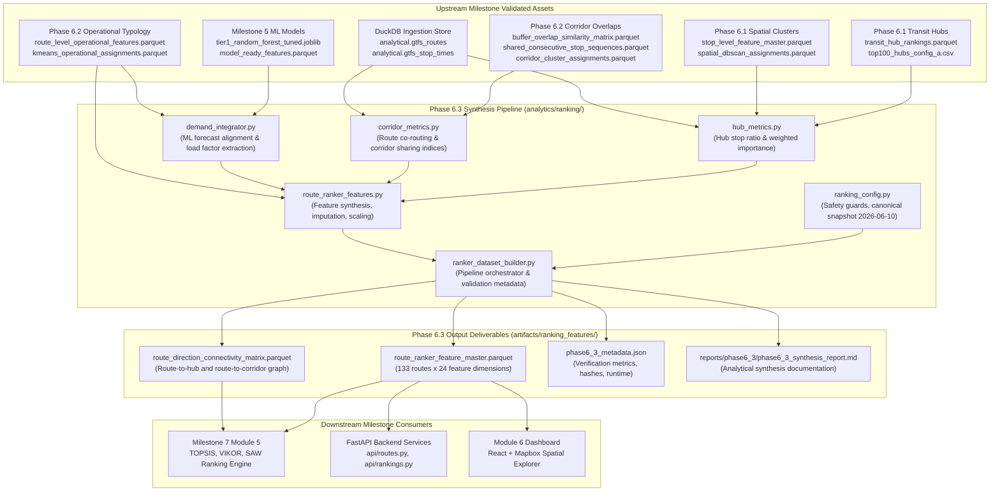

# Phase 6.3 — Technical Architecture Plan
## Cross-Phase Spatial Synthesis and Multi-Criteria Route Ranker Feature Integration

**Project:** AI_RouteRanker — AI-Powered Public Transit Route Optimization  
**Project Directory:** `D:\B.TECH_PROJECTS\AI_RouteRanker`  
**Date:** 2026-11-25 13:30:00 +05:30  
**Phase:** Phase 6.3 (Milestone 6 Module 4 / Module 5 Integration Bridge)  
**Mode:** **READ-ONLY INSPECTION AND PLANNING ONLY**  
**Status:** **TECHNICAL ARCHITECTURE DESIGNED**

---

## 1. Executive Summary & Purpose

Phase 6.3 is the foundational architectural bridge between **Module 4 (Spatial Stop & Route Clustering — Milestone 6)** and **Module 5 (Multi-Criteria Route Ranking Engine — Milestone 7)**.

While Phase 6.1 characterized the microscopic network level (11,020 stops, DBSCAN density clusters, transit hub rankings) and Phase 6.2 characterized the mesoscopic corridor level (133 canonical routes, 261 patterns, 100m buffer overlaps, Fréchet regional partitioning, and operational typologies), the transit optimization engine requires a unified, multidimensional, route-level evaluation matrix.

Phase 6.3 designs and orchestrates the synthesis pipeline that integrates:
1. **Stop-Level Connectivity & Hub Access (Phase 6.1)**
2. **Corridor Sharing, Duplication, and Operational Typologies (Phase 6.2)**
3. **Machine Learning Passenger Demand Predictions (Milestone 5)**
4. **Canonical GTFS Schedule & Network Metadata (DuckDB / Phase 1)**

The resulting primary artifact—`route_ranker_feature_master.parquet`—arms downstream Multi-Criteria Decision Making (MCDM) algorithms (TOPSIS, VIKOR, SAW, AHP) with standardized, validated performance indicators for all 133 canonical CTA routes.

---

## 2. End-to-End System Context & Data Flow

The following sequence diagram and flowchart illustrate how Phase 6.3 acts as the confluence point for upstream analytical milestones:

---

## 3. Proposed Modular Software Architecture

All Phase 6.3 code will reside in the established `analytics/ranking/` namespace, strictly maintaining modular separation of concerns:

### 3.1 `analytics/ranking/config.py`
Central configuration object governing Phase 6.3 and downstream ranking:
- **Canonical Date:** Strict lock to `2026-06-10`.
- **GTFS Snapshot:** Strict lock to `mdb-389-202605300003`.
- **Protected Paths:** Read-only paths to Phase 6.1, Phase 6.2, Milestone 5 artifacts, and DuckDB.
- **Resource Constraints:** Abort threshold when available RAM $<600\text{ MB}$ or system memory load $>95\%$.
- **Indicator Weights & Thresholds:** Bounded normalization bounds ($p_{01}, p_{99}$), default criteria weights for MCDM baseline evaluations.

### 3.2 `analytics/ranking/hub_metrics.py`
Computes the route-level transit hub interaction indices:
- **Input:** Read-only join between `analytical.gtfs_stop_times`, `stop_level_feature_master.parquet`, and `top100_hubs_config_a.csv`.
- **Calculations:**
  - `hub_stop_count`: Total physical stops along the route intersecting Phase 6.1 Top-100 transit hubs.
  - `hub_stop_ratio`: Fraction of route's unique stops categorized as transit hubs ($H_{ratio} = \frac{|S_r \cap S_{hubs}|}{|S_r|}$).
  - `hub_weighted_importance`: Sum of Phase 6.1 Composite Hub Scores (Config A) for all intersecting stops ($H_{imp} = \sum_{s \in S_r} \text{hub\_score}(s)$).
- **Directional Preservation:** Computes both per-direction ($N=261$) and aggregated route-level ($N=133$) representations.

### 3.3 `analytics/ranking/corridor_metrics.py`
Computes the route-level corridor co-routing and infrastructure sharing indices:
- **Input:** `buffer_overlap_similarity_matrix.parquet` ($261 \times 261$), `shared_consecutive_stop_sequences.parquet` (950 sequences), and `corridor_cluster_assignments.parquet`.
- **Calculations:**
  - `max_corridor_overlap`: Maximum pairwise 100m buffer overlap between route $r$ and any other route $r' \ne r$ ($O_{max} = \max_{r' \ne r} \text{overlap}(r, r')$).
  - `mean_corridor_overlap`: Mean buffer overlap across the top-5 most coincident routes.
  - `shared_consecutive_stop_count`: Total number of physical stops where the route shares a contiguous sequence of $\ge 2$ stops with another route.
  - `corridor_duplication_ratio`: Ratio of shared consecutive stops to total route stops ($D_{ratio} = \frac{S_{shared}}{S_r}$).
  - `regional_partition`: Categorical alignment from Fréchet $K=2$ corridor clustering (North Chicago Corridor vs South Chicago Corridor).

### 3.4 `analytics/ranking/demand_integrator.py`
Harmonizes machine learning demand forecasts and historical ridership:
- **Input:** `tier1_random_forest_tuned.joblib`, `tier2_random_forest_tuned.joblib`, `model_ready_features.parquet`, and `route_level_operational_features.parquet`.
- **Calculations:**
  - Aligns predicted passenger boardings for the canonical service date (`2026-06-10`).
  - Calculates `rides_per_trip`: $\frac{\text{forecasted\_daily\_demand}}{\text{scheduled\_trips}}$.
  - Calculates `load_intensity_factor`: Normalized ratio of demand density (rides per route km) to scheduled trip frequency.
  - Preserves rail ridership as `NaN` (honoring data origin: CTA bus boardings vs rail turnstiles).

### 3.5 `analytics/ranking/route_ranker_features.py`
Primary synthesis module that merges all analytical streams into a single tabular schema:
- Implements robust validation checks: verifies exactly 133 routes, checks primary key uniqueness (`route_id`), validates value ranges.
- Formulates multi-criteria composite performance dimensions.
- Applies percentile MinMax scaling ($\text{clip}[p_{01}, p_{99}]$) to provide normalized $[0, 1]$ columns alongside raw metric values.

### 3.6 `analytics/ranking/ranker_dataset_builder.py`
Execution orchestrator and CLI entry point:
- Performs preflight integrity verification (checks 22 protected asset baseline hashes).
- Executes synthesis pipeline sequentially with explicit memory management and garbage collection.
- Serializes `route_ranker_feature_master.parquet` and `route_direction_connectivity_matrix.parquet`.
- Generates `phase6_3_metadata.json` documenting summary statistics, execution time, and data distributions.

---

## 4. Target Data Schemas & Nullability Specifications

### 4.1 Primary Dataset: `route_ranker_feature_master.parquet`
Target row count: **Exactly 133 rows** (125 bus, 8 rail). Unique primary key: `route_id`.

| Field Name | Type | Nullable | Source Milestone | Description / Mathematical Definition |
| :--- | :--- | :---: | :--- | :--- |
| `route_id` | `VARCHAR` | **No** | Phase 1 / GTFS | Canonical route identifier (e.g. `'1'`, `'Red'`) |
| `route_short_name` | `VARCHAR` | **No** | Phase 1 / GTFS | Public display identifier (e.g. `'1'`, `'Red'`) |
| `route_long_name` | `VARCHAR` | **No** | Phase 1 / GTFS | Full descriptive name (e.g. `'Bronzeville/Union Station'`) |
| `route_type` | `INTEGER` | **No** | Phase 1 / GTFS | GTFS route type: `3` (Bus), `1` (Heavy Rail) |
| `is_rail` | `BOOLEAN` | **No** | Phase 6.2 | Flag: `True` if rail ($N=8$), `False` if bus ($N=125$) |
| `scheduled_trips` | `INTEGER` | **No** | Phase 6.2 | Active scheduled trips on canonical date `2026-06-10` |
| `service_span_hours` | `DOUBLE` | **No** | Phase 6.2 | Daily operational duration between first & last departure |
| `am_headway_min` | `DOUBLE` | **Yes** | Phase 6.2 | Mean AM peak departure interval (min). `NaN` for Routes 10, 130, N5 |
| `route_length_km` | `DOUBLE` | **No** | Phase 6.2 | Total physical corridor length in kilometers |
| `unique_stops_count` | `INTEGER` | **No** | Phase 6.2 | Count of unique physical boarding stops served |
| `operational_cluster_k3` | `INTEGER` | **Yes** | Phase 6.2 | Champion KMeans cluster ($0, 1, 2$). `NaN` for Routes 10, 130, N5 |
| `operational_cluster_label` | `VARCHAR` | **Yes** | Phase 6.2 | Descriptive label: `'Trunk'`, `'Feeder'`, `'Regional'` |
| `historical_mean_daily_rides` | `DOUBLE` | **Yes** | Phase 6.2 | Historical mean bus ridership. `NaN` for all 8 rail lines |
| `forecasted_daily_demand` | `DOUBLE` | **Yes** | Milestone 5 | RF model predicted boardings on `2026-06-10`. `NaN` for rail |
| `rides_per_trip` | `DOUBLE` | **Yes** | Phase 6.3 | $\frac{\text{forecasted\_daily\_demand}}{\text{scheduled\_trips}}$. `NaN` for rail |
| `hub_stop_count` | `INTEGER` | **No** | Phase 6.1 / 6.3 | Number of stops intersecting Top-100 transit hubs |
| `hub_stop_ratio` | `DOUBLE` | **No** | Phase 6.1 / 6.3 | Ratio of hub stops to total unique stops: $\frac{|S_r \cap S_{hubs}|}{|S_r|}$ |
| `hub_weighted_importance` | `DOUBLE` | **No** | Phase 6.1 / 6.3 | Sum of composite hub scores across intersecting stops |
| `max_corridor_overlap` | `DOUBLE` | **No** | Phase 6.2 / 6.3 | Max pairwise 100m buffer overlap with any other route $\in [0, 1]$ |
| `mean_corridor_overlap` | `DOUBLE` | **No** | Phase 6.2 / 6.3 | Mean buffer overlap with top-5 most coincident routes $\in [0, 1]$ |
| `shared_consecutive_stop_count`| `INTEGER` | **No** | Phase 6.2 / 6.3 | Stops shared in contiguous sequences $\ge 2$ stops |
| `corridor_duplication_ratio` | `DOUBLE` | **No** | Phase 6.2 / 6.3 | $\frac{\text{shared\_consecutive\_stop\_count}}{\text{unique\_stops\_count}} \in [0, 1]$ |
| `regional_partition` | `VARCHAR` | **No** | Phase 6.2 / 6.3 | Fréchet $K=2$ partition: `'North Chicago'` vs `'South Chicago'` |
| `load_intensity_factor` | `DOUBLE` | **Yes** | Phase 6.3 | Demand per route km normalized by scheduled frequency |

### 4.2 Secondary Link Table: `route_direction_connectivity_matrix.parquet`
Target row count: **Exactly 261 rows** (all active route-direction patterns). Primary key: `pattern_id` (e.g. `'1_0'`).
- Provides directional resolution of hub intersections and corridor coincidences for spatial mapping layers.

---

## 5. Mathematical Formulation of Synthesized Indicators

Phase 6.3 constructs four standardized multi-criteria indicators representing complementary operational dimensions:

### 5.1 Transit Hub Connectivity Index ($H_r$)
Measures the strategic value of route $r$ in connecting commuters to the network's highest-density interchange hubs:
$$H_r = w_1 \cdot \left(\frac{|S_r \cap S_{\text{Top100}}|}{|S_r|}\right) + w_2 \cdot \left(\frac{\sum_{s \in S_r \cap S_{\text{Top100}}} \text{HubScore}(s)}{\max_{r'} \sum_{s' \in S_{r'} \cap S_{\text{Top100}}} \text{HubScore}(s')}\right)$$
Where $w_1 = 0.40$ (stop proportion) and $w_2 = 0.60$ (hub score weight). $H_r \in [0, 1]$.

### 5.2 Corridor Duplication & Co-Routing Index ($D_r$)
Quantifies the extent to which route $r$ shares arterial infrastructure with other services:
$$D_r = \alpha \cdot \text{Overlap}_{\max}(r) + \beta \cdot \text{Overlap}_{\text{top5\_mean}}(r) + \gamma \cdot \left(\frac{\text{SharedConsecutiveStops}(r)}{|S_r|}\right)$$
Where $\alpha = 0.40$, $\beta = 0.30$, and $\gamma = 0.30$. $D_r \in [0, 1]$.
*Interpretation Note:* High $D_r$ indicates strong arterial consolidation or potential scheduling redundancy; it does not inherently mean inefficient service.

### 5.3 Demand Pressure & Load Factor ($L_r$)
Reflects the passenger boarding demand relative to scheduled service provision:
$$L_r = \frac{\widehat{Y}_r}{\text{Trips}_r \cdot \text{LengthKm}_r}$$
Where $\widehat{Y}_r$ is the Random Forest forecasted daily demand for route $r$. For rail routes ($N=8$) where ridership is not available, $L_r$ is assigned `NaN` and evaluated via a dedicated rail capacity sub-model.

### 5.4 Spatial Equity & Coverage Indicator ($E_r$)
Evaluates the route's contribution to regional connectivity, particularly serving peripheral or transit-underserved areas:
$$E_r = \frac{|S_r \cap S_{\text{peripheral/noise}}|}{|S_r|}$$
Where $S_{\text{peripheral/noise}}$ are stops classified as DBSCAN noise or peripheral clusters in Phase 6.1. High $E_r$ highlights lifeline coverage routes operating in lower-density urban zones.

---

## 6. Integration Interfaces with Downstream Modules

### 6.1 Module 5 (Multi-Criteria Route Ranking Engine)
- **Direct Consumption:** Module 5 reads `route_ranker_feature_master.parquet` directly.
- **Algorithm Readiness:** Provides both raw engineering units (minutes, km, rides) and normalized $[0, 1]$ columns.
- **MCDM Method Support:** Directly formatted for TOPSIS (Technique for Order Preference by Similarity to Ideal Solution), VIKOR (VlseKriterijumska Optimizacija I Kompromisno Resenje), and SAW (Simple Additive Weighting).

### 6.2 Module 6 (FastAPI Backend & Interactive Dashboard)
- **API Endpoint:** `/api/v1/routes/ranker-features` exposes the synthesized feature master with filtering by route type (`bus` vs `rail`), operational cluster (`Trunk`, `Feeder`, `Regional`), and corridor partition (`North` vs `South`).
- **Dashboard Visualization:** Enables bivariate scatter plots (e.g. Hub Connectivity vs Corridor Duplication), radar profiles per route, and spatial corridor highlighting via Mapbox GL layers.

---

## 7. Resource Management & Memory Safety Architecture

Phase 6.3 operates under strict hardware boundaries:
- **Environment:** Windows 10/11, CPU-only, 8 GB physical RAM.
- **Zero Heavy Recalculations:** Phase 6.3 does **not** re-run Shapely polygon buffer operations or Fréchet distance algorithms. It reads the precomputed, validated matrices (`buffer_overlap_similarity_matrix.parquet`, `shared_consecutive_stop_sequences.parquet`, etc.).
- **Memory Footprint:** The combined in-memory footprint of all required Parquet matrices and DuckDB query results is $<85\text{ MB}$, well within the 8 GB limit.
- **Active Safeguards:**
  - Strict read-only DuckDB connections (`read_only=True`).
  - Explicit garbage collection (`gc.collect()`) after matrix joins.
  - Continuous memory load checks with immediate abort if available RAM drops below $600\text{ MB}$ or load exceeds $95\%$.

---

## 8. Summary of Architectural Guarantees

1. **100% Population Coverage:** All 133 canonical routes are represented in the output dataset.
2. **Zero Protected Asset Mutation:** All 22 baseline hashes remain unmodified.
3. **Transparent Handling of Missing Data:** Rail ridership ($N=8$) remains `NaN`; specialized routes lacking AM peak headways ($10, 130, N5$) are documented and handled safely.
4. **Reproducibility:** Deterministic joins and standardized mathematical transformations ensure bit-for-bit reproducible feature generation.