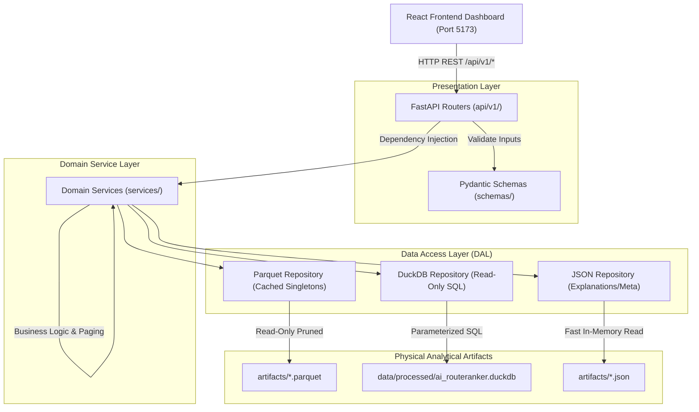

# AI_RouteRanker — Milestone 8: Backend API Integration
## Phase 8 Backend Architecture Plan & Modular Design

**Project:** `D:\B.TECH_PROJECTS\AI_RouteRanker`  
**Milestone:** 8 — Backend API Integration  
**Document:** Backend System Architecture, Layering & Design Patterns  
**Author:** AI_RouteRanker Engineering & Analytics Team  
**Date:** 2026-11-25T17:27:00+05:30  
**Status:** APPROVED ARCHITECTURAL BLUEPRINT (PLANNING PHASE)  

---

## 1. Architectural Philosophy & Design Principles

The AI_RouteRanker backend is architected around four core design principles:

1. **Preservation of Existing Framework:** Retains the existing **FastAPI**, **Pydantic v2**, and **Uvicorn** foundation established in Phase 0 without introducing unnecessary third-party frameworks.
2. **Strict Separation of Concerns (Three-Tier Layering):**
   - **API Presentation Layer (Routers):** Handles HTTP request parsing, query parameter validation, status codes, and response serialization.
   - **Domain Service Layer:** Orchestrates business logic, filtering, sorting, pagination, and multi-artifact synthesis.
   - **Data Access Repository Layer:** Abstracts physical storage, isolating Parquet reads, DuckDB analytical SQL execution, and JSON parsing.
3. **Memory Safety & Resource Conservation:** Tailored specifically for execution on an 8 GB RAM laptop. Prohibits bulk data copying and implements lazy singleton readers with column pruning.
4. **Resilience & Defensiveness:** All inputs are strictly type-validated via Pydantic v2; missing entities trigger RFC 7807 problem details without leaking internal tracebacks or system paths.

---

## 2. Target Directory & Package Structure

The proposed structure cleanly extends the existing `backend/app/` layout while maintaining 100% backwards compatibility with `test_health.py` and `main.py`:

```text
backend/app/
│
├── api/                                # Presentation Layer: FastAPI Routers
│   ├── __init__.py                     # Aggregates and exports api_router
│   ├── endpoints.py                    # Preserved legacy router (health check)
│   └── v1/                             # Modular Versioned API Routers
│       ├── __init__.py                 # Router mounting
│       ├── health.py                   # System status & operational ping
│       ├── routes.py                   # Route directory & detailed profiles
│       ├── rankings.py                 # Multi-criteria WSM/TOPSIS rankings & explanations
│       ├── spatial.py                  # Transit hubs & stop clustering
│       ├── corridors.py                # Corridor co-routing & shared stops
│       ├── forecasting.py              # Demand predictions & model benchmarks
│       ├── ridership.py                # Historical timeseries analytics (DuckDB)
│       └── metadata.py                 # Feature dictionaries & run provenance
│
├── core/                               # Core Infrastructure & Configuration
│   ├── __init__.py
│   ├── config.py                       # Extended settings (artifact paths, limits)
│   ├── exceptions.py                   # Custom domain exceptions & global handlers
│   ├── logging.py                      # Structured logging configuration
│   └── cache.py                       # In-memory LRU cache decorators & singletons
│
├── schemas/                            # Pydantic Data Contracts & Serialization
│   ├── __init__.py
│   ├── common.py                       # Pagination, error schemas, standard wrappers
│   ├── health.py                       # Preserved HealthCheckResponse schema
│   ├── routes.py                       # Route list, detail, and filter schemas
│   ├── rankings.py                     # WSM/TOPSIS, pillar scores, contributions schemas
│   ├── spatial.py                      # Transit hubs, GeoJSON markers, cluster schemas
│   ├── corridors.py                    # Co-routing overlap and cluster schemas
│   ├── forecasting.py                  # Prediction intervals and accuracy schemas
│   └── ridership.py                    # Aggregated monthly/daytype timeseries schemas
│
├── services/                           # Business Domain Services
│   ├── __init__.py
│   ├── route_service.py                # Route lookup, search, and profile formatting
│   ├── ranking_service.py              # Ranking tracks, sorting, and explanation extraction
│   ├── spatial_service.py              # Hub ranking filtering and coordinate formatting
│   ├── corridor_service.py             # Corridor overlap and sequence matching
│   ├── forecasting_service.py          # Prediction vs actual comparison logic
│   └── ridership_service.py            # Historical ridership query execution
│
├── repositories/                       # Data Access Layer (DAL)
│   ├── __init__.py
│   ├── parquet_repository.py           # Column-pruned Parquet readers with caching
│   ├── duckdb_repository.py            # Read-only DuckDB SQL connector
│   └── json_repository.py               # Explanations and metadata JSON readers
│
├── database/                           # Database Engine (Preserved)
│   ├── __init__.py
│   └── session.py                      # Preserved SQLAlchemy session maker (optional OLTP)
│
└── main.py                             # Application entry point & middleware mounting
```

---

## 3. Layered Component Responsibilities



### 3.1 Presentation Layer (FastAPI Routers)
- Mounted with `/api/v1` prefix (with `/api` backwards-compatible redirects).
- Uses FastAPI dependency injection (`Depends()`) to inject domain services into route handlers.
- Enforces strict input validation: integer bounds on `limit` and `offset`, regex string validation on route IDs, and enumeration matching on `mode` and `track`.
- Documents comprehensive Swagger/OpenAPI schemas, response codes (`200`, `400`, `404`, `500`), and example payloads.

### 3.2 Domain Service Layer
- Decouples HTTP handling from data access.
- Implements route sorting, multi-column ranking pagination, and pillar score aggregation.
- Implements specialized route handling logic: identifying when Routes 10, 130, or N5 are queried and augmenting explanations with missing-headway warnings.
- Converts raw dataframe dictionaries into strongly-typed Pydantic response models.

### 3.3 Data Access Layer (Repositories)
- **`ParquetRepository`**:
  - Implements lazy loading: artifacts are only read into memory upon the first request that targets them.
  - Utilizes `pyarrow` / `pandas` column selection (`columns=[...]`) to load only the exact fields required by a given query.
  - Implements thread-safe singleton caching for immutable master tables (`route_rankings_master.parquet` is $\sim 100\text{ KB}$, taking less than $1\text{ MB}$ of RAM).
- **`DuckDBRepository`**:
  - Opens `data/processed/ai_routeranker.duckdb` strictly in **`read_only=True`** mode.
  - Executes parameterized SQL queries (e.g., `WHERE route = ? AND date >= ?`) ensuring zero SQL injection risks.
  - Automatically manages connection lifecycle without resource leakage.
- **`JSONRepository`**:
  - Loads `route_ranking_explanations.json` ($\sim 797\text{ KB}$) into a dictionary index keyed by `(track, route_id)` for $O(1)$ lookups.

---

## 4. Configuration Management & Settings Architecture

The configuration will be cleanly extended in `backend/app/core/config.py` using `pydantic-settings`:

```python
class Settings(BaseSettings):
    # Application identity
    PROJECT_NAME: str = "AI_RouteRanker"
    VERSION: str = "1.0.0"
    API_V1_STR: str = "/api/v1"
    DEBUG: bool = False
    ENVIRONMENT: str = "development"
    
    # Server network bindings
    BACKEND_HOST: str = "127.0.0.1"
    BACKEND_PORT: int = 8000
    
    # CORS Origins
    CORS_ORIGINS: List[str] = [
        "http://localhost:5173",
        "http://127.0.0.1:5173",
        "http://localhost:3000",
    ]
    
    # Analytical Data Paths
    DATA_DIR: Path = Path("data/processed")
    DUCKDB_PATH: Path = DATA_DIR / "ai_routeranker.duckdb"
    
    # Analytical Artifact Paths
    ARTIFACTS_DIR: Path = Path("artifacts")
    RANKINGS_MASTER_PATH: Path = ARTIFACTS_DIR / "ranking_results" / "route_rankings_master.parquet"
    EXPLANATIONS_PATH: Path = ARTIFACTS_DIR / "ranking_results" / "route_ranking_explanations.json"
    SENSITIVITY_PATH: Path = ARTIFACTS_DIR / "ranking_results" / "ranking_sensitivity_analysis.parquet"
    FEATURE_MASTER_PATH: Path = ARTIFACTS_DIR / "ranking_features" / "route_ranker_feature_master.parquet"
    TRANSIT_HUBS_PATH: Path = ARTIFACTS_DIR / "clustering" / "transit_hub_rankings.parquet"
    TOP100_HUBS_PATH: Path = ARTIFACTS_DIR / "clustering" / "top100_hubs_config_a.csv"
    
    # Performance & Safety Thresholds
    MAX_PAGE_LIMIT: int = 150
    DEFAULT_PAGE_LIMIT: int = 25
    CACHE_TTL_SECONDS: int = 3600
```

---

## 5. Error Handling & Exception Architecture

A unified exception handling architecture ensures consistent RFC 7807 error structures:

```json
{
  "error": {
    "code": "ROUTE_NOT_FOUND",
    "message": "Route identifier '999' was not found in the canonical transit network.",
    "status": 404,
    "timestamp": "2026-11-25T12:00:00.000000Z",
    "details": {
      "valid_route_count": 133,
      "hint": "Check /api/v1/routes for the complete list of valid route IDs."
    }
  }
}
```

### Domain Exception Hierarchy
- `AI_RouteRankerException` (Base Exception)
  - `EntityNotFoundException` (Mapped to `HTTP 404`)
    - `RouteNotFoundError`
    - `StopNotFoundError`
    - `ExplanationNotFoundError`
  - `InvalidParameterException` (Mapped to `HTTP 400`)
    - `UnsupportedTrackError`
    - `UnsupportedSortFieldError`
    - `PaginationOutOfBoundsError`
  - `ArtifactMissingException` (Mapped to `HTTP 503`)
    - `ArtifactUnavailableError`

---

## 6. Pagination, Filtering, and Sorting Strategy

To provide responsive UI interaction without memory strain:

1. **Cursor vs Offset Pagination:**
   - Offset pagination (`limit`, `offset`) is chosen because transit route populations are bounded ($N=133$ routes total, $N=125$ bus routes, $N=100$ top hubs). Offset pagination allows the frontend table to jump directly to any page number.
   - Default page size: `25` items. Maximum allowed limit: `150` items.
2. **Deterministic Multi-Column Sorting:**
   - The repository guarantees stable sorting by always applying `route_id` as a secondary tie-breaker:
     `df.sort_values(by=[sort_by, 'route_id'], ascending=[is_asc, True])`.
3. **Filtering Execution:**
   - Filtering by mode (`is_rail`), cluster, or regional partition is executed in memory on the cached dataframe prior to slicing, completing in $< 1\text{ ms}$.
