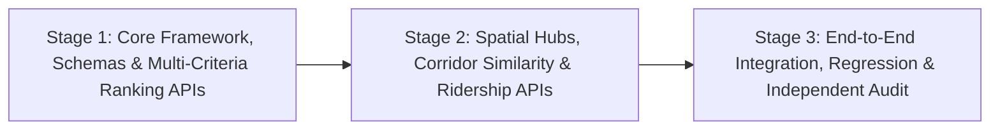

# AI_RouteRanker — Milestone 8: Backend API Integration
## Phase 8 Implementation Roadmap & Quality Assurance Strategy

**Project:** `D:\B.TECH_PROJECTS\AI_RouteRanker`  
**Milestone:** 8 — Backend API Integration  
**Document:** Staged Engineering Roadmap, Testing Strategy & Verification Gates  
**Author:** AI_RouteRanker Engineering & Analytics Team  
**Date:** 2026-11-25T17:30:00+05:30  
**Status:** APPROVED IMPLEMENTATION ROADMAP (PLANNING PHASE)  

---

## 1. Staged Implementation Methodology

To guarantee system stability, prevent regression of the existing passing backend tests (`backend/tests/test_health.py`), and enforce strict memory safety on the developer laptop, Milestone 8 is structured into three progressive implementation stages:

---

## 2. Stage-by-Stage Implementation Breakdown

### 2.1 Stage 1: Core Infrastructure, Schemas, Repositories & Ranking APIs
**Primary Focus:** Build the foundational layers and expose all Multi-Criteria Ranking (Module 5) endpoints.
- **Tasks to Implement:**
  1. Create `backend/app/core/exceptions.py` and register global FastAPI exception handlers in `app/main.py`.
  2. Implement `backend/app/repositories/parquet_repository.py` for column-pruned cached Parquet reading.
  3. Implement `backend/app/repositories/json_repository.py` for explanation narratives and metadata.
  4. Create Pydantic v2 schemas for routes (`schemas/routes.py`), rankings (`schemas/rankings.py`), and common pagination/error models (`schemas/common.py`).
  5. Implement `RouteService` and `RankingService` in `backend/app/services/`.
  6. Implement and mount API routers:
     - `GET /api/v1/routes` (list, filter, search, pagination)
     - `GET /api/v1/routes/{route_id}` (detail profile)
     - `GET /api/v1/rankings/bus` (Track 1 Bus Priority)
     - `GET /api/v1/rankings/rail` (Track 2 Rail Priority)
     - `GET /api/v1/rankings/unified` (Track 3 Unified Supply)
     - `GET /api/v1/rankings/routes/{route_id}/explanation` (natural-language explanation)
     - `GET /api/v1/rankings/sensitivity` (60 OAT perturbation scenarios)
- **Verification Gate 1:**
  - Synthetic and fixture-based unit tests for all Stage 1 endpoints.
  - Zero regression on existing `backend/tests/test_health.py` (2/2 passing).
  - Validation of Routes 10, 130, N5 missing-headway handling via API.

---

### 2.2 Stage 2: Spatial Hubs, Corridor Connectivity & Ridership Analytics
**Primary Focus:** Integrate spatial clustering (Module 4), corridor co-routing, forecasting (Module 3), and DuckDB historical analytics.
- **Tasks to Implement:**
  1. Implement `backend/app/repositories/duckdb_repository.py` with read-only connection pooling and parameterized SQL execution.
  2. Create Pydantic schemas for spatial hubs (`schemas/spatial.py`), corridors (`schemas/corridors.py`), forecasting (`schemas/forecasting.py`), and ridership (`schemas/ridership.py`).
  3. Implement `SpatialService`, `CorridorService`, `ForecastingService`, and `RidershipService`.
  4. Implement and mount API routers:
     - `GET /api/v1/spatial/hubs/top` (Top 100 regional transfer hubs)
     - `GET /api/v1/spatial/hubs` (full 10k stop hub rankings with coordinate filtering)
     - `GET /api/v1/corridors/clusters` (corridor clustering assignments)
     - `GET /api/v1/corridors/routes/{route_id}/co-routing` (buffer overlap and shared stops)
     - `GET /api/v1/forecasting/summary` & `GET /api/v1/forecasting/routes/{route_id}`
     - `GET /api/v1/ridership/routes/{route_id}/timeseries` (monthly daytype ridership from DuckDB)
     - `GET /api/v1/metadata/phases` (audit provenance)
- **Verification Gate 2:**
  - Automated tests verifying DuckDB query latency ($< 30\text{ ms}$) and zero write operations.
  - Verification of Recharts and Leaflet-ready JSON structures.

---

### 2.3 Stage 3: End-to-End Integration, Security, Performance & Audit
**Primary Focus:** Comprehensive testing, performance profiling, and formal independent audit.
- **Tasks to Implement:**
  1. End-to-end integration test suite simulating full React frontend dashboard user workflows.
  2. Benchmarking test verifying response times under simulated concurrent traffic ($< 100\text{ ms}$).
  3. Resident memory profiling confirming backend RSS stays strictly under $350\text{ MB}$.
  4. Comprehensive negative testing: path traversal protection, SQL injection prevention, non-existent route IDs, corrupted parameters.
  5. Author Stage 3 verification and audit closure reports.
- **Verification Gate 3:**
  - 100% test pass rate across all new API tests and legacy backend tests.
  - Independent read-only audit sign-off.

---

## 3. Comprehensive Testing Strategy

The testing strategy is designed to achieve $> 95\%$ test coverage across all backend routers, services, and repositories:

| Test Category | Target Scope / Component | Test Scenarios & Assertions | Tooling / Framework |
| :--- | :--- | :--- | :--- |
| **Health & Diagnostics** | `GET /api/health`, `/api/system/status` | HTTP 200, status="ok", memory reporting, uptime fields | `unittest.TestCase`, `TestClient` |
| **Route Listing & Filter**| `GET /api/v1/routes` | Pagination bounds, mode filter (`bus`=125, `rail`=8), search string matching | `TestClient` |
| **Route Detail Lookups** | `GET /api/v1/routes/{id}` | Complete payload structure, valid routes vs unknown route (HTTP 404) | `TestClient` |
| **Rankings Track 1** | `GET /api/v1/rankings/bus` | Exactly 125 bus items, sorting by score desc, pillar integrity | `TestClient` |
| **Rankings Track 2** | `GET /api/v1/rankings/rail` | Exactly 8 rail lines, 0% demand score, correct Red/Blue line rank #1/#2 | `TestClient` |
| **Rankings Track 3** | `GET /api/v1/rankings/unified`| Exactly 133 routes, Route 79 at rank #2, rail line inclusion | `TestClient` |
| **Route Explanations** | `GET /api/v1/rankings/routes/{id}/explanation` | Valid narrative text, driver arrays, Route 10 missing-headway warning | `TestClient` |
| **Ranking Sensitivity** | `GET /api/v1/rankings/sensitivity` | Exactly 60 scenarios, delta values $\pm 0.10, \pm 0.20$, Spearman $\rho \ge 0.95$ | `TestClient` |
| **Spatial Hubs** | `GET /api/v1/spatial/hubs/top` | Top 100 hubs, valid `lat`/`lon` floats, non-null hub importance scores | `TestClient` |
| **Historical Ridership**| `GET /api/v1/ridership/routes/{id}/timeseries` | Parameterized DuckDB execution, year bounds, daytype fields | `TestClient` |
| **Input Validation** | All Endpoints | Negative limits (e.g. `limit=-5`), non-integer pages, SQL injection strings | `TestClient` (Assert 400/422) |
| **Entity Not Found** | All Entity Endpoints | Route ID `"999"`, Route ID `"INVALID"`, Stop ID `"0000"` (Assert 404 RFC 7807) | `TestClient` |
| **Memory Performance** | Global Application | Peak memory under 50 sequential queries stays $< 350\text{ MB}$ RSS | Python `tracemalloc` / OS metrics |
| **Regression Safety** | `backend/tests/test_health.py` | Legacy tests pass identically before and after new endpoints mounted | Standard library `unittest` |

---

## 4. Verification Gates & Acceptance Criteria

Before Milestone 8 can be closed and accepted, the following criteria must be satisfied:

1. **Endpoint Completeness:** All 18 endpoints defined in `phase8_api_catalog.md` are implemented and operational.
2. **Schema Conformance:** 100% of responses strictly match the Pydantic schemas and TypeScript definitions.
3. **Memory Safety:** Backend RSS does not exceed $350\text{ MB}$ under local execution.
4. **Zero Asset Corruption:** All 23 protected baseline assets remain 100% bit-for-bit identical via SHA-256 checks.
5. **No Database Writes:** Zero write operations executed against DuckDB or PostgreSQL during API requests.
6. **Passing Test Suite:** All new API tests and legacy backend tests pass with zero errors.
