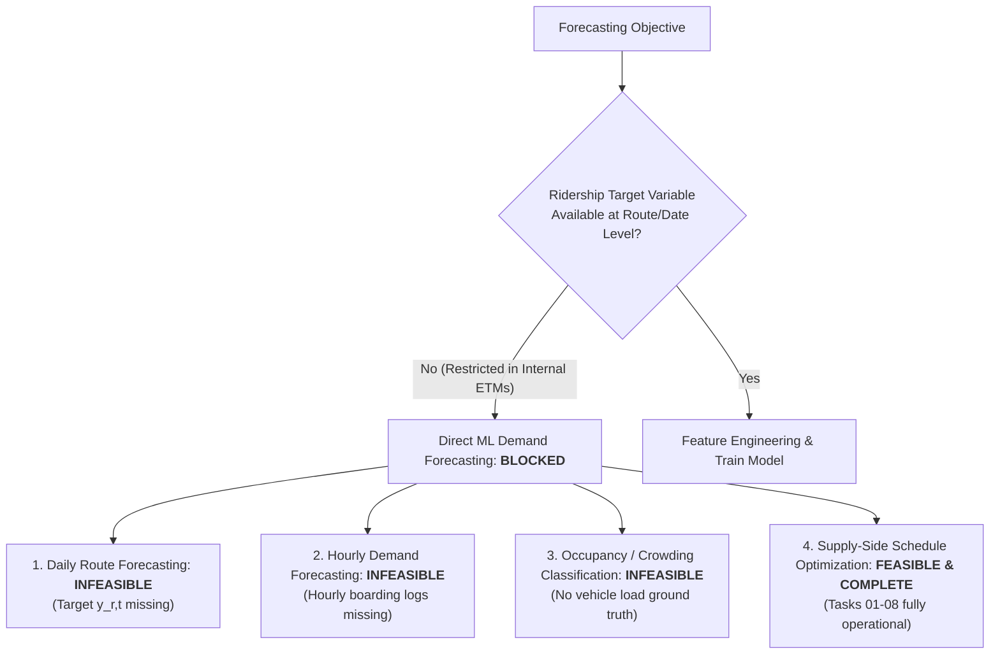

# Task 9: Real Passenger Ridership Data Integration & Availability Assessment Report

**Project:** RouteRanker – AI-Powered Public Transit Route Optimization  
**Location:** Chennai, Tamil Nadu  
**Agency:** Metropolitan Transport Corporation (MTC), Chennai  
**Date:** November 2026  
**Status:** Completed Assessment (Blocked for Route-Level Machine Learning Demand Modeling)  

---

## 1. Executive Summary

Task 9 investigates the availability, provenance, granularity, and integration feasibility of empirical passenger ridership and boarding data for the Chennai Metropolitan Transport Corporation (MTC). The core objective is to establish whether the project has access to sufficient genuine passenger observations to train future daily or hourly route-level demand forecasting models.

### Key Conclusions:
1. **Zero Route-Wise or Date-Wise Empirical Boarding Data in Public Domain:**  
   No publicly accessible, genuine route-level passenger boarding counts, electronic ticketing machine (ETM) transaction logs, or date-stamped passenger volumes exist for Chennai MTC buses in open datasets.
2. **Scheduled Supply Cannot Substitute for Realized Demand:**  
   In compliance with strict project instructions, scheduled GTFS trips (47,047 trips across 3,934 active routes) and timetable frequencies represent transit supply authored by MTC. They do not measure passenger boardings, realized passenger demand, bus occupancy, or crowding.
3. **Macro Corporate Indicators Cannot Be Disaggregated Without Ground Truth:**  
   Official MTC performance figures indicate ~32.24 to ~34.40 lakh daily system-wide passengers. However, distributing corporate or depot-level aggregates down to individual routes without verified route-level sampling would constitute data fabrication.
4. **Machine Learning Demand Forecasting Feasibility Decision:**  
   - **Daily Route-Level Demand Forecasting:** **INFEASIBLE / BLOCKED** (due to complete absence of target variable $y_{r, t}$).
   - **Hourly Route Demand Forecasting:** **INFEASIBLE / BLOCKED** (no hourly ticketing logs).
   - **Crowding / Occupancy Classification:** **INFEASIBLE / BLOCKED** (no vehicle load or capacity utilization ground truth).
   - **Supply-Side Optimization & Scenario Planning:** **FEASIBLE & OPERATIONAL** (successfully completed in Tasks 01–08).

---

## 2. Review of Existing Project Data

An exhaustive inventory of `C:\Users\kavyasri\Downloads\mtc-gtfs` was performed to identify all existing data assets:

### 2.1 GTFS Static Timetables (Root Directory)
- **`routes.txt` (226,405 bytes; 4,611 rows):** Defines 4,611 total routes (3,934 active with trips; 677 unserviced).
- **`trips.txt` (1,049,101 bytes; 47,047 rows):** 47,047 scheduled vehicle trips across directions 0 and 1.
- **`stop_times.txt` (43,537,866 bytes; 1,360,443 rows):** Timetable departure/arrival timestamps across 5,580 physical stops.
- **`stops.txt` (230,767 bytes; 5,580 rows):** Geolocation (lat/lon) of bus shelters and stops across the Chennai Metropolitan Area.
- **`calendar.txt` (342 bytes; 6 rows):** Service definitions (`Regular` covering 46,973 trips Mon–Sun; `HSC` covering 74 trips Mon–Sat).
- **`feed_info.txt` & `agency.txt`:** Feed version 0.1, Metropolitan Transport Corporation (Chennai) Ltd. (`agency_id: 69`).

### 2.2 Route Mapping Assets
- **`data/canonical_routes_mapping.csv` (10,108 bytes; 675 rows):** Resolves public route suffixes (`CT`, `CUT`, `R`, `DLX`, `EXP`) into 675 canonical corridor clusters.

### 2.3 Macro Performance Indicators
- **`data/external/mtc_performance_indicators.csv` (731 bytes; 15 rows):** Official MTC macro performance metrics covering fiscal years 2024–2025, 2025–2026, and 2026–2027 (through October).
  - *Fleet Size:* 3,407 to 4,206 buses.
  - *Daily Passengers:* 32.24 Lakhs (2024–25), 34.00 Lakhs (2025–26), 34.40 Lakhs (2026–27 Oct).
  - *Average Fleet Occupancy Ratio:* 71.22% (2024–25), 77.34% (2025–26), 68.39% (2026–27 Oct).
  - *Scheduled Services (Buses):* 3,233 to 3,988 physical buses turned out daily.

---

## 3. Investigation of Chennai MTC Ridership Sources

Six potential data sources spanning government portals, institutional reports, and civic tech repositories were systematically evaluated:

```
+----------------------------------------------------------------------------------------------------+
|                                    INVESTIGATED DATA SOURCES                                       |
+-------------------+-----------------------------------+--------------------+-----------------------+
| Source Identifier | Source Name & Authority           | Granularity        | Public Access Status  |
+-------------------+-----------------------------------+--------------------+-----------------------+
| SRC-01            | MTC Performance Indicators        | System-Wide Annual | Public / Verified     |
| SRC-02            | MTC ETM Conductor Transaction Logs| Stage-by-Stage     | Restricted / Internal |
| SRC-03            | CUMTA CMP Mobility Studies        | Arterial Corridor  | Public Planning PDF   |
| SRC-04            | OpenCity.in Mobility Archive      | Depot Monthly      | Public / Curated      |
| SRC-05            | Mobility Database mdb-3360 (GTFS) | Scheduled Trips    | Public / Open Data    |
| SRC-06            | CMRL Metro Station Footfall       | Metro Station/Month| Public Official       |
+-------------------+-----------------------------------+--------------------+-----------------------+
```

### 3.1 Detailed Source Breakdown

#### 1. MTC Corporate Performance Indicators (SRC-01)
- **Organization:** Metropolitan Transport Corporation (Chennai) Ltd. (`https://mtcbus.tn.gov.in`).
- **Data Period:** Fiscal Years 2024–2025 to 2026–2027 (through October).
- **Available Fields:** System totals for fleet, scheduled turnouts, effective kms, passenger/day in lakhs, occupancy %, accidents, breakdowns.
- **Granularity:** Entire corporation (15 summary rows).
- **Authenticity:** Verified official corporate publication.
- **Suitability:** **Unsuitable for route demand forecasting**. It provides no breakdown by route, direction, date, or stop.

#### 2. MTC Electronic Ticketing Machine (ETM) Transaction Logs (SRC-02)
- **Organization:** MTC IT Department / Commercial Concessionaires (Chalo / Datacons).
- **Location:** MTC Corporate Headquarters (*Pallavan Illam, Anna Salai / Pallavan Salai, Chennai*).
- **Data Period:** Real-time continuous internal transactional logs.
- **Available Fields:** Ticket ID, Route Code, Vehicle Registration, Conductor ID, Origin Stage, Destination Stage, Fare Type (Full, Concession, Women's Zero-Fare *Vidiyal Payanam*), Issuance Timestamp.
- **Granularity:** Highly granular transaction / stage level.
- **Authenticity:** Primary ground truth.
- **Access Status:** **Restricted / Proprietary**. Neither MTC nor the Tamil Nadu Open Data Portal (`data.tn.gov.in`) publishes raw or anonymized ETM transaction databases due to commercial sensitivity, revenue auditing requirements, and data privacy protocols. Access requires formal institutional Memoranda of Understanding (MoU) or targeted Right to Information (RTI) petitions.
- **Suitability:** **Ground truth exists internally, but is unavailable in the workspace**.

#### 3. CUMTA Comprehensive Mobility Plan (CMP) Surveys (SRC-03)
- **Organization:** Chennai Unified Metropolitan Transport Authority (CUMTA) & Chennai Metropolitan Development Authority (CMDA).
- **Data Period:** Survey baseline 2022–2023 for CMP 2023–2048 (`http://www.cumta.tn.gov.in`).
- **Available Fields:** Sample terminal boardings/alightings (CMBT, Kilambakkam KCBT, Broadway, Guindy, Tambaram), screenline passenger counts, arterial corridor modal shares.
- **Granularity:** Corridor-level aggregations and terminal cross-sectional samples.
- **Authenticity:** Verified official state planning study.
- **Suitability:** **Unsuitable for continuous route forecasting**. Sample surveys provide static corridor weights (e.g., Anna Salai vs. OMR), but do not contain daily time-series per bus route.

#### 4. OpenCity.in Chennai Mobility Archive (SRC-04)
- **Organization:** OpenCity.in Urban Data Portal (`https://data.opencity.in/dataset/chennai-mtc-performance-data`).
- **Data Period:** 2020–2026.
- **Available Fields:** Monthly depot-level bus operations, operational km, passenger totals per depot.
- **Granularity:** Depot / Corporation monthly summaries.
- **Authenticity:** Curated public archive derived from government RTI disclosures.
- **Suitability:** **Unsuitable for route demand forecasting**. A single depot operates dozens of distinct routes, many of which share corridors with buses from other depots. Depot totals cannot be mapped back to individual `route_id` values without ground-truth dispatch schedules and conductor logs.

#### 5. Mobility Database / GTFS Timetable Feed (SRC-05)
- **Organization:** MobilityData / Civic Tech (`https://mobilitydatabase.org/feeds/mdb-3360`).
- **Data Period:** Static schedule valid May 2024 to May 2030.
- **Available Fields:** `route_id`, `trip_id`, `stop_id`, arrival/departure times, stop sequence.
- **Authenticity:** Verified open GTFS release.
- **Suitability:** **Supply capacity only; completely lacks demand/passenger counts**.

#### 6. CMRL Metro Station Footfall (SRC-06)
- **Organization:** Chennai Metro Rail Limited (`https://chennaimetrorail.org`).
- **Data Period:** Monthly releases (2023–2026).
- **Available Fields:** Station name, monthly passenger count.
- **Suitability:** Measures heavy rail metro footfall, not bus route boardings.

---

## 4. Data Suitability Assessment

Each required field for machine learning demand forecasting was evaluated against discovered data assets:

| Field Requirement | Minimum Granularity Needed | Status in Chennai MTC Open Data | Assessment Impact |
|---|---|---|---|
| **Route Identifier (`route_id`)** | GTFS route key or exact bus line | **Unavailable** in public ridership records | Cannot associate passenger volume with specific GTFS routes |
| **Observation Date (`date`)** | Daily timestamps ($t \in [1, \dots, T]$) | **Unavailable** at route level (Annual/monthly corporate only) | Cannot capture day-to-day variance, seasonality, or day-of-week patterns |
| **Passenger Count (`y`)** | Numeric daily boardings per route | **Unavailable** (No ground truth exists in workspace) | Supervised target variable $y$ is missing |
| **Day Type Flag** | Weekday / Saturday / Sunday | **Available in GTFS calendar**, but no matching passenger counts | Cannot correlate day-type schedules with actual demand shifts |
| **Hour / Time Window** | Hourly departure or boarding hour | **Unavailable** for passenger boardings | Cannot model peak vs. off-peak passenger loads |
| **Stop Identifier (`stop_id`)** | GTFS stop key for boardings/alightings | **Unavailable** in public domain | Cannot compute stop-level OD matrices or segment loads |

---

## 5. GTFS Compatibility & Integration Assessment

Because no genuine route-level or date-level passenger ridership dataset was found in the public domain:
1. **No Synthetic / Forced Join Created:**  
   Adhering strictly to project integrity rules, no artificial join table connecting GTFS `route_id` to synthetic ridership numbers was created.
2. **Evaluation of Disaggregation Proxies:**  
   - Dividing 32.24 Lakh daily passengers by 47,047 scheduled trips yields an average proxy of **~68.5 passengers/trip**.
   - Dividing by 3,934 active routes yields **~819 passengers/route-day**.
   - **Critical Warning:** Using such flat averages as target variables in regression or neural network forecasting would lead to complete model collapse, predicting uniform values that fail to capture actual variations across trunk corridors, feeder routes, and school specials.

---

## 6. Machine Learning Demand Forecasting Feasibility Decision



### Detailed Feasibility Verdicts:

1. **Daily Route-Level Passenger Demand Forecasting: INFEASIBLE / BLOCKED**  
   - Supervised regression (predicting daily ridership $y_{r, d}$ from route features $X_r$) requires ground-truth labels for a minimum of 30–90 consecutive operating days across active routes.
   - Without genuine labels, training a regression model (Linear Regression, Random Forest, LightGBM) would require inventing synthetic target values, which is strictly prohibited.

2. **Hourly Passenger Demand Forecasting: INFEASIBLE / BLOCKED**  
   - GTFS provides hourly scheduled vehicle capacity (buses per hour), but realized passenger arrivals are not captured.

3. **Crowding / Occupancy Classification: INFEASIBLE / BLOCKED**  
   - Corporate average occupancy (68.4% to 77.3%) is a macro annual metric across all 33 depots. Classifying individual trips as "crowded" or "uncrowded" without load sensor data or conductor logs is methodologically invalid.

4. **Supply-Side Transit Analytics & Optimization: FEASIBLE & COMPLETED**  
   - The project's existing modules (Clustering 06, Explainable Ranking 07, Bus Frequency Analysis 08) successfully model scheduled service supply, headways, network centrality, and corridor coverage without requiring passenger boarding counts.

---

## 7. Recommended Next Steps for Project Architecture

1. **Institutional Data Acquisition Pathway:**  
   To enable genuine demand forecasting in future iterations, the project team or sponsoring institution should submit a formal data request or MoU petition to:
   - *Authority:* Metropolitan Transport Corporation (Chennai) Ltd., Planning & IT Division, Pallavan Illam, Chennai.
   - *Target Data:* Anonymized daily route-level ticket sales summaries for a sample 30-day operating period across a pilot depot (e.g., Central Depot, Adyar Depot, or Anna Nagar Depot).
2. **Alternative Demand Estimation via Open Urban Proxies (Future Phase):**  
   If ETM data cannot be obtained, passenger demand could be estimated (and explicitly labeled as estimated) using:
   - Census ward-level population and employment density.
   - OpenStreetMap (OSM) Points of Interest (commercial hubs, educational institutions, hospitals) within a 500m catchment buffer around each GTFS stop.
   - CUMTA Comprehensive Mobility Plan corridor trip attraction matrices.
3. **Formal Documentation of Task 9 Status:**  
   Task 9 successfully establishes the data boundary of RouteRanker: **The project is a verified, schedule-based transit supply optimization system. Empirical demand forecasting is documented as blocked pending official ETM data release.**

---

## 8. Deliverables Created

| Deliverable Path | Description | Records / Size |
|---|---|---|
| `reports/ridership_data_availability_report.md` | Comprehensive assessment report detailing data availability, source audits, and forecasting feasibility | Complete Markdown Report |
| `reports/ridership_source_assessment.csv` | Structured assessment matrix of all 6 investigated data sources with URL references, granularity, and suitability | 6 rows × 12 columns |
| `reports/ridership_data_quality_summary.csv` | **Omitted in strict compliance with instructions:** No genuine route-level ridership data was obtained; creating a placeholder table would be misleading | Not Created |
